# Install Agentic SOC

This guide installs **Agentic SOC 0.1.13** step by step: from a first look on a workstation,
through the recommended Docker Compose stack and its setup wizard, to a hardened deployment.
Every screenshot is a real capture of the 0.1.13 Console. Numbered amber outlines mark the
fields and buttons each step talks about, and the table under each screenshot explains them.

> [!NOTE]
> This is the walkthrough. [`DEPLOY.md`](DEPLOY.md) is the full deployment reference, and the
> installed Console carries a version-matched Help Center (select **Help Center** at the bottom
> of the navigation rail; it is served by your own deployment at `/docs/0.1/`).

> [!TIP]
> The screenshots use the light theme. A new installation opens the setup wizard and the Console
> in the **dark** theme. Each person can change it later in **Settings → Account → Appearance**.

## Contents

- [1. Choose your path](#1-choose-your-path)
- [2. What you are installing](#2-what-you-are-installing)
- [3. System requirements](#3-system-requirements)
- [4. Path A: try the demo on a workstation](#4-path-a-try-the-demo-on-a-workstation)
- [5. Path B: install the Compose stack (recommended)](#5-path-b-install-the-compose-stack-recommended)
  - [5.1 Check the prerequisites](#51-check-the-prerequisites)
  - [5.2 Get the source](#52-get-the-source)
  - [5.3 Configure the environment file](#53-configure-the-environment-file)
  - [5.4 Validate the configuration](#54-validate-the-configuration)
  - [5.5 Build and start the stack](#55-build-and-start-the-stack)
  - [5.6 Watch it come up](#56-watch-it-come-up)
  - [5.7 Verify health](#57-verify-health)
  - [5.8 Open the Console](#58-open-the-console)
  - [5.9 Create the first administrator](#59-create-the-first-administrator)
  - [5.10 Sign in](#510-sign-in)
  - [5.11 Run the setup wizard](#511-run-the-setup-wizard)
  - [5.12 What you see after launch](#512-what-you-see-after-launch)
- [6. Path C: harden for production](#6-path-c-harden-for-production)
- [7. Connect your first real source safely](#7-connect-your-first-real-source-safely)
- [8. Updates](#8-updates)
- [9. Stop, restart and uninstall](#9-stop-restart-and-uninstall)
- [10. Path D: attach to an existing Elastic stack](#10-path-d-attach-to-an-existing-elastic-stack)
- [11. Path E: run from source for development](#11-path-e-run-from-source-for-development)
- [12. Troubleshooting](#12-troubleshooting)
- [13. Get help](#13-get-help)

## 1. Choose your path

| Path | Use it when | You need | Effort | You end up with |
| --- | --- | --- | --- | --- |
| [A. Demo on a workstation](#4-path-a-try-the-demo-on-a-workstation) | You want to see the product without a SIEM, a provider key or Docker | Git, Python 3.11, Node.js 22 and npm, Bash | One command; the first run installs Python and Node packages | A populated, synthetic Console on `127.0.0.1:5173` with a `$0` deterministic model. Nothing is kept after you stop it |
| [B. Compose stack](#5-path-b-install-the-compose-stack-recommended) **(recommended)** | You want a persistent evaluation with real sources | Docker Engine or Docker Desktop, Docker Compose v2, Git, Bash and Python 3 | About a dozen short steps; the first build downloads images and packages | PostgreSQL with pgvector, Redis, the API, the Console and the update supervisor on one host, with the Console on port 8080 |
| [C. Production hardening](#6-path-c-harden-for-production) | Path B works and other people will use it | A TLS ingress, a backup destination, provider-side budgets | A checklist on top of path B | Named accounts with least-privilege roles, MFA, TLS with secure cookies, restricted ports, tested backups |
| [D. Existing Elastic stack](#10-path-d-attach-to-an-existing-elastic-stack) | You already operate a compatible Elasticsearch stack and want Agentic SOC state in its own indices there | Superuser access once, to mint two scoped API keys | Merge service blocks into your existing Compose file | The API and Console beside your stack, state in `tlsoc-agent-*` indices, upstream untouched |
| [E. From source](#11-path-e-run-from-source-for-development) | You develop or debug Agentic SOC | Python 3.11, Node.js 22 and npm | Two terminals | A hot-reloading Console on `localhost:5173` against a local API, with tests and builds |

The setup wizard, the first-administrator screen and the Console are the same on every path.

## 2. What you are installing

Agentic SOC is a read-only triage layer that sits beside your security tooling. It reads alerts
and events from your sources (pull or push), normalises them to OCSF, correlates and scores them
with deterministic code, has a model investigate only the clusters it admits, and leaves the close
or escalate decision to deterministic code and your policy. Your SIEM is not part of the stack:
you connect it from the setup wizard after the stack is running.

The recommended path B starts this topology on one Docker host:

<a href="docs/assets/architecture/deployment-light.svg">
<picture>
  <source media="(prefers-color-scheme: dark)" srcset="docs/assets/architecture/deployment-dark.svg">
  
</picture>
</a>

<sub>Select the diagram to open it full size.</sub>

| Container | Image | What it does | Published port |
| --- | --- | --- | --- |
| `tlsoc-webui` | Built from `webui/Dockerfile` | nginx serving the Console and the bundled Help Center; proxies `/api/` to the backend | `8080` (container port 80) |
| `tlsoc-backend` | Built from `backend/Dockerfile` | FastAPI API, connectors and receivers, correlation, investigation, the deterministic Case Manager | `8088` |
| `tlsoc-postgres` | `pgvector/pgvector:pg16` | All application state (cases, audit log, usage ledger, settings, cursors, users, knowledge) on the named volume `tlsoc-pgdata` | None |
| `tlsoc-redis` | `redis:7-alpine` | Enrichment and deduplication cache, no persistence | None |
| `agentic-soc-updater` | Built from `updater/Dockerfile` | Private update supervisor. The only container that mounts the Docker socket | None |

The container and image names keep the `tlsoc-` prefix as a compatibility identifier. For the
logical architecture (connectors, OCSF, correlation, the model gateway and the Case Manager), see
[`docs/concepts/architecture.md`](docs/concepts/architecture.md).

## 3. System requirements

The repository does not publish CPU, memory or disk figures. Size the host for five containers,
a PostgreSQL volume that grows with your cases and audit log, and the first image build. The main
running cost is model API usage, which the Console meters in its cost ledger.

| Requirement | Needed for | Notes |
| --- | --- | --- |
| Linux or macOS with Bash | Paths A, B, D, E | `scripts/agentic-soc-compose.sh` is a Bash script that runs a small Python lifecycle guard using POSIX file locks. On Windows, run it inside a Linux environment such as WSL 2 |
| Docker Engine or Docker Desktop | Paths B, D | `docker version` must show both a Client and a Server section |
| Docker Compose v2 | Paths B, D | The `docker compose` plugin, not the legacy `docker-compose` binary |
| Git | Paths A, B, D, E | The wrapper stamps each build with the checkout's commit and date. The updater bootstrap refuses to run without Git |
| Python 3 | Path B | Runs the wrapper's lifecycle guard on the host |
| Python 3.11, Node.js 22 and npm | Paths A, E | The backend requires Python 3.11 or later |
| `curl` and `openssl` | Path B | To check health and to generate secrets |
| Free ports | All | `8080` and `8088` (path B), `8088` and `5173` (paths A and E). Paths A and B both use `8088`, so do not run them at the same time |
| Outbound network | Path B build and run | Docker Hub and `ghcr.io` for base images (`pgvector/pgvector:pg16`, `redis:7-alpine`, `python:3.11` slim and alpine, `node:22-alpine`, `nginx:1.27-alpine`, `docker:27.5.1-cli`, the Sigstore cosign image), the Alpine package repository (`dl-cdn.alpinelinux.org`, for the update supervisor's `apk add`), PyPI and the npm registry during the build, and your model provider's API at run time |
| A model provider | Live investigations | An OpenAI key for the default GPT-5.6 Luna roles, another supported provider, or an OpenAI-compatible endpoint. Without a key the Console still runs, but no investigation can call a model: each cluster sent to investigation becomes a **Needs human** case whose recommended action names the missing key, and nothing is closed automatically. Only retrieval embeddings fall back to local ones. The `$0` mock model is used only by Demo Mode |
| A read-only source credential | Pull sources | Scoped to the log indices Agentic SOC should read. Push sources need no source credential |

Version 0.1 runs **one backend replica**. It is a single-host reference deployment, not a
high-availability design. Read [Known limitations](docs/releases/known-limitations.md) before
admitting sensitive or loss-intolerant data.

## 4. Path A: try the demo on a workstation

The demo starts the API and the Console directly on your machine (no Docker), signs in a seeded
demo administrator, completes setup and turns on the isolated **Demo Mode**. Synthetic stories
from five simulated sources (Splunk HEC, QRadar, Wazuh, syslog and Microsoft Entra ID) pass
through the real parsing, OCSF, correlation, investigation and decision pipeline. The model is a
deterministic `$0` mock, even if you have provider keys in your environment.

1. Clone the repository and start the demo from its root:

   ```bash
   git clone https://github.com/ARYDESTROYER/Kavach-AgenticSOC.git
   cd Kavach-AgenticSOC
   ./scripts/run-demo.sh
   ```

   On the first run the script creates `backend/.venv`, installs the backend packages, runs
   `npm install` in `webui/` and, if no MkDocs toolchain is found, installs the pinned Help Center
   toolchain into `.docs-venv`. It needs internet access for this. Every run, including later
   ones, rebuilds the bundled Help Center before the Console starts.

2. Wait for the banner. It prints the Console address and the demo sign-in. Both services bind to
   `127.0.0.1` only, so they are not reachable from your network. The banner can appear before the
   Help Center build finishes, so the Console address can take a little while to answer.

3. Open `http://127.0.0.1:5173` and sign in with **`Admin`** / **`Admin@123`**.

4. Stop both services with <kbd>Ctrl</kbd>+<kbd>C</kbd>. The demo keeps its state in memory, so
   nothing remains after it stops.

For a static dataset instead of ongoing synthetic activity, run `DEMO_MODE=seeded ./scripts/run-demo.sh`.
Change the ports with `BACKEND_PORT` and `WEBUI_PORT`.

<picture>
  <source media="(prefers-color-scheme: dark)" srcset="docs/assets/screenshots/hero-overview-dark.webp">
  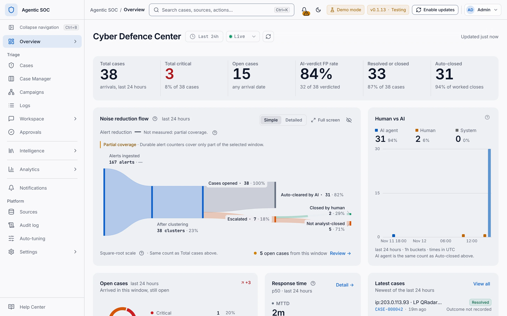
</picture>

*The demo opens on the Cyber Defence Center with synthetic cases, the noise reduction flow and
the Human vs AI split. The **Demo mode** badge in the header shows that triage runs in the
isolated demo store. Partial coverage appears because the demo's durable alert counters started less than 24 hours before the capture.*

> [!WARNING]
> `Admin` / `Admin@123` is a demo credential. Never expose the demo on a network, never reuse
> that password, and never use the demo script as a deployment. [`DEMO.md`](DEMO.md) has a guided
> tour of every feature.

## 5. Path B: install the Compose stack (recommended)

This path runs `deploy/docker-compose.agnostic.yml` through the lifecycle wrapper
`scripts/agentic-soc-compose.sh`. Always use the wrapper rather than raw `docker compose`: it
fixes the project name, reads `.env`, stamps the build with your checkout's commit, and keeps the
update supervisor's digest pins in force.

> [!IMPORTANT]
> Do not edit `deploy/docker-compose.agnostic.yml`. The supervised update protocol pins its exact
> bytes (`deploy/update-base-v1.sha256`), and an edit also marks your build as modified. When you
> need a local change, such as publishing a syslog port or setting `TRUSTED_PROXIES`, put it in a
> [Compose override file](#use-an-override-file-for-local-changes) instead.

### 5.1 Check the prerequisites

Run each check and compare it with the expected result:

```bash
docker version          # shows a Client section and a Server section
docker compose version  # prints "Docker Compose version v2..."
git --version
python3 --version
openssl version
curl --version
```

If `docker version` prints the client but fails on the server, the Docker daemon is not running
or your user cannot reach it. Start Docker Desktop, or start the Docker service and add your user
to the `docker` group, before you continue.

### 5.2 Get the source

Clone the repository:

```bash
git clone https://github.com/ARYDESTROYER/Kavach-AgenticSOC.git
cd Kavach-AgenticSOC
```

Then choose what to build:

| You want | Run | When to use it |
| --- | --- | --- |
| **Stable 0.1.13** | `git checkout v0.1.13` | Only after the `v0.1.13` [GitHub Release](https://github.com/ARYDESTROYER/Kavach-AgenticSOC/releases) exists with its signed plan. Git reports a detached HEAD, which is expected for a tag |
| **Testing** | `git checkout Testing` | The integration branch: the next candidate, for evaluation of unreleased work |
| **Current Stable source** | stay on `main` (the default branch) | The last accepted Stable tree |

Keep a full clone (no `--depth 1`): a later updater bootstrap checks that the release tag is an
annotated tag contained in `origin/main`. Never create or move a release tag locally. Tags
`v0.1.4` to `v0.1.12` are historical publication records and are not installation sources; the
[release notes](docs/releases/0.1.13.md) and [release channels](docs/releases/channels.md) explain
the Stable and Testing contract.

### 5.3 Configure the environment file

Create `.env` from the template in the repository root:

```bash
cp .env.example .env
```

Then set the values below. The quickest way is this command, which generates the three secrets
with `openssl rand` and turns authentication on (it uses `sed -i.bak`, which works with both GNU
and BSD `sed`):

```bash
sed -i.bak \
  -e "s|^TLSOC_PG_PASSWORD=.*|TLSOC_PG_PASSWORD=$(openssl rand -hex 32)|" \
  -e "s|^TLSOC_AUTH_ENABLED=.*|TLSOC_AUTH_ENABLED=true|" \
  -e "s|^TLSOC_AUTH_JWT_SECRET=.*|TLSOC_AUTH_JWT_SECRET=$(openssl rand -hex 32)|" \
  -e "s|^TLSOC_AUTH_ADMIN_PASSWORD=.*|TLSOC_AUTH_ADMIN_PASSWORD=$(openssl rand -hex 24)|" \
  .env && rm .env.bak
```

Or open `.env` in an editor, run `openssl rand -hex 32` once per secret, and paste each result.
Do not write `$(openssl rand -hex 32)` into `.env` itself: Compose does not run commands, so the
literal text would become the secret.

Then add one provider key, for example `TLSOC_OPENAI_API_KEY=<your key>`.

**Variables to set**

| Variable | Required | What it does |
| --- | --- | --- |
| `TLSOC_PG_PASSWORD` | **Yes** | PostgreSQL password. Compose refuses to start without it and builds the backend's database URL from it, so use a hex value (no `@`, `:` or `/`). PostgreSQL applies it only when the `tlsoc-pgdata` volume is first created |
| `TLSOC_AUTH_ENABLED` | **Yes, set `true`** | Turns on sign-in, the six roles, MFA and SSO. The template ships `false`, which leaves the Console open to anyone who can reach it, with every caller treated as a super administrator |
| `TLSOC_AUTH_JWT_SECRET` | **Yes, with auth** | Signs sessions. Keep it stable: if it is empty or changes, every restart signs everyone out. Supervised updates need at least 32 characters (`openssl rand -hex 32` gives 64). When `TLSOC_MFA_OBFUSCATION_KEY` is blank, the MFA key is derived from it |
| `TLSOC_AUTH_ADMIN_PASSWORD` | Recommended | Password of an environment break-glass super administrator named by `TLSOC_AUTH_ADMIN_USERNAME` (default `admin`). It is hashed in memory at startup and never stored. Setting it also stops the backend from seeding the demo `Admin` / `Admin@123` account, so the Console opens on **Create your admin account** |
| `TLSOC_OPENAI_API_KEY` | Recommended | Default provider: fresh workspaces assign GPT-5.6 Luna to every completion role and use OpenAI for embeddings |
| `TLSOC_ANTHROPIC_API_KEY` | Optional | Alternative provider for Claude models. Assign models to roles in **Settings → General → Models** after launch |
| `TLSOC_EMBEDDING_API_KEY` | Optional | Embeddings for knowledge retrieval. Falls back to the OpenAI key, then to local hashing embeddings |
| `TLSOC_AUTH_COOKIE_SECURE` | Set `true` behind TLS | Makes the session cookie HTTPS-only. Required before **Remember me** is offered over the network |
| `TLSOC_RELEASE_CHANNEL` | Leave `testing` | Set `stable` only when you build the exact `v0.1.13` tag. A Testing build must not report itself as Stable |
| `TLSOC_ES_URL`, `TLSOC_ES_API_KEY`, `TLSOC_ES_CA_CERT`, `TLSOC_ES_VERIFY_CERTS` | Optional | Pre-seed one Elasticsearch, OpenSearch or Wazuh pull source at boot. This is the restart-safe alternative to typing the key in the wizard. `TLSOC_ES_CA_CERT` is a file path inside the backend container, not a host path: for a private CA, mount the certificate with an [override file](#use-an-override-file-for-local-changes) (under `tlsoc-backend`, `volumes:` `- /absolute/host/path/ca.crt:/certs/ca.crt:ro`, with an absolute host path to a file the container user can read) and set `TLSOC_ES_CA_CERT=/certs/ca.crt` |
| `TLSOC_ABUSEIPDB_API_KEY`, `TLSOC_VIRUSTOTAL_API_KEY` | Optional | Keyed enrichment. Keyless providers run without keys. The base Compose file also forwards the Round 3 keys listed in `.env.example` (for example `TLSOC_GREYNOISE_API_KEY` and `TLSOC_SHODAN_API_KEY`); only the twelve Round 11 keys need `deploy/docker-compose.enrichment-keys.yml` (see below) |
| `TLSOC_PG_USER`, `TLSOC_PG_DB` | Optional | Database user and name, both `tlsoc` by default. Like the password, they apply only when the `tlsoc-pgdata` volume is first created: set them before the first `up` and do not change them afterwards |
| `TLSOC_AUTH_TOKEN_HOURS` | Optional | Token lifetime of a sign-in without Remember me (default 12; values above 144 are reduced to 144) |
| `TLSOC_MFA_OBFUSCATION_KEY` | Optional | Key that obfuscates TOTP secrets at rest. Generate it with `openssl rand -hex 32` |

**Variables to leave as they are**

| Variable | Why |
| --- | --- |
| `TLSOC_STATE_BACKEND`, `TLSOC_STATE_DB_URL` | The Compose file sets `STATE_BACKEND=postgres` and builds the database URL itself |
| `TLSOC_ES_MGMT_API_KEY` | Used only when Elasticsearch holds Agentic SOC's own state ([path D](#10-path-d-attach-to-an-existing-elastic-stack)) |
| `TLSOC_VERSION` | The wrapper reads the version from the `VERSION` file |
| `TLSOC_BUILD_SHA`, `TLSOC_BUILD_DATE` | Keep them commented out. The wrapper derives both from your checkout |
| `AGENTIC_SOC_UPDATE_REPOSITORY` | Keep `ARYDESTROYER/Agentic-Kibana`. It names the repository whose signed releases the update supervisor trusts; only a fork changes it, before bootstrapping its own supervisor |

> [!CAUTION]
> `.env` holds every secret of the deployment. It is listed in `.gitignore`: never commit it,
> never paste it into an issue or a chat, and back it up separately from the database. The
> backend reads unprefixed names (`ES_API_KEY`, `AUTH_ENABLED`, and so on); the Compose file maps
> the `TLSOC_*` names in `.env` onto them, so you only ever edit `TLSOC_*` here.

> [!IMPORTANT]
> Secrets you type into the Console later (provider keys in the wizard, source API keys,
> notification and SSO secrets) are kept in process memory and must be entered again after the
> backend restarts. `.env` is the restart-safe path for anything you cannot re-enter by hand.

<details>
<summary>Optional: other model providers, local models and more enrichment keys</summary>

- **Azure OpenAI, AWS Bedrock, Google Vertex:** uncomment and fill the `TLSOC_AZURE_OPENAI_*`,
  `TLSOC_AWS_*` or `TLSOC_VERTEX_*` lines in `.env`. The Compose file already forwards them.
- **OpenAI-compatible endpoints** (vLLM, Ollama, LM Studio, a LiteLLM proxy, OpenRouter and
  similar): no new key is needed for an unauthenticated endpoint. After launch, use
  **Analytics → Models → Add local model** and set its base URL.
- **Round 11 enrichment providers** (CrowdSec, Google Safe Browsing, IPQualityScore and others):
  set their `TLSOC_*` keys in `.env` and add `-f deploy/docker-compose.enrichment-keys.yml` to
  every wrapper command that creates or recreates containers, starting with step 5.5:
  `./scripts/agentic-soc-compose.sh -f deploy/docker-compose.enrichment-keys.yml up --detach --build`.
  A command without it (for example `up --detach` in [section 9](#9-stop-restart-and-uninstall))
  recreates the backend without these keys, and nothing reports an error. A supervised update
  also drops them, because it uses only the base file and its release override. Each provider
  is also switched on or off in **Settings → Integrations → Enrichment**.

[`docs/ENVIRONMENT.md`](docs/ENVIRONMENT.md) lists every variable and its mapping.

</details>

### 5.4 Validate the configuration

```bash
./scripts/agentic-soc-compose.sh config --quiet
```

A valid configuration prints nothing and exits with status 0. Common messages:

- `.env is missing; copy .env.example and configure it first.` The wrapper did not find `.env`
  in the repository root.
- `set TLSOC_PG_PASSWORD in .env` (inside a Compose interpolation error). The database password
  is empty.
- `build provenance is not an immutable release revision ...` on stderr. You are not in a Git
  checkout, or tracked files are modified (the commit is reported as `<sha>-dirty`). The stack
  still runs, but its records carry that revision and supervised updates stay unavailable.

### 5.5 Build and start the stack

```bash
./scripts/agentic-soc-compose.sh up --detach --build
```

This builds the backend, Console and updater images from your checkout, pulls the PostgreSQL and
Redis images, and starts all five containers. The first build downloads the base images and the
Python and Node packages, so it takes noticeably longer than later starts.

If you set Round 11 enrichment keys (section 5.3) or keep a local
[override file](#use-an-override-file-for-local-changes), add each file with `-f` to this command
and to every later command that creates or recreates containers.

### 5.6 Watch it come up

```bash
./scripts/agentic-soc-compose.sh ps
./scripts/agentic-soc-compose.sh logs -f tlsoc-backend    # Ctrl+C stops following, not the stack
```

The containers start in dependency order:

1. `tlsoc-postgres` starts first and reports `(healthy)` once `pg_isready` succeeds.
2. `tlsoc-backend` waits for a healthy database. Its own health check calls
   `/api/health/ready` every 30 seconds after a 20-second start period, so it can take a little
   while to show `(healthy)`.
3. `tlsoc-webui` starts only after the backend is healthy.

In the backend log, look for these lines:

```text
Built async SQL engine (...)
OWN-state backend: SQL (postgres)
pgvector extension ensured
SQL state schema ensured
Application startup complete.
```

If you see `Seeded demo super_admin 'Admin' (change the password!)`, the backend created the demo
account because `TLSOC_AUTH_ADMIN_PASSWORD` was empty; see [5.9](#59-create-the-first-administrator).

### 5.7 Verify health

The health endpoints are public, so they answer before anyone signs in. Call them through the
Console's proxy on port 8080:

```bash
curl --fail http://localhost:8080/api/health/live
curl --fail http://localhost:8080/api/health/ready
curl --fail http://localhost:8080/api/health/build-info
```

This is real output from a local run of the 0.1.13 **demo backend** (`127.0.0.1:8088`, with an
in-memory state store), pretty-printed with `python3 -m json.tool` so you know the shape of each
answer:

```console
$ curl -s http://127.0.0.1:8088/api/health/live | python3 -m json.tool
{
    "status": "ok",
    "service": "tlsoc-agentic-triage",
    "version": "0.1.13"
}

$ curl -s http://127.0.0.1:8088/api/health/ready | python3 -m json.tool
{
    "status": "ready",
    "ready": true,
    "version": "0.1.13",
    "store_type": "InMemoryESClient",
    "checks": {
        "state_store": true
    }
}

$ curl -s http://127.0.0.1:8088/api/health/build-info | python3 -m json.tool
{
    "service": "tlsoc-agentic-triage",
    "version": "0.1.13",
    "release_channel": "testing",
    "commit_sha": "4cb849a9092d115845000b64efa388e3864964d7",
    "build_time": "2026-11-11T22:34:11+05:30",
    "state_backend": "elasticsearch",
    "ocsf_version": "1.4.0",
    "provenance_complete": true,
    "provenance_missing": [],
    "provenance_advisories": []
}
```

| Endpoint | What a healthy Compose stack shows | What it proves |
| --- | --- | --- |
| `/api/health/live` | `"status": "ok"` and your version | The API process answers |
| `/api/health/ready` | `"ready": true` and `"store_type": "PostgresStateStore"` | PostgreSQL passed a bounded read and write probe. A failure returns HTTP 503 |
| `/api/health/build-info` | `"state_backend": "postgres"`, your commit in `commit_sha`, and `"provenance_complete": true` | Which build is running, without secrets. Record it with every deployment |

`"service": "tlsoc-agentic-triage"` is a compatibility identifier, not a product name. Readiness
covers the state store only; it does not test sources, providers or notification channels.

### 5.8 Open the Console

Open `http://localhost:8080` in a browser on the Docker host. With authentication on and no
account yet, the first screen is **Create your admin account**.

> [!WARNING]
> Until the first administrator exists, anyone who can reach port 8080 can create it. Do the next
> step straight away, and keep ports 8080 and 8088 on a trusted network until you have finished
> [path C](#6-path-c-harden-for-production). The step locks itself once an account exists.

### 5.9 Create the first administrator

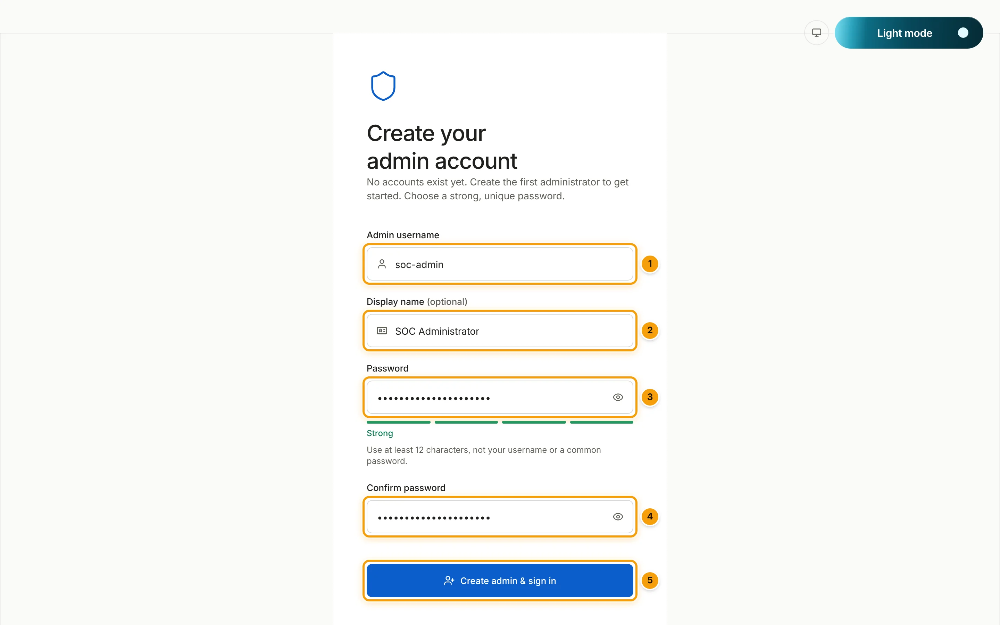

*Figure 1. Create your admin account, the first screen of a new installation.*

| # | Field or button | What to do |
| --- | --- | --- |
| 1 | **Admin username** | Choose a named administrator account, for example `soc-admin`. Use a different name from `TLSOC_AUTH_ADMIN_USERNAME` so the two accounts stay distinct |
| 2 | **Display name (optional)** | The name shown in the header and the audit log, for example `SOC Administrator` |
| 3 | **Password** | At least 12 characters, not your username and not a common password. The meter under the field rates the strength, and the server enforces the same rule |
| 4 | **Confirm password** | Repeat the password. The form shows `Passwords do not match.` if they differ |
| 5 | **Create admin & sign in** | Enabled once the form is valid. It creates the first super administrator and signs you in |

Agentic SOC then offers a second factor:

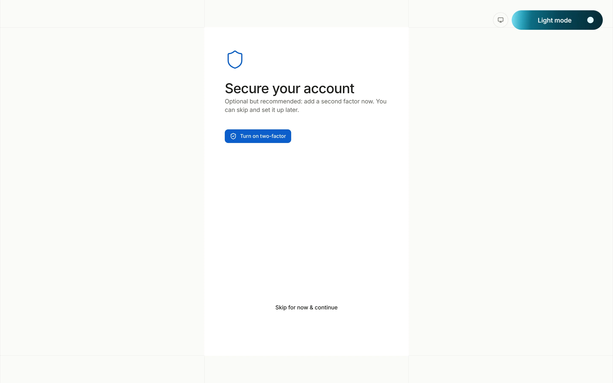

*Figure 2. Secure your account. **Turn on two-factor** enrols a TOTP authenticator app now with a
QR code and recovery codes; **Skip for now & continue** goes straight to setup. You can enrol
later in **Settings → Account → Security & two-factor**. For an administrator account, turn it
on.*

> [!NOTE]
> If the first screen is **Welcome back** with a hint for `Admin` / `Admin@123` instead,
> `TLSOC_AUTH_ADMIN_PASSWORD` was empty and the backend seeded its demo super administrator. Sign
> in with it and finish the setup wizard first ([section 5.11](#511-run-the-setup-wizard)). You can
> choose **Skip for now** on the Data sources and AI runtime stages and add them later. Settings
> opens only after **Launch Agentic SOC**. Then create your named administrator in
> **Settings → Security & access → Users**, sign in as that account, and turn the `Admin` account
> off with its **Active** switch. Agentic SOC never lets you remove the last active super
> administrator, so create the replacement first.

### 5.10 Sign in

Creating the administrator signs you in, so you go straight to the setup wizard. The sign-in
screen is what you and your team see on every later visit. It has two steps.

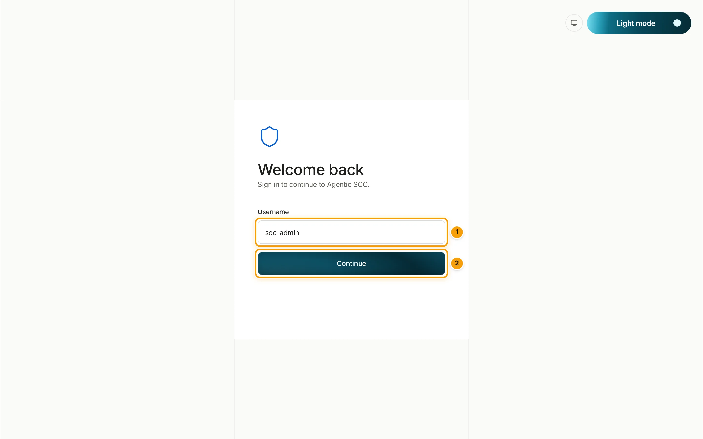

*Figure 3. Sign-in, step 1.*

| # | Field or button | What to do |
| --- | --- | --- |
| 1 | **Username** | Type your username |
| 2 | **Continue** | Appears once a username is typed. It moves to the password step |

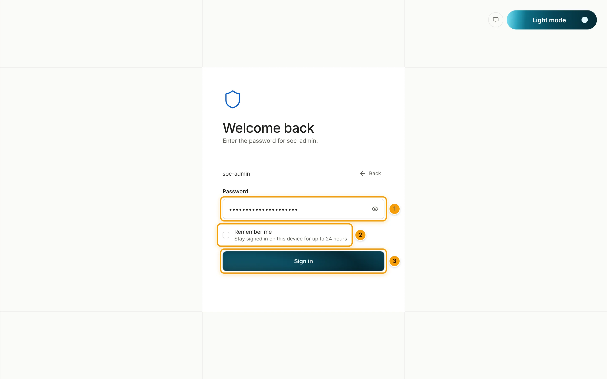

*Figure 4. Sign-in, step 2. **Back** returns to the username.*

| # | Field or button | What to do |
| --- | --- | --- |
| 1 | **Password** | Type your password. The eye button shows it while you type |
| 2 | **Remember me** | Keeps this device signed in for up to 24 hours by default. Use it only on a device you alone use. It never skips two-factor authentication or the password prompt for sensitive actions |
| 3 | **Sign in** | Signs in. If two-factor authentication is enrolled, a code step follows |

> [!NOTE]
> Figure 4 was captured on a direct local connection. On the Compose stack over plain HTTP,
> **Remember me** is greyed out and reads `Available when the console is served over HTTPS`. It
> becomes available once the Console is behind TLS and `TLSOC_AUTH_COOKIE_SECURE=true`.

### 5.11 Run the setup wizard

Until setup is complete, the Console shows the setup workspace instead of the operational pages.
Every stage has the same frame: the four stages in a left rail (a check means ready, an amber
triangle means it needs attention), `Step N of 4` at the top right, a **Back** button, and a
primary button that reads **Continue**, **Skip for now** when the stage has nothing configured,
or **Launch Agentic SOC** on the last stage. The note at the bottom of the rail is the rule for
every secret: provider and connector secrets are write-only, and the Console only reports whether
each one is configured. Moving between stages changes nothing by itself. Choosing **Synthetic demo**
turns Demo Mode on at once (choosing **Live environment** again asks before removing it), a source
is saved when you choose **Add source**, a typed provider key when you leave stage 3, and setup is
completed only by **Launch Agentic SOC**.

#### Stage 1: Workspace

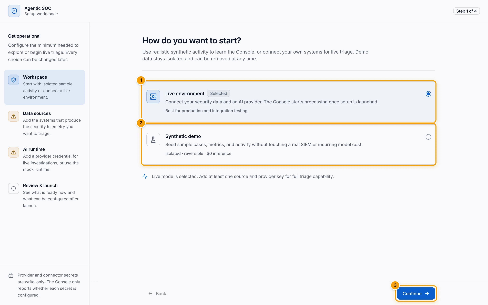

*Figure 5. How do you want to start?*

| # | Option or button | What it means |
| --- | --- | --- |
| 1 | **Live environment** | Preselected on a fresh install. Connect your own sources and an AI provider. Pull sources start polling once setup is launched, and a receiver starts accepting events as soon as it is saved. Choose it for a real evaluation or production |
| 2 | **Synthetic demo** | Seeds isolated sample cases, metrics and activity and uses the `$0` mock runtime. It never calls a configured provider and is not a test of a real source. It can be removed later, and it makes stages 2 and 3 optional |
| 3 | **Continue** | Moves to Data sources |

#### Stage 2: Data sources

Choose **Add your first source** to open the connector catalog. To finish setup first and add
sources later from the **Sources** page, choose **Skip for now** instead.

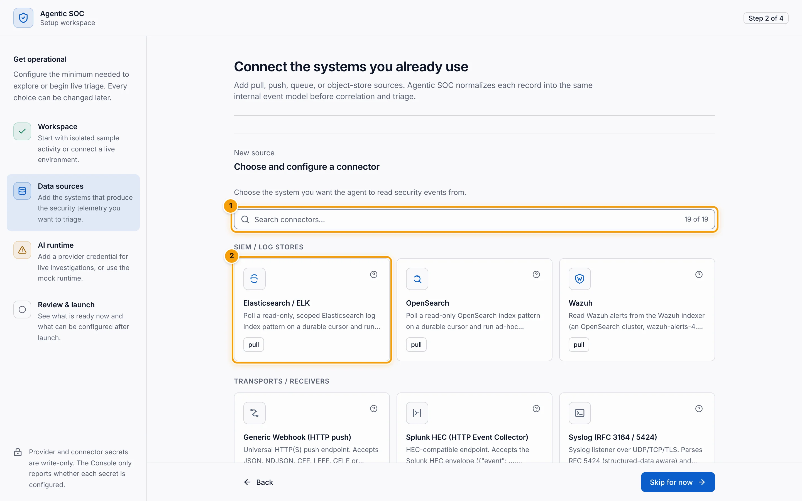

*Figure 6. Choose and configure a connector. The catalog lists 19 connectors: SIEM and log stores
(Elasticsearch / ELK, OpenSearch, Wazuh), transports and receivers (Generic Webhook, Splunk HEC,
Syslog), queues and brokers (Kafka or Redpanda, Kinesis, SQS, Event Hubs, Pub/Sub, MQTT, NATS,
RabbitMQ, Redis Streams), object stores (S3 or Security Lake, Azure Blob, Google Cloud Storage) and
a local file tail. Each card's **?** button explains the connector.*

| # | Control | What to do |
| --- | --- | --- |
| 1 | **Search connectors…** | Filter the catalog by name |
| 2 | **Elasticsearch / ELK** card | Select the connector. This walkthrough uses Elasticsearch; OpenSearch and Wazuh have the same shape |

The source editor is generated from the connector's manifest, so every connector shows only the
fields it supports. It is taller than one screen; figures 7 to 9 follow it from top to bottom.

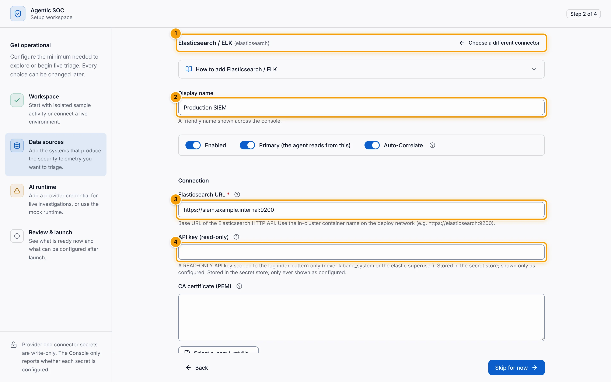

*Figure 7. The top of the Elasticsearch / ELK source editor. **How to add Elasticsearch / ELK**
expands a step-by-step guide. The **Enabled**, **Primary (the agent reads from this)** and
**Auto-Correlate** switches are on for the first source.*

| # | Field | What to do |
| --- | --- | --- |
| 1 | Selected connector | Confirms the connector. **Choose a different connector** returns to the catalog |
| 2 | **Display name** | A recognisable name shown across the Console, for example `Production SIEM` |
| 3 | **Elasticsearch URL** (required) | The cluster's HTTP API as the backend container reaches it, for example `https://elasticsearch:9200` on a shared Docker network. `localhost` here means the backend container itself |
| 4 | **API key (read-only)** | Paste a key that can only read your log indices ([how to mint one](#mint-a-read-only-key)). Never `elastic` or `kibana_system`. It is stored in the secret tier and only ever shown as configured. The capture leaves it empty because the example host does not exist |

Below the key, **CA certificate (PEM)** is for a private CA. Leave it blank for a public CA.
For a private CA, mount the certificate into the backend container as the `TLSOC_ES_CA_CERT` row
in [section 5.3](#53-configure-the-environment-file) shows, and type its container path, for
example `/certs/ca.crt`.

> [!WARNING]
> **Known issue in 0.1.13:** the field also offers to take pasted PEM text or a selected `.pem` or
> `.crt` file, but the backend passes the value to the Elasticsearch client as a file path. Pasted
> or uploaded certificate text is not a path, so the source cannot use it. Use a mounted path.

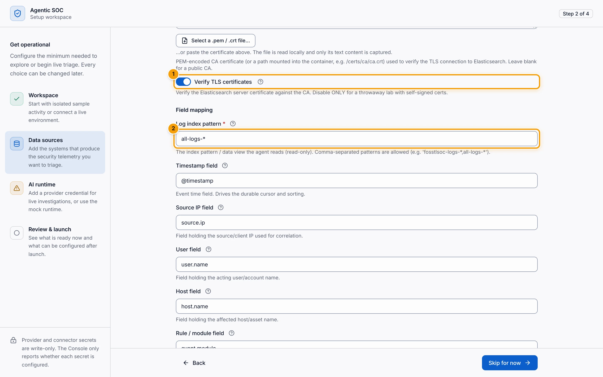

*Figure 8. TLS verification and field mapping. The mapping defaults suit ECS-shaped data:
`@timestamp`, `source.ip`, `user.name`, `host.name` and `event.module`.*

| # | Field | What to do |
| --- | --- | --- |
| 1 | **Verify TLS certificates** | Keep it on. Turn it off only for a throwaway lab with self-signed certificates |
| 2 | **Log index pattern** (required) | The index pattern or data view the agent reads, for example `all-logs-*`. Comma-separated patterns are allowed. Start with the narrowest pattern that holds your alerts |

> [!WARNING]
> **Known issue in 0.1.13:** the **Log index pattern** field shows `all-logs-*` before you type
> anything, but that displayed default does not count as a value. If you leave it untouched,
> **Add source** fails with `Please complete required fields: Log index pattern`. Clear the field
> and type the pattern yourself. The same applies to the index pattern fields of the OpenSearch
> and Wazuh connectors.

Further down, the **Feeds** block describes what this source reads: the index pattern, a role
(**Events**, **Alerts** or **Ignore**), a severity floor, an optional feed query with its own
**Test**, and a poll schedule that inherits the source interval when left blank. Keep one narrow
feed at first. **Correlation → Entity strategy** defaults to `Auto (IP → host → user → rule)`;
pin Host, User or Rule for sources that carry no source IP, such as an audit log.

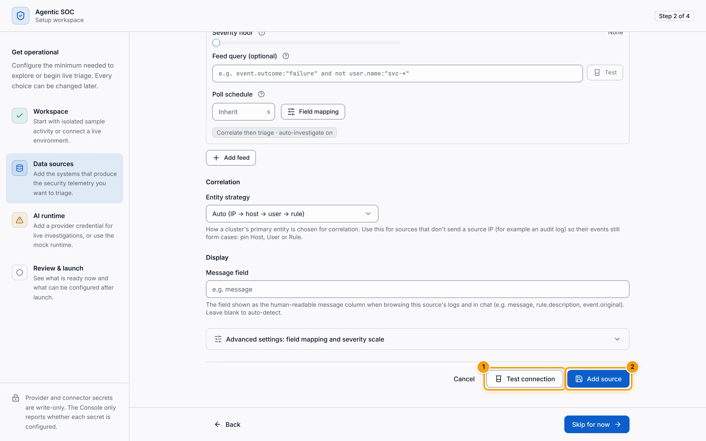

*Figure 9. The bottom of the source editor.*

| # | Button | What to do |
| --- | --- | --- |
| 1 | **Test connection** | Tests the current draft without saving it. It runs a cheap read on your index pattern; a correctly scoped read-only key passes even without cluster monitor rights. Run it before saving |
| 2 | **Add source** | Saves the source. Only the URL and the index pattern are required, so you can save first and add the key later |

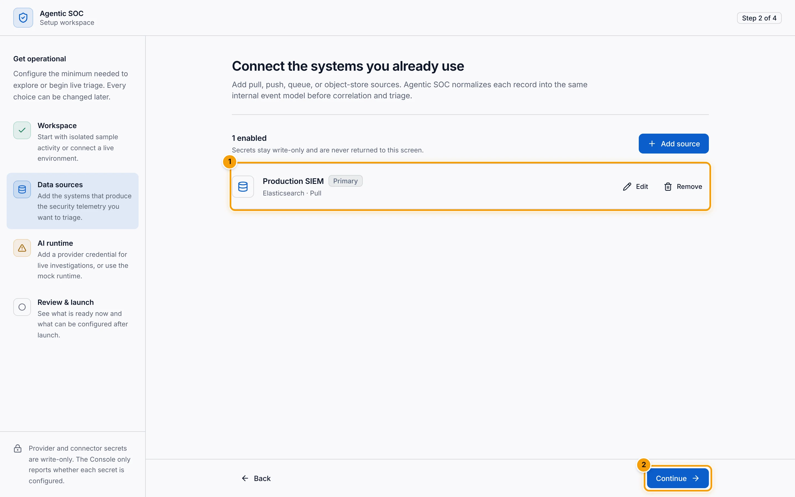

*Figure 10. The saved source.*

| # | Item | What it shows |
| --- | --- | --- |
| 1 | Source row | `Production SIEM`, marked **Primary**, `Elasticsearch · Pull`, with **Edit** and **Remove**. **Add source** adds more |
| 2 | **Continue** | Replaces **Skip for now** once a source is enabled |

For push sources (webhook, HEC, syslog, queues), save the receiver first and then send a synthetic
event; a one-shot connection test is not meaningful for them. See
[section 7](#7-connect-your-first-real-source-safely).

#### Stage 3: AI runtime

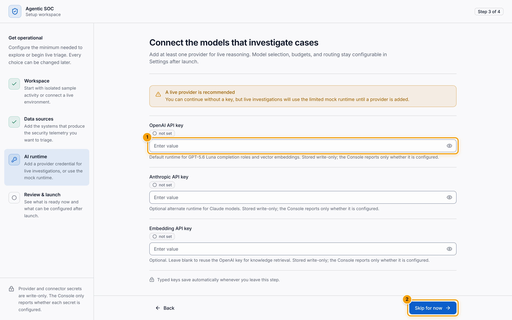

*Figure 11. Connect the models that investigate cases. The amber callout recommends a live
provider; its wording about a mock runtime is a known issue, explained below the table.*

| # | Field or button | What to do |
| --- | --- | --- |
| 1 | **OpenAI API key** | The default runtime for the GPT-5.6 Luna completion roles and embeddings. The chip above each field reads `not set` or shows the key as configured; a key set in `.env` already counts |
| 2 | **Skip for now** | Leaves the stage without a key. It reads **Continue** once a key is typed or already configured |

> [!WARNING]
> **Known issue in 0.1.13:** without a key, the callout says live investigations "will use the
> limited mock runtime until a provider is added", and the review stage reads
> `No provider configured · mock runtime only`. That wording is wrong. Without a key the Console
> still runs, but no investigation can call a model: each cluster sent to investigation becomes a
> **Needs human** case whose recommended action names the missing key, and nothing is closed
> automatically. The `$0` mock model is used only by Demo Mode.

**Anthropic API key** is the optional alternative for Claude models, and **Embedding API key** is
optional (blank reuses the OpenAI key). A typed key saves when you leave the stage; if the save
fails, the wizard keeps you on this stage so you can retry. A blank field never clears an existing
key.

> [!TIP]
> Prefer the provider key in `.env` (section 5.3). A key typed here lives in memory and must be
> typed again after a backend restart. Model choice per role stays configurable in
> **Settings → General → Models**; budgets and local endpoints are on **Analytics → Models**.

#### Stage 4: Review and launch

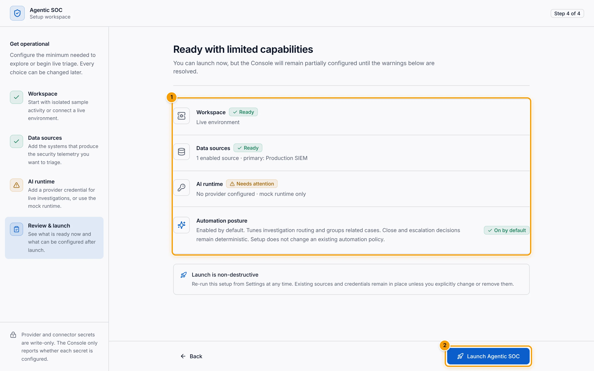

*Figure 12. Review & launch. This capture has a source but no provider, so it reads **Ready with
limited capabilities**.*

| # | Item | What it shows |
| --- | --- | --- |
| 1 | Readiness summary | One row per area with **Ready**, **Needs attention** or **Optional**: Workspace (`Live environment`), Data sources (`1 enabled source · primary: Production SIEM`), AI runtime (`No provider configured · mock runtime only`, which is wrong: see the known issue under [stage 3](#stage-3-ai-runtime)), and Automation posture (**On by default**: it tunes investigation routing and groups related cases, while close and escalation decisions remain deterministic) |
| 2 | **Launch Agentic SOC** | Completes setup and starts polling of enabled pull sources. Push, queue, object-store and file receivers do not wait for launch: each starts accepting events as soon as you save it with **Add source** |

The heading tells you where you stand:

| Heading | Meaning |
| --- | --- |
| **Ready for live triage** | A live source and a provider are configured |
| **Ready with limited capabilities** | Live mode, but a source or a provider is missing. You can launch and fix it later. Until a provider is added, each cluster sent to investigation becomes a **Needs human** case |
| **Demo workspace is ready** | Synthetic demo was chosen |

Launch is non-destructive. Administrators can re-run setup from **Settings** (its final button is
then **Apply changes**), and existing sources and credentials stay unless you change or remove
them.

### 5.12 What you see after launch

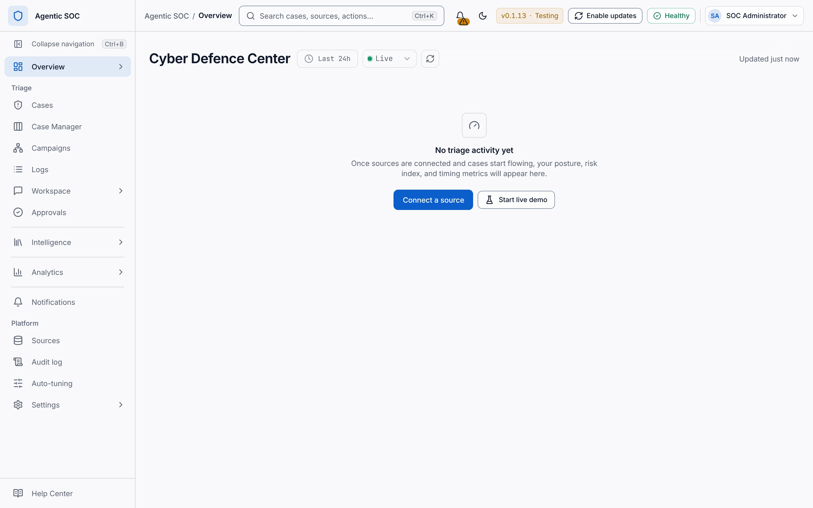

*Figure 13. The Console after launch, before any data has been triaged.*

- **Cyber Defence Center** is the landing dashboard. Until cases flow, it reads
  **No triage activity yet** with **Connect a source** and **Start live demo** (which turns on the
  reversible, isolated Demo Mode).
- The header holds the search box (<kbd>Ctrl</kbd>+<kbd>K</kbd>), notifications, the theme
  toggle, the release badge (`v0.1.13 · Testing` for a source build), the update control
  (**Enable updates** here; see [section 8](#8-updates)), the health pill (**Healthy**) and your
  account menu.
- The navigation rail groups Overview, Triage (Cases, Case Manager, Campaigns, Logs, Workspace,
  Approvals), Intelligence, Analytics, Notifications and Platform (Sources, Audit log, Auto-tuning,
  Settings). <kbd>Ctrl</kbd>+<kbd>B</kbd> collapses it. **Help Center** sits at the bottom.

Check the installation:

- [ ] **Sources** lists your source as enabled, and its health shows a successful poll or a recent
      event.
- [ ] **Logs** shows normalised records with the expected fields and source attribution.
- [ ] **Analytics → Cost** stays at zero until a model-backed action runs.
- [ ] **Audit log** records your sign-in, the account creation and the setup changes.
- [ ] **Help Center** opens on this deployment at `/docs/0.1/`.

Then continue with [path C](#6-path-c-harden-for-production) before anyone else uses the
deployment, and with [Your first case](docs/getting-started/first-case.md) to prove data reaches
the case workflow.

## 6. Path C: harden for production

Work through this checklist before the deployment handles real data or real users. The full
threat model is in [`SECURITY.md`](SECURITY.md) and
[`docs/operations/security.md`](docs/operations/security.md).

### Accounts and roles

1. **Turn on role-based access.** Out of the box `rbac.enabled` is `false`, so every signed-in
   account counts as Super admin, whatever role you assign. While that is true,
   **Settings → Security & access → Single sign-on & policy** shows the Posture row
   **Role-based access** as `Off: everyone is Super admin`, and
   **Settings → Security & access → Roles & permissions** shows a **Role-based access is off**
   callout. The 0.1.13 Console has no switch for it (a known gap). Turn it on through the settings
   API (permission `settings:manage`) from a shell on the Docker host:

   ```bash
   CONSOLE=http://localhost:8080
   ADMIN=soc-admin
   read -r -s -p "Password for $ADMIN: " PW; echo
   TOKEN=$(ADMIN="$ADMIN" PW="$PW" python3 -c 'import json, os; print(json.dumps({"username": os.environ["ADMIN"], "password": os.environ["PW"]}))' \
     | curl -s -X POST "$CONSOLE/api/auth/login" -H 'Content-Type: application/json' --data-binary @- \
     | python3 -c 'import json, sys; print(json.load(sys.stdin)["token"])')
   unset PW
   curl --fail -s -o /dev/null -w 'settings saved: HTTP %{http_code}\n' -X PUT "$CONSOLE/api/settings" \
     -H "Authorization: Bearer $TOKEN" -H 'Content-Type: application/json' \
     -d '{"rbac": {"enabled": true}}'
   unset TOKEN
   curl -s "$CONSOLE/api/setup/status" | python3 -c 'import json, sys; print("rbac_enabled:", json.load(sys.stdin)["rbac_enabled"])'
   ```

   Expected output: `settings saved: HTTP 200`, then `rbac_enabled: True`. Set `ADMIN` to a super
   administrator that has not turned on two-factor authentication: for an account with
   two-factor, the sign-in call returns `requires_mfa` and a `pending_token` instead of `token`,
   and the first command ends with `KeyError: 'token'` (as it also does for a wrong password). If
   your named administrator already uses two-factor, run the command as the environment
   administrator instead (`TLSOC_AUTH_ADMIN_USERNAME`, default `admin`, with the
   `TLSOC_AUTH_ADMIN_PASSWORD` value from `.env`), which signs in with its password alone.
   The change takes effect on the next request. Reload **Roles & permissions** and check that
   the callout is gone before you hand out accounts, and always keep at least one super
   administrator.
2. **Remove demo or seeded credentials.** If the `Admin` / `Admin@123` account exists, turn it off
   once a named super administrator works. If you set `TLSOC_AUTH_ADMIN_PASSWORD`, that account
   (`TLSOC_AUTH_ADMIN_USERNAME`, default `admin`) is a super administrator that signs in with its
   password alone. It can never enrol in, or be required to use, two-factor authentication, and it
   has no row or **Active** switch in **Users**. Keep it only as a deliberate break-glass secret,
   stored offline. Otherwise, once named administrators exist, remove the value from `.env` and
   recreate the backend (`./scripts/agentic-soc-compose.sh up --detach`, with your `-f` files if
   you use any).
3. **Create a named account for every person**, with the smallest role that covers the work.

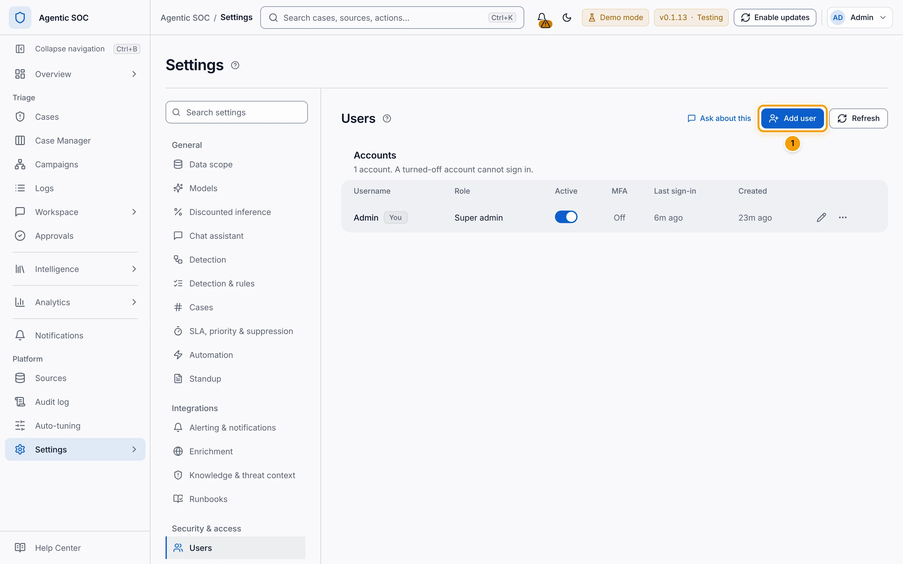

*Figure 14. **Settings → Security & access → Users** (captured on the demo workspace, which is why
the header shows **Demo mode** and the seeded `Admin` account). Each row shows the role, an
**Active** switch (a turned-off account cannot sign in), the MFA state and the last sign-in.
**1** marks **Add user**.*

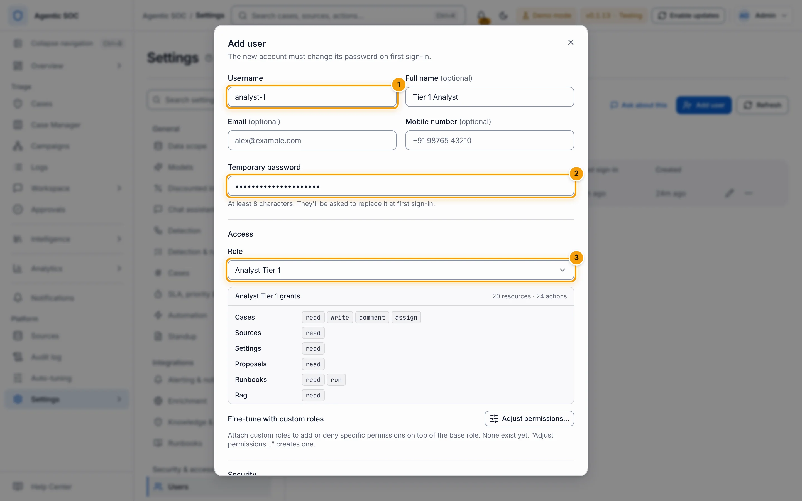

*Figure 15. The Add user dialog. The new account must change its password at first sign-in.*

| # | Field | What to do |
| --- | --- | --- |
| 1 | **Username** | A unique sign-in name, for example `analyst-1` |
| 2 | **Temporary password** | At least 8 characters; the user replaces it at first sign-in. Share it over a separate channel |
| 3 | **Role** | Pick the base role. The panel below lists what it grants. **Fine-tune with custom roles → Adjust permissions…** adds or denies single permissions on top |

Below the fold, the **Security** group has **Require multi-factor authentication**; turn it on for
privileged accounts. The six built-in roles are enforced only once role-based access is on
(step 1):

| Role | Intended use |
| --- | --- |
| `super_admin` | Platform owner |
| `soc_manager` | SOC administration: cases, sources, users, settings, rules, knowledge and audit |
| `analyst_tier2` | Senior analyst: full investigation and closure, read-only administration |
| `analyst_tier1` | Analyst: read, update, assign and comment on cases; no closure by default |
| `responder` | Tier 1 case and runbook access plus proposal approval |
| `auditor` | Read-only, including the audit trail |

See [Users and RBAC](docs/administration/users-rbac.md) and
[Authentication](docs/administration/authentication.md) for custom roles, SSO and session policy.

### Hardening checklist

| Control | How |
| --- | --- |
| **Role-based access** | Off by default, so every signed-in account counts as Super admin. Turn it on with the command in [Accounts and roles](#accounts-and-roles) step 1, then check that **Settings → Security & access → Single sign-on & policy** shows **Role-based access** as **Enforced** |
| **MFA** | Each person enrols in **Settings → Account → Security & two-factor**. Require it per account in the user dialog. The environment administrator can never enrol ([Accounts and roles](#accounts-and-roles) step 2) |
| **Stable secrets** | Keep `TLSOC_AUTH_JWT_SECRET` (and `TLSOC_MFA_OBFUSCATION_KEY` if set) unchanged across restarts, outside Git, in a protected secret backup |
| **TLS at a trusted ingress** | Put a TLS-terminating reverse proxy in front of port 8080 (example below). The Console itself serves plain HTTP |
| **Secure cookies** | With TLS in place, set `TLSOC_AUTH_COOKIE_SECURE=true` in `.env` and run `./scripts/agentic-soc-compose.sh up --detach` (with your `-f` files, if any) |
| **Restrict ports** | Allow port 8080 only from your ingress. Port 8088 is published for direct API access and HTTP push senders: firewall it to the hosts that need it, or block it. PostgreSQL and Redis are not published |
| **Client addresses in the audit log** | The audit log trusts `X-Forwarded-For` only from proxies in `TRUSTED_PROXIES` (default `tlsoc-webui`). To record real client addresses behind your ingress, add it through an [override file](#use-an-override-file-for-local-changes) (see [`DEPLOY.md`](DEPLOY.md) section 3.2) |
| **Session policy** | Review idle and absolute limits and Remember me in **Settings → Security & access → Single sign-on & policy** |
| **Model spend** | The pipeline's daily AI budget is on by default ($10 a day, blocking when exceeded, with over-budget cases routed to a person). Workspace and Case Manager chat are outside that budget; set **Settings → General → Chat assistant**'s optional daily chat cap if you need one. Always add a budget at the provider as a second boundary |
| **Least-privilege sources** | Read-only, pattern-scoped credentials for every source ([section 7](#7-connect-your-first-real-source-safely)) |
| **Backups** | Back up PostgreSQL and `.env` separately, and test a restore (below) |
| **Audit forwarding** | Export the append-only audit log from **Audit log → Export** to an independently protected destination. The export runs as a background job; download its file soon, because job files are lost when the backend container is recreated ([Back up and restore](#back-up-and-restore)) |

<details>
<summary>Example: nginx as the TLS ingress in front of port 8080</summary>

This mirrors the bundled proxy's settings: the live event stream (`/api/events`) and the chat
stream (`/api/chat/stream`) must not be buffered, and investigations can hold a request open for
minutes. Replace the host name and certificate paths with yours.

```nginx
server {
    listen 443 ssl;
    server_name soc.example.com;
    ssl_certificate     /etc/ssl/soc.example.com/fullchain.pem;
    ssl_certificate_key /etc/ssl/soc.example.com/privkey.pem;

    location / {
        proxy_pass http://127.0.0.1:8080;
        proxy_http_version 1.1;
        proxy_set_header Host $host;
        proxy_set_header X-Forwarded-For $proxy_add_x_forwarded_for;
        proxy_set_header X-Forwarded-Proto https;
        proxy_set_header Connection '';
        proxy_buffering off;        # live updates and chat streaming
        proxy_read_timeout 3600s;   # the bundled proxy allows up to an hour on /api/events
        proxy_send_timeout 3600s;
    }
}
```

</details>

> [!WARNING]
> **Single sign-on behind a TLS ingress, known issue in 0.1.13:** the backend builds the SSO
> callback address from the request it receives from `tlsoc-webui`, which reaches it over plain
> HTTP. Behind the ingress above it therefore sends `http://soc.example.com/api/auth/sso/callback`
> to the identity provider, although the provider editor's **Callback URL** field shows the
> `https://` address. A provider registered with the `https://` callback rejects the sign-in with a
> redirect URI mismatch, and this ingress does not serve plain HTTP. To check, open
> `https://soc.example.com/api/auth/sso/authorize?provider=<id>` and read the `redirect_uri`
> parameter of the returned `auth_url`. If it starts with `http://`, SSO cannot complete behind
> this ingress in 0.1.13: use password sign-in with MFA, and keep a local administrator account.

### Back up and restore

The `tlsoc-pgdata` volume holds the application's database (cases, audit log, users, settings and
knowledge). Files produced by background jobs, such as data exports and audit exports, are kept
inside the backend container and are lost when it is recreated, so download them promptly.

Dump the database with the tools in the PostgreSQL container. The single quotes matter: the
command reads the container's own `POSTGRES_USER` and `POSTGRES_DB`, which Compose sets from
`TLSOC_PG_USER` and `TLSOC_PG_DB`, so it works whatever `.env` sets:

```bash
docker exec tlsoc-postgres sh -c 'pg_dump -U "$POSTGRES_USER" "$POSTGRES_DB"' > tlsoc-backup-$(date +%F).sql
```

Restore only into an empty database on a stack running the same version. The backend creates
its schema at startup and keeps writing, so a plain dump piped into the live database fails on
existing tables and leaves mixed state. Rehearse the restore in an isolated environment first,
then:

```bash
./scripts/agentic-soc-compose.sh stop tlsoc-backend
docker exec tlsoc-postgres sh -c 'dropdb -U "$POSTGRES_USER" "$POSTGRES_DB"'
docker exec tlsoc-postgres sh -c 'createdb -U "$POSTGRES_USER" "$POSTGRES_DB"'
docker exec -i tlsoc-postgres sh -c 'psql -U "$POSTGRES_USER" -d "$POSTGRES_DB" -v ON_ERROR_STOP=1' < tlsoc-backup-YYYY-MM-DD.sql
./scripts/agentic-soc-compose.sh start tlsoc-backend
```

Keep `.env`, CA material and other secrets in a separate protected backup: the database dump
contains no secret values. Redis is a cache and needs no backup. Test the restore in an isolated
environment before you rely on it; [Health, backup and restore](docs/operations/health-backup.md)
has the full procedure.

### Use an override file for local changes

Keep local Compose changes in a file outside the checkout, so the base file stays byte-identical
and the checkout stays clean. For example, `$HOME/agentic-soc/local.compose.yml`:

```yaml
services:
  tlsoc-backend:
    environment:
      - TRUSTED_PROXIES=tlsoc-webui,10.0.0.5   # add the address your ingress connects from
    ports:
      - "1514:1514/udp"   # syslog UDP: set the syslog source's Port to 1514
      - "1514:1514/tcp"   # syslog TCP: same port
```

- **`TRUSTED_PROXIES`:** if the ingress runs on the Docker host itself, as in the nginx example
  above, the Console's proxy sees its connections arrive from the Compose network's gateway, not
  from `127.0.0.1` or the host's LAN address. List that gateway instead. Print it with
  `docker network inspect tlsoc-agentic-soc_default --format '{{(index .IPAM.Config 0).Gateway}}'`,
  then sign in through the ingress and check that the audit log records your own address.
- **Ports:** the container port on the right must equal the syslog source's **Port**, which
  defaults to 514. To use this example, set the source's **Port** to 1514.

Pass the file with `-f` on every command that creates or recreates containers, including the
`up` commands elsewhere in this guide, which are printed without it:

```bash
./scripts/agentic-soc-compose.sh -f "$HOME/agentic-soc/local.compose.yml" up --detach
```

> [!WARNING]
> The update supervisor does not read this file. A supervised update or rollback recreates the
> backend and the Console from the base file and the signed release pins only, which drops your
> published syslog ports and your `TRUSTED_PROXIES` value. After every supervised update or
> rollback, run the command above again and confirm that your syslog sources receive events (see
> [section 8](#8-updates)).

## 7. Connect your first real source safely

Start narrow, prove the mapping with synthetic data, then widen.

1. **Pick an implemented connector** from the [source support matrix](docs/sources/support-matrix.md).
   Pull connectors in 0.1 are Elasticsearch, OpenSearch and Wazuh (through its indexer). Other
   SIEM and EDR vendors can push to the webhook, HEC, syslog, queue or object-store receivers.
2. **Use a least-privilege credential.** A pull key needs only `read` and `view_index_metadata` on
   the exact patterns. A queue or object-store credential should reach only its subscription,
   stream, bucket or prefix. Never a superuser, `kibana_system`, or an OpenSearch or Wazuh
   administrator.
3. **Configure one narrow feed** and check its role, severity floor and field mapping.
4. **Test, then save.** Use **Test connection** for pull sources. For push sources, save the
   receiver and send one synthetic event. Once the source is saved, and when the data is not
   ECS-shaped, paste a representative, non-sensitive record into **Paste a sample record
   (optional)** and select **Suggest mappings**; the sample is not stored.
5. **Validate the result** in **Logs** and **Cases**: timestamp, native ID, rule, severity, user,
   host, address and source provenance.
6. **Widen the scope** only when the normalised record and the resulting case are correct.

Read [Feeds and field mapping](docs/sources/feeds-mapping.md) before step 3, and
[Pull sources](docs/sources/pull.md), [HTTP and syslog](docs/sources/http-syslog.md) or
[Queues and object stores](docs/sources/queues-object-stores.md) for your source type.

<a id="mint-a-read-only-key"></a>
<details>
<summary>Mint a read-only Elasticsearch API key</summary>

In Kibana, open **Stack Management → Security → API keys → Create API key**, choose **Restrict
privileges**, and paste a role descriptor limited to your log patterns:

```json
{
  "tlsoc_agent_readonly": {
    "indices": [
      { "names": ["all-logs-*"], "privileges": ["read", "view_index_metadata"] }
    ]
  }
}
```

Copy the encoded key into the source editor's **API key (read-only)** field, or into
`TLSOC_ES_API_KEY` in `.env` together with `TLSOC_ES_URL` to make it restart-safe. The role name
inside the descriptor is a compatibility identifier.

</details>

<details>
<summary>Send a synthetic event to an HTTP receiver</summary>

Add a **Generic Webhook** or **Splunk HEC** source, choose bearer or HMAC authentication, and set
its token in the source editor's write-only secret field. The receiver accepts JSON, NDJSON, CEF,
LEEF, GELF, syslog and key-value payloads at `/api/ingest/<source-id>`.

Find the source's ID in **Sources**: open **Columns**, tick **ID**, and read the new column (hover
a long value to see it in full). The Console adds a short suffix to the name you typed, for
example `my-webhook-k3f9`, and an unknown ID answers `404` with `No enabled source with that id`.

```bash
SOURCE_ID=my-webhook-k3f9   # replace with the ID from the Sources table
curl -X POST "http://localhost:8080/api/ingest/$SOURCE_ID" \
  -H 'Authorization: Bearer <the token you set on the source>' \
  -H 'Content-Type: application/json' \
  -d '{"event.module":"web_auth","source.ip":"203.0.113.7","user.name":"alice"}'
```

The sender must retry non-success answers. Socket receivers such as syslog bind inside the
backend container, so publish their port with an [override file](#use-an-override-file-for-local-changes)
and firewall it to your forwarders.

</details>

## 8. Updates

The stack includes `agentic-soc-updater`, a private update supervisor. It is the only container
that mounts `/var/run/docker.sock`, which is equivalent to root on the host, so protect the host,
the Compose project, `.env` and the updater volumes accordingly. The backend talks to it only
through a private Unix socket; the Console and the browser never get Docker access.

**What supervised updates support.** A built-in super administrator, freshly re-authenticated,
can install a newer compatible **Stable** release from the top bar (the control offers
`Review vX.Y.Z`). The supervisor verifies the signed release plan and every image digest, backs up
PostgreSQL, replaces the backend and the Console, checks readiness and identity, and rolls the
application images back automatically if the switch fails. It never changes the PostgreSQL or
Redis images and never rewrites the database. It requires:

- the unmodified reference Compose topology (the base file matching `deploy/update-base-v1.sha256`);
- PostgreSQL-owned state and one backend replica;
- `TLSOC_AUTH_ENABLED=true`, a durable `TLSOC_AUTH_JWT_SECRET` of at least 32 characters, and a
  durable `TLSOC_PG_PASSWORD` in `.env`;
- a deployment running signed Stable release images, and a release that needs no database
  migration.

**Your own `-f` files are not applied.** A supervised update or rollback recreates
`tlsoc-backend` and `tlsoc-webui` from the base file and the signed release override only. Settings
from an [override file](#use-an-override-file-for-local-changes) or the enrichment-keys overlay
(for example `TRUSTED_PROXIES`, published receiver ports and the Round 11 enrichment keys) are
dropped, and preflight does not report this as a blocker. After each supervised update or
rollback, run `./scripts/agentic-soc-compose.sh -f <your file> up --detach` again (one `-f` per
file). Do not attach the backend to extra networks in an override: preflight then reports it as
outside the canonical Compose network.

**A stack built from source** (this guide) does not carry a managed Stable identity, so it cannot
update itself. The header shows **Enable updates** or **Updates unavailable**; select it to see
each blocker and its remediation. Upgrade such a stack manually:

```bash
# back up first (see "Back up and restore" in section 6)
docker exec tlsoc-postgres sh -c 'pg_dump -U "$POSTGRES_USER" "$POSTGRES_DB"' > tlsoc-backup-$(date +%F).sql
git fetch --tags origin
git checkout vX.Y.Z            # the exact accepted release tag
./scripts/agentic-soc-compose.sh up --detach --build   # put your -f <file> options, if any, before "up"
```

Read the release notes and
[Changes that need attention](docs/operations/upgrades.md#changes-that-need-attention-when-upgrading-to-this-build)
before each upgrade, and follow the
[manual upgrade procedure](docs/operations/upgrades.md#manual-deployment-upgrade-procedure).

**The one-time bootstrap.** An installation made before the supervisor existed cannot grant itself
host authority. For the supported transition from a running v0.1.1 reference PostgreSQL deployment
to v0.1.13, an operator runs once, on the host, from a clean checkout of the exact annotated
`v0.1.13` tag contained in `origin/main`:

```bash
./scripts/bootstrap-updater.sh
```

It refuses a modified or untracked checkout, a lightweight or mismatched tag, an unsupported
topology, missing durable secrets or an active update, and it never force-replaces work in
progress. It cannot bootstrap a deployment that already runs 0.1.13. After a bootstrap, use
`./scripts/agentic-soc-compose.sh` for every lifecycle command: it layers the supervisor's
digest pins, refuses `--build` while a signed release is active, and blocks changing commands
while an update runs. The full contract is in [Upgrades and promotion](docs/operations/upgrades.md).

## 9. Stop, restart and uninstall

Run these from the repository root. While a supervised update runs, the wrapper allows only
read-only commands (`ps`, `logs`, `config`).

> [!IMPORTANT]
> If you started the stack with the enrichment overlay or a local override file, add the same
> `-f` arguments, placed before `up`, to every `up` command in this guide, for example
> `./scripts/agentic-soc-compose.sh -f deploy/docker-compose.enrichment-keys.yml -f "$HOME/agentic-soc/local.compose.yml" up --detach`.
> Without them, Compose recreates the backend without those settings and shows no error.

```bash
./scripts/agentic-soc-compose.sh ps                       # status
./scripts/agentic-soc-compose.sh logs -f tlsoc-backend    # follow the backend log
./scripts/agentic-soc-compose.sh restart tlsoc-backend    # restart one service
./scripts/agentic-soc-compose.sh stop                     # stop the containers, keep them
./scripts/agentic-soc-compose.sh start                    # start them again
./scripts/agentic-soc-compose.sh down                     # remove containers and network, keep the database and updater volumes
./scripts/agentic-soc-compose.sh up --detach              # recreate from the existing images and data (add your -f files)
```

After a restart, re-enter any secret you typed into the Console (source keys, provider keys,
notification and SSO secrets) that is not in `.env`. `down`, and any command that recreates the
backend, also discards background-job files you have not downloaded yet, such as data and audit
exports.

**Uninstall.** Back up first. Then remove the containers together with every named volume, and
the images built from your checkout:

```bash
./scripts/agentic-soc-compose.sh down --volumes
docker image ls | grep -E 'tlsoc-agentic-triage|agentic-soc-updater'
docker image rm <the image IDs or names listed above>
```

> [!CAUTION]
> `down --volumes` permanently deletes `tlsoc-pgdata` (every case, the audit log, users and
> settings) and the updater's state and backup volumes. There is no undo. For a scoped, audited
> reset of cases or sources, use the [reset controls](docs/administration/reset.md) instead.

Finally, delete the checkout, including `.env` and the generated `.agentic-soc-runtime/`
directory.

## 10. Path D: attach to an existing Elastic stack

Use this only if you already operate a compatible Elasticsearch stack (the compatibility target
is 8.19.12; see [`COMPATIBILITY.md`](COMPATIBILITY.md)) and want Agentic SOC to keep its own state
in dedicated `tlsoc-agent-*` indices there. Agentic SOC reads your logs and never modifies the
upstream pipeline or existing services. Supervised updates do not apply to this shape; upgrade it
manually.

1. **Clone next to the stack's Compose file.** The shipped service block expects the backend at
   `./agentic-kibana/backend`, so clone into a directory with that name:

   ```bash
   cd /path/to/your-stack        # the directory that holds the stack's docker-compose.yml
   git clone https://github.com/ARYDESTROYER/Kavach-AgenticSOC.git agentic-kibana
   git -C agentic-kibana checkout v0.1.13   # only once the v0.1.13 GitHub Release exists (section 5.2); otherwise use Testing or stay on main
   ```

2. **Mint two scoped API keys, once, with the superuser.** Never give Agentic SOC the `elastic`
   superuser or `kibana_system`. A read-only key for your log indices:

   ```json
   { "tlsoc_agent_readonly": {
       "indices": [ { "names": ["all-logs-*"], "privileges": ["read", "view_index_metadata"] } ] } }
   ```

   A management key for Agentic SOC's own indices only. Keep all three cluster privileges.
   `monitor` is needed because the readiness check (`/api/health/ready`, which is also the
   container health check) pings the cluster with this key. `manage_index_templates` is needed
   because the first start creates the `tlsoc-agent-*` index templates. `manage_ilm` is used by
   Storage and retention lifecycle. None of them grants access to your log indices:

   ```json
   { "tlsoc_agent_mgmt": {
       "cluster": ["manage_ilm", "manage_index_templates", "monitor"],
       "indices": [ { "names": ["tlsoc-agent-*"],
         "privileges": ["read", "write", "create_index", "view_index_metadata", "manage"] } ] } }
   ```

   Create each in Kibana (**Stack Management → Security → API keys → Create API key → Restrict
   privileges**) or with the `_security/api_key` API, and keep the `encoded` values.

3. **Add the Agentic SOC values to the existing `.env`** next to the stack's
   `docker-compose.yml`. Create one only if the stack has none; never replace an existing file.
   Append `TLSOC_ES_API_KEY` (read-only key), `TLSOC_ES_MGMT_API_KEY` (management key), a
   provider key, and the authentication values from section 5.3; `agentic-kibana/.env.example`
   documents each name. The block sets no `STATE_BACKEND`, so the backend uses its default,
   `elasticsearch`.

4. **Merge the services.** Copy the `tlsoc-backend` and `tlsoc-redis` services and the
   `agentic-soc-job-artifacts` volume from `agentic-kibana/deploy/docker-compose.tlsoc.yml` into
   your stack's `docker-compose.yml`. Do not change any existing service. The block reaches
   `https://elasticsearch:9200` by container name, depends on a service named `elasticsearch`,
   and mounts the host file `./certs/ca/ca.crt` read-only at `/certs/ca.crt`. These are literals.
   If your Elasticsearch service has another name or your CA file lives elsewhere, edit the
   `ES_URL` and `ES_VERIFY_CERTS` lines, the `depends_on` entry and the CA line under `volumes:`
   in the block. Check that the CA file exists before you start: Docker creates a missing host
   path as an empty directory.

5. **Add authentication to the backend.** The block maps no authentication variables. Add these
   lines to its `environment:` list (the reference stack maps the same names):

   ```yaml
         - AUTH_ENABLED=${TLSOC_AUTH_ENABLED:-false}
         - AUTH_JWT_SECRET=${TLSOC_AUTH_JWT_SECRET:-}
         - AUTH_ADMIN_USERNAME=${TLSOC_AUTH_ADMIN_USERNAME:-admin}
         - AUTH_ADMIN_PASSWORD=${TLSOC_AUTH_ADMIN_PASSWORD:-}
         - AUTH_COOKIE_SECURE=${TLSOC_AUTH_COOKIE_SECURE:-false}
         - AUTH_TOKEN_HOURS=${TLSOC_AUTH_TOKEN_HOURS:-12}
         - MFA_OBFUSCATION_KEY=${TLSOC_MFA_OBFUSCATION_KEY:-}
         - SSO_CLIENT_SECRETS=${TLSOC_SSO_CLIENT_SECRETS:-{}}
         - NOTIFICATION_SECRETS=${TLSOC_NOTIFICATION_SECRETS:-{}}
   ```

   Set `TLSOC_MFA_OBFUSCATION_KEY` before anyone enrols two-factor, and do not add or change it
   afterwards: when it is blank the MFA key is derived from `TLSOC_AUTH_JWT_SECRET`, and a later
   change makes every enrolled authenticator fail.

6. **Add the Console.** The block has no Web UI. This service is the reference stack's
   `tlsoc-webui`, adapted to the merged layout. Keep the name `tlsoc-webui`: its nginx proxies
   `/api/` to `tlsoc-backend:8088`, and the audit log trusts that name by default. Pick a free host
   port.

   ```yaml
     tlsoc-webui:
       build:
         context: ./agentic-kibana
         dockerfile: webui/Dockerfile
         args:
           TLSOC_VERSION: ${TLSOC_VERSION:-0.1.13}
           TLSOC_RELEASE_CHANNEL: ${TLSOC_RELEASE_CHANNEL:-testing}
           TLSOC_BUILD_SHA: ${TLSOC_BUILD_SHA:-unknown}
           TLSOC_BUILD_DATE: ${TLSOC_BUILD_DATE:-unknown}
       image: tlsoc-agentic-triage-webui:${TLSOC_VERSION:-0.1.13}
       container_name: tlsoc-webui
       restart: unless-stopped
       depends_on:
         - tlsoc-backend
       ports:
         - "8080:80"
   ```

7. **Build and start**, stamping both build values from the checkout (a half-stamped pair is
   reported as unreproducible):

   ```bash
   export TLSOC_BUILD_SHA="$(git -C agentic-kibana rev-parse HEAD)"
   export TLSOC_BUILD_DATE="$(git -C agentic-kibana show -s --format=%cI HEAD)"
   docker compose up -d --build tlsoc-backend tlsoc-redis tlsoc-webui
   ```

8. **Verify** from the host (the block publishes port 8088), then open the Console and follow
   sections [5.8](#58-open-the-console) to [5.12](#512-what-you-see-after-launch). Role-based
   access is off on this shape too: turn it on as in [Accounts and roles](#accounts-and-roles)
   step 1, with `CONSOLE` set to the host port you gave `tlsoc-webui`.

   ```bash
   curl --fail http://localhost:8088/api/health/ready
   curl --fail http://localhost:8088/api/health/build-info   # "state_backend":"elasticsearch"
   ```

On first start the backend creates only missing `tlsoc-agent-*` templates and indices; it never
remaps or reindexes existing ones. Back up with Elasticsearch snapshots of `tlsoc-agent-*`, and
never move a snapshot repository prefix to Glacier. [`DEPLOY.md`](DEPLOY.md) section 7 has the
lifecycle details.

## 11. Path E: run from source for development

Run the API and the Console's development server in two terminals. For the one-command version
with Demo Mode, use [path A](#4-path-a-try-the-demo-on-a-workstation).

**Terminal 1: the API on `127.0.0.1:8088`, with authentication on and state in a local SQLite file**

```bash
cd backend
python3.11 -m venv .venv          # Python 3.11, as CI uses; the pinned packages do not install on 3.13 or later
. .venv/bin/activate
pip install -r requirements-dev.txt
mkdir -p data
export AUTH_ENABLED=true
export AUTH_SEED_ADMIN=false        # show "Create your admin account" instead of seeding Admin
export AUTH_JWT_SECRET="$(python3 -c 'import secrets; print(secrets.token_hex(32))')"
export STATE_BACKEND=sqlite
export STATE_DB_URL="sqlite+aiosqlite:///./data/tlsoc-dev.db"
python -m uvicorn app.main:app --host 127.0.0.1 --port 8088
```

A direct run reads the **unprefixed** variable names; the `TLSOC_*` names exist only for Compose.
Provider keys are `OPENAI_API_KEY`, `ANTHROPIC_API_KEY` and so on. Without Redis, the log warns
`Redis unavailable ...; using in-memory cache fallback`, which is expected. The command above
creates a new JWT secret each time you run it. Sessions then end, and because the MFA key is
derived from the JWT secret, any authenticator enrolled in this database also stops working. To
keep both, export a fixed `AUTH_JWT_SECRET` (and, if you enrol two-factor, a fixed
`MFA_OBFUSCATION_KEY`). `backend/data/` is ignored by Git.

**Terminal 2: the Console on `localhost:5173`, proxying `/api` to the API**

```bash
cd webui
npm install
BACKEND_URL=http://127.0.0.1:8088 npm run dev
```

Open `http://localhost:5173`; the first-run flow from [section 5.9](#59-create-the-first-administrator)
applies. Before you open a pull request, run the gates from [`CONTRIBUTING.md`](CONTRIBUTING.md)
and the matching CI lanes, starting from the repository root:

```bash
(cd backend && . .venv/bin/activate && python -m pytest -q)   # offline: fake Elasticsearch, mock model
(cd webui && npm run build)                                    # Help Center bundle, type check, Vite build
(cd webui && npm run lint -- --max-warnings=0 && npm run gates && npm run test:strict)
```

[`AGENTS.md`](AGENTS.md) is the project's architecture and rules reference, including the 12
non-negotiables that every change must keep.

## 12. Troubleshooting

Where a fix says `up --detach`, run it through the wrapper with the same `-f` files you started
the stack with ([section 9](#9-stop-restart-and-uninstall)).

| Symptom | Likely cause | Fix |
| --- | --- | --- |
| The wrapper stops with `.env is missing` | No `.env` in the repository root | `cp .env.example .env` and configure it ([5.3](#53-configure-the-environment-file)) |
| Compose stops with `set TLSOC_PG_PASSWORD in .env` | The database password is empty | Set `TLSOC_PG_PASSWORD` |
| `build provenance is not an immutable release revision` | Not a Git checkout, or tracked files are modified | Build from a clean clone; keep local changes in an [override file](#use-an-override-file-for-local-changes) |
| `Bind for 0.0.0.0:8080 failed: port is already allocated` (or 8088) | Another service, often the demo script, holds the port | Stop it, then run `up --detach` again |
| `tlsoc-backend` never becomes healthy; `/api/health/ready` answers 503 | The state store probe fails | Read the backend log (`./scripts/agentic-soc-compose.sh logs tlsoc-backend`, or `docker logs tlsoc-backend` on path D). On path B, check `docker exec tlsoc-postgres sh -c 'pg_isready -U "$POSTGRES_USER" -d "$POSTGRES_DB"'`. On path D, check that the management key has the `monitor` cluster privilege and `write` on `tlsoc-agent-*` |
| `password authentication failed` after you changed `TLSOC_PG_PASSWORD` | PostgreSQL keeps the password set when the volume was first created | Put the original value back. Only on a throwaway install, reset with `down --volumes` (deletes all data) |
| No sign-in screen, the Console opens straight into setup | `TLSOC_AUTH_ENABLED` is not `true` | Set it and run `./scripts/agentic-soc-compose.sh up --detach` |
| The sign-in page hints `Admin` / `Admin@123` | Auth is on, the user store was empty and `TLSOC_AUTH_ADMIN_PASSWORD` was empty, so the demo admin was seeded | Sign in, create a named super administrator, then turn `Admin` off ([5.9](#59-create-the-first-administrator)) |
| Everyone is signed out after each restart | `TLSOC_AUTH_JWT_SECRET` is empty or changed | Set a stable value of at least 32 characters |
| **Remember me** is greyed out: `Available when the console is served over HTTPS` | Secure cookies are off | Serve the Console over TLS and set `TLSOC_AUTH_COOKIE_SECURE=true` |
| `Can't verify setup state` with **Retry** | `/api/setup/status` cannot be read through the proxy | Check `curl -fsS http://localhost:8080/api/setup/status`, fix the backend, then **Retry** |
| **Add source** fails: `Please complete required fields: Log index pattern` | Known 0.1.13 issue: the displayed default is not counted | Clear the field and type the pattern |
| **Test connection** fails | Wrong URL (for example `localhost`, which is the backend container itself), wrong or under-scoped key, or an untrusted private CA | Use a URL the backend container can reach, a read-only key scoped to the pattern and, for a private CA, the container path of a mounted CA file ([5.3](#53-configure-the-environment-file)) |
| Connection passes but no cases appear | Field mapping does not match the data, or the correlation threshold is not met | Check mapping against a real document; see [No cases appear](docs/TROUBLESHOOTING.md#h-no-cases-appear) |
| A source stops after a backend restart | Its key was typed into the Console and lived in memory | Enter it again after each restart. For one Elasticsearch, OpenSearch or Wazuh pull source, `TLSOC_ES_URL` and `TLSOC_ES_API_KEY` in `.env` are the restart-safe alternative ([5.3](#53-configure-the-environment-file)). The shipped Compose files have no `.env` variable for other sources' secrets |
| Setup will not leave **AI runtime** | A typed key could not be saved | Restore the backend connection and retry the same button |
| New cases are **Needs human**, and their recommended action names a missing key (for example `OpenAI API key not configured`) | No provider key is configured. No investigation can call a model, so each cluster sent to investigation goes to a person and nothing is closed automatically. The `$0` mock model is used only by Demo Mode | Add `TLSOC_OPENAI_API_KEY` (or another provider) to `.env` and run `up --detach` |
| The health pill reads **Degraded**, `Knowledge corpus empty` | The knowledge corpus is empty, often because the provider rejects the key | Fix the provider key first; see [Troubleshooting](docs/operations/troubleshooting.md#the-knowledge-corpus-is-empty-or-auto-close-has-stopped) |
| Saving a change answers `503 audit_unavailable` | The audit log cannot be written, so the change is refused | Check the state store's health and free space |
| The Console shows a 502 for `/api` | The backend container is not running or not healthy | Check `ps` and the backend log |
| `tlsoc-webui` keeps restarting and its log shows `host not found in upstream "tlsoc-backend:8088"` | No running container named `tlsoc-backend` is on the Console's network | Keep the backend service and container named `tlsoc-backend`, start it, then start `tlsoc-webui` again |
| Syslog or socket receivers get nothing | The listener port is not published, the source's **Port** differs from the published container port, or a supervised update dropped your override | Publish the source's **Port** in an [override file](#use-an-override-file-for-local-changes), run `up --detach` with it again, and firewall it |
| An `auditor` or analyst account can manage users, sources or settings | Role-based access is off, so every signed-in account counts as Super admin | Turn it on as in [Accounts and roles](#accounts-and-roles) step 1 |
| A webhook sender gets `401` | The sender's credential does not match the receiver's bearer or HMAC setting | Match the token or HMAC secret; re-enter it after a restart |
| `a supervised update is active; mutating Compose commands are temporarily blocked` | An update job is running | Wait until it finishes; inspection commands still work |
| `source builds are blocked while a signed release override is active` | The updater installed a signed release | Returning to a source build is a recovery operation. Make an application export (**Settings → Organization → Data export**) and a verified PostgreSQL backup, stop the stack through the wrapper, move `.agentic-soc-runtime/active-release.compose.yml` to a retained `.disabled` file, then build from source. Do not delete the updater state or backup volume, and run the updater bootstrap again before you use one-click updates. See [`updater/README.md`](updater/README.md) |

The full guides are [Troubleshooting](docs/operations/troubleshooting.md) in the Help Center and
the longer [`docs/TROUBLESHOOTING.md`](docs/TROUBLESHOOTING.md).

## 13. Get help

- **In the Console:** select **Help Center** at the bottom of the navigation rail. It is the
  version-matched manual for the build you run and works without internet access.

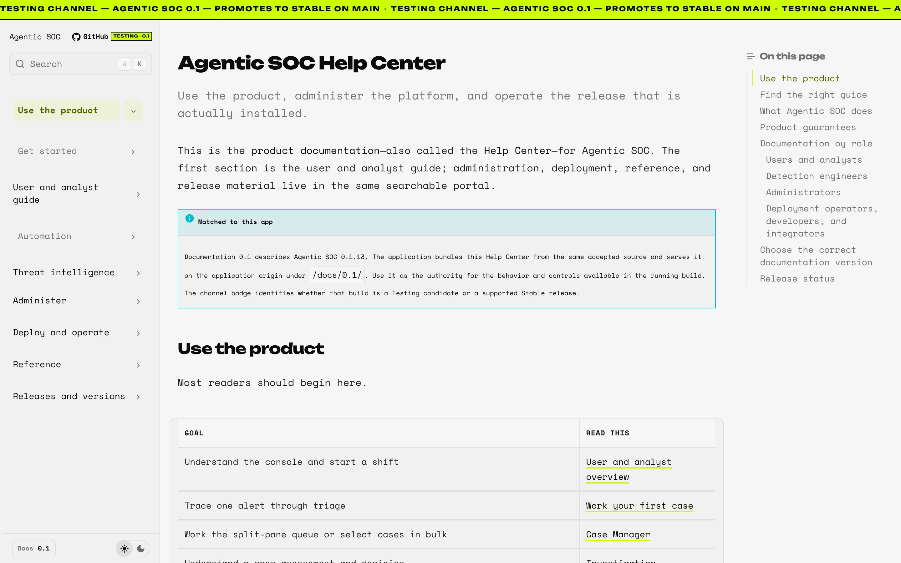

*Figure 16. The bundled Help Center, served by the Console at `/docs/0.1/`.*

- **Reference documents:** [`DEPLOY.md`](DEPLOY.md) (deployment reference),
  [`docs/USAGE.md`](docs/USAGE.md) (day-to-day use), [`SECURITY.md`](SECURITY.md) (threat model),
  [`COMPATIBILITY.md`](COMPATIBILITY.md) and [Known limitations](docs/releases/known-limitations.md).
- **Questions and bugs:** open an issue in the
  [GitHub repository](https://github.com/ARYDESTROYER/Kavach-AgenticSOC/issues). Include the
  `/api/health/build-info` output, your deployment path (A to E), the state backend, the failing
  step or request with its status, and whether it reproduces with synthetic data. Never paste
  credentials, tokens, `.env` or sensitive events.
- **Security vulnerabilities:** do not open a public issue. Follow the private process in
  [`SECURITY.md`](SECURITY.md#8-responsible-disclosure).
