<div align="center">

# Agentic SOC

**Self-hosted, vendor-agnostic alert triage that turns raw alert volume into audited,
cost-metered cases a person can review.**<br>
The model recommends a verdict. Deterministic code makes the close or escalate decision.

[](https://github.com/ARYDESTROYER/Kavach-AgenticSOC/actions/workflows/ci.yml?query=branch%3ATesting)
[](docs/releases/0.1.13.md)
[](docs/index.md)

</div>

<picture>
  <source media="(prefers-color-scheme: dark)" srcset="docs/assets/screenshots/hero-overview-dark.webp">
  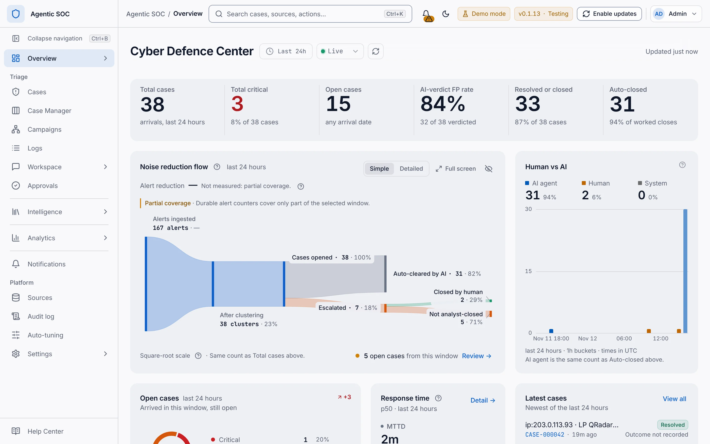
</picture>

<p align="center"><sub>The Cyber Defence Center, the landing dashboard, showing synthetic Demo Mode data. Partial coverage appears because the demo's durable alert counters started less than 24 hours before the capture.</sub></p>

## Contents

- [What it is](#what-it-is)
- [Key capabilities](#key-capabilities)
- [Screenshots](#screenshots)
- [Architecture](#architecture)
- [Safety model](#safety-model)
- [Supported sources](#supported-sources)
- [Quick start: the demo](#quick-start-the-demo)
- [Installation](#installation)
- [Configuration](#configuration)
- [Documentation](#documentation)
- [Repository layout](#repository-layout)
- [Development and testing](#development-and-testing)
- [Release channels and versions](#release-channels-and-versions)
- [Roadmap](#roadmap)
- [Contributing, conduct and security](#contributing-conduct-and-security)
- [License](#license)
- [Acknowledgements](#acknowledgements)

## What it is

Agentic SOC sits next to the security tools you already run. It reads alerts and events
from them, normalises every record to [OCSF](docs/concepts/ocsf.md), groups related
records into cases, and investigates the cases that matter with role-separated AI agents.
Each case keeps the source facts, the agent's findings, the risk factors and the final
decision side by side, so an analyst can see exactly why it was closed or escalated.

| Who it is for | What it gives them |
| --- | --- |
| SOC analysts | One queue of explained cases instead of thousands of raw alerts, with the evidence, an investigation trace, runbook steps and a read-only chat assistant in one place. |
| SOC managers and shift leads | Dashboards for workload, response times and noise reduction, a shift standup, SLAs, and a cost ledger for every model call. |
| Detection engineers | Per-rule drill-down, a rules editor with versioning and a preview that never calls a model, auto-tuning proposals, and baselines. |
| Platform and security administrators | Read-only access to your log stores, an append-only audit log, roles, MFA and SSO, a choice of state store, and supervised signed updates. |

What it is not:

- **Not a SIEM.** It reads from your sources and keeps its own records (cases, audit log,
  cost ledger) apart from your logs.
- **Not an autonomous responder.** It never acts on your hosts. Pull connectors read your
  log stores with a read-only key and never modify them. Queue receivers do consume: most
  acknowledge or commit each message they process, and SQS, RabbitMQ and Pub/Sub then
  remove it, so give each receiver its own queue, subscription or consumer group. The S3
  receiver's SQS-notification mode also deletes each notification it processes. A
  runbook's Action steps are carried out by a person in another tool.
- **Not a model that closes cases.** See the [safety model](#safety-model).

## Key capabilities

### Ingest and normalise

- **19 built-in connectors:** 3 pull connectors (Elasticsearch, OpenSearch, Wazuh indexer)
  and 16 push, queue, object-store and file receivers. See [supported sources](#supported-sources).
- **One canonical schema:** every record becomes an OCSF 1.4 event that keeps its source
  provenance. Per-source field mapping, with a mapping suggestion from a pasted sample.
- **No skips, no duplicates on pull sources:** a durable cursor per pull source and feed,
  and cases that are idempotent by cluster signature. Receivers have no durable receipt
  inbox in 0.1, so senders and brokers must retain and retry, and how durable each
  receiver's checkpoint is depends on the receiver. The
  [source support matrix](docs/sources/support-matrix.md) lists each boundary.
- **Comprehensive by default:** every enabled event is correlated and risk-scored. Only
  candidates admitted by the risk gate, your policy, caps and budget reach a model; the
  rest stay visible as `$0` candidates.

### Investigate

- **Two-tier AI investigation:** a router does a cheap first triage, an investigator runs a
  ReAct loop over read-only tools, and a formatter returns a verdict, a confidence and
  compact evidence.
- **Threat context:** 38 built-in enrichment providers (quota-safe keyless providers are on
  by default, keyed providers are opt-in), cached in Redis, plus a bundled MITRE ATT&CK map of 697
  techniques with coverage and Navigator layer export.
- **Knowledge and memory:** hybrid keyword and vector retrieval over a curated corpus,
  imported documents and resolved cases, and operator memory that a person must approve
  before the agents trust it.
- **Runbooks:** 12 built-in runbooks and your own, with phases, five step kinds (Check,
  Lookup, Decision, Action, Record), deterministic matching with a stated reason, a
  per-case run with a Next step card, and Draft, In review, Published and Retired
  versions. The investigator reads only Published text.

### Decide and account

- **Deterministic case authority:** `decide()` compares the verdict, confidence and risk
  score with your `AutoClosePolicy` and chooses Close, Escalate or Needs human.
- **Append-only audit log:** a searchable page with three scopes, a record inspector and an
  audited CSV or JSON Lines export.
- **Metered AI spend:** one model gateway writes one usage and cost record for every call.
  The default daily AI budget ($10 a day, warning at 80%) is checked before every pipeline
  model call, and a blocked investigation goes to a person. Workspace and Case Manager chat
  are outside the daily and monthly AI budget; their only spending bound is an optional
  chat-only daily cap (`chat_agent.chat_daily_cap_usd`), off by default. Chat calls are
  still recorded in the ledger.

### Work as a team

- **Case Manager:** an Active, Mine and All queue beside the full case, with Overview,
  Runbook, Timeline, Investigation, Threat context, Collaboration and Chat tabs, plus
  bulk actions that run as background jobs.
- **Workspace Chat:** a read-only assistant over cases, logs, metrics, threat intelligence
  and the product itself. Answers cite their lookups, render tables and charts, and can be
  collected into exportable reports. Suggested questions are computed by code from your own
  data at `$0`.
- **Dashboards:** the Cyber Defence Center (the landing page) plus SOC operations,
  Detection and data health, Executive summary, and your own boards.
- **Detection and tuning:** a rules editor with versions and rollback, one rule sheet from
  every rule name, campaigns, entity baselines, and threshold tuning that proposes changes
  for review.
- **Identity and notifications:** six built-in roles plus custom roles (role-based access
  is off by default), TOTP MFA, OIDC SSO (Google, Microsoft or generic), session policy,
  and alerts by email, Resend, Slack, Teams, PagerDuty, Telegram, webhook or the in-app
  Inbox.

### Operate

- **AI runtime of your choice:** OpenAI (fresh workspaces use GPT-5.6 Luna for completion
  roles and `text-embedding-3-small` for embeddings), Anthropic, Azure OpenAI, AWS Bedrock,
  Google Vertex, or a self-hosted OpenAI-compatible endpoint such as LiteLLM, vLLM or
  Ollama. Each agent role can use a different model.
- **State store of your choice:** PostgreSQL with pgvector, Elasticsearch, or SQLite.
- **Durable background jobs:** exports, bulk case work, knowledge maintenance, resets and
  storage lifecycle continue server-side with progress, cancellation and verified
  artifacts.
- **Supervised updates:** a reference PostgreSQL Compose deployment that runs signed
  Stable release images can, after a one-time bootstrap, install a newer signed,
  digest-pinned Stable release from the Console. It makes a verified backup, runs
  readiness checks and rolls the application images back automatically when the rollout
  fails (a database restore stays a manual step). A stack built from source is upgraded
  manually.
- **A complete Console:** first-run setup, light and dark themes (dark by default), and a
  version-matched Help Center that works offline at `/docs/0.1/`.

## Screenshots

All images are real captures of version 0.1.13 (Testing). The product views use synthetic
Demo Mode data; the setup screens in [Installation](#installation) come from a fresh
install. The captures use the light theme except where noted; a new Console opens in the
dark theme by default. Select a thumbnail to open it full size.

<table>
  <tr>
    <td width="33%" valign="top">
      <a href="docs/assets/screenshots/case-manager.webp">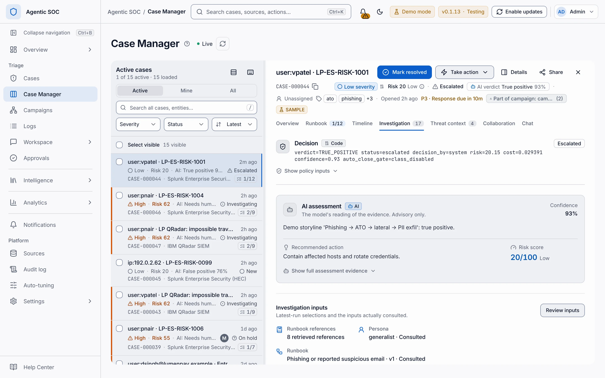</a><br>
      <sub><b>Case Manager.</b> The decision card (Code) sits above the advisory AI assessment, which only recommends.</sub>
    </td>
    <td width="33%" valign="top">
      <a href="docs/assets/screenshots/workspace-chat.webp">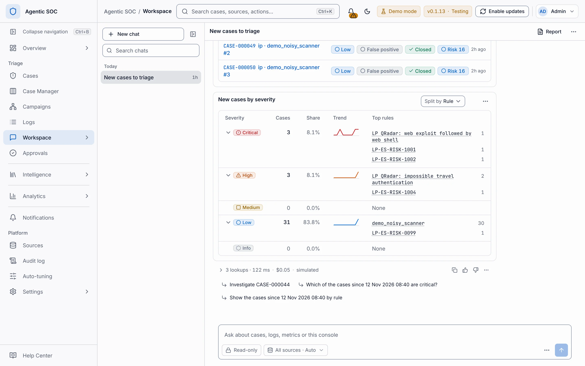</a><br>
      <sub><b>Workspace Chat.</b> A read-only answer with a severity breakdown, its cost and suggested follow-ups.</sub>
    </td>
    <td width="33%" valign="top">
      <a href="docs/assets/screenshots/sources.webp">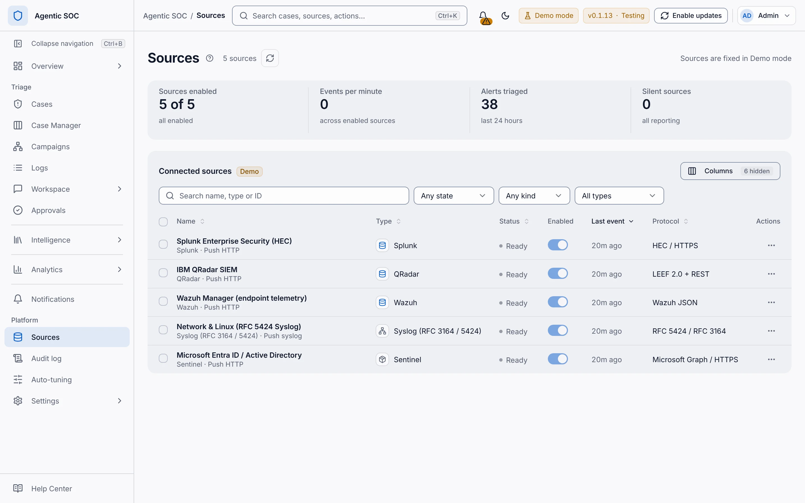</a><br>
      <sub><b>Sources.</b> The demo's five synthetic sources, which arrive over push transports.</sub>
    </td>
  </tr>
  <tr>
    <td width="33%" valign="top">
      <a href="docs/assets/screenshots/dashboards-library.webp">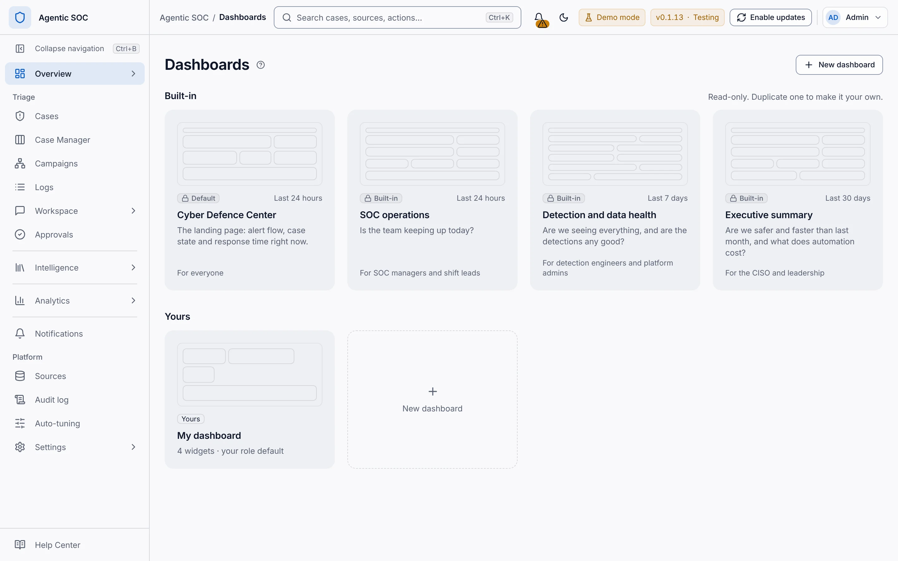</a><br>
      <sub><b>Dashboards.</b> Four built-in boards and your own.</sub>
    </td>
    <td width="33%" valign="top">
      <a href="docs/assets/screenshots/runbooks.webp">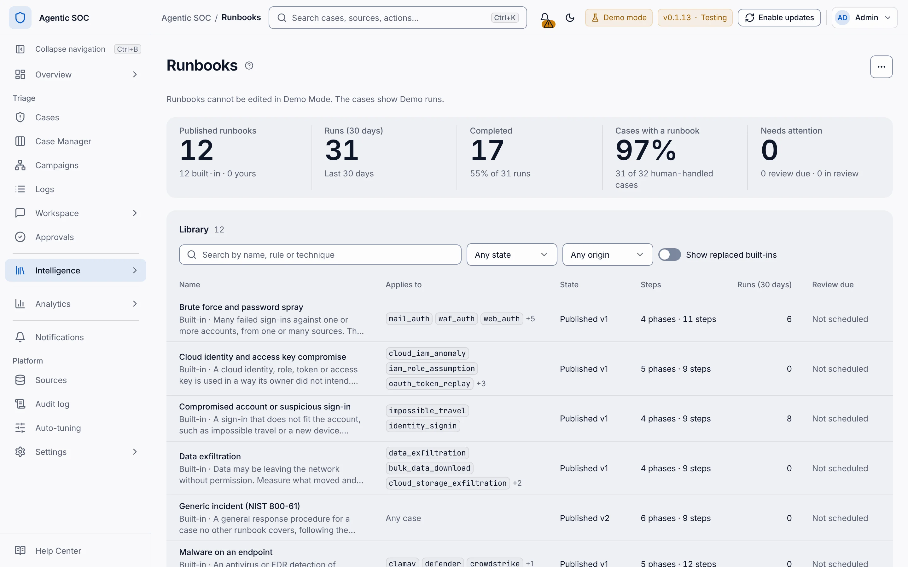</a><br>
      <sub><b>Runbooks.</b> The governed library with run statistics.</sub>
    </td>
    <td width="33%" valign="top">
      <a href="docs/assets/screenshots/audit-log.webp">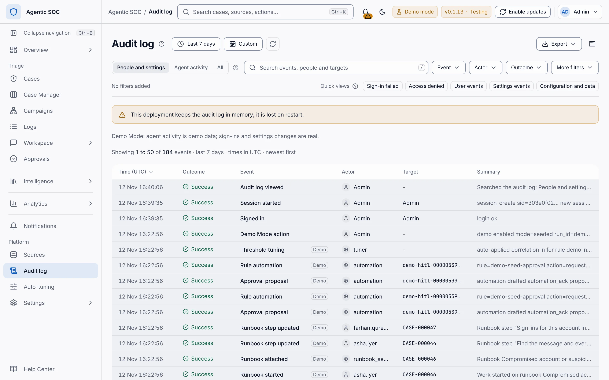</a><br>
      <sub><b>Audit log.</b> Scopes, search, filters and export. The in-memory banner appears because the local demo keeps state in memory.</sub>
    </td>
  </tr>
  <tr>
    <td width="33%" valign="top">
      <a href="docs/assets/screenshots/settings-models.webp">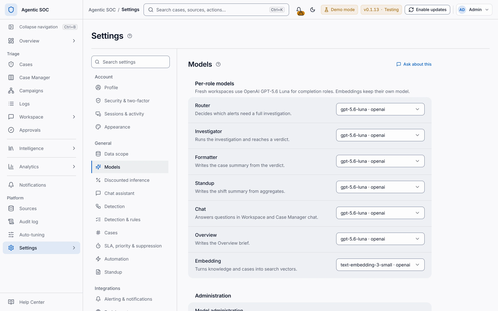</a><br>
      <sub><b>Settings, Models.</b> One model per agent role.</sub>
    </td>
    <td width="33%" valign="top">
      <a href="docs/assets/screenshots/help-center.webp">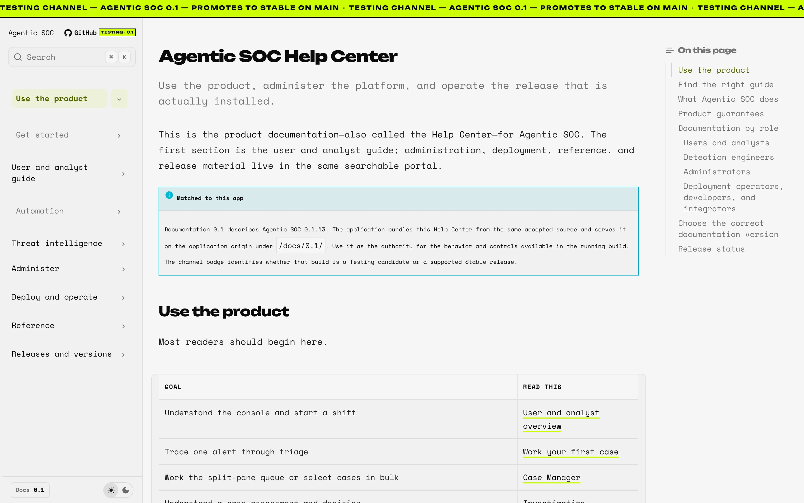</a><br>
      <sub><b>Help Center.</b> Bundled with the Console at <code>/docs/0.1/</code> and matched to the installed version.</sub>
    </td>
    <td width="33%" valign="top">
      <a href="docs/assets/screenshots/hero-overview-dark.webp">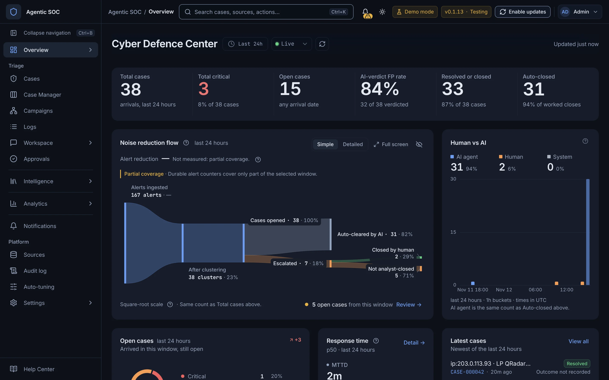</a><br>
      <sub><b>Dark theme.</b> The Cyber Defence Center in the default theme.</sub>
    </td>
  </tr>
</table>

## Architecture

<a href="docs/assets/architecture/system-light.svg">
<picture>
  <source media="(prefers-color-scheme: dark)" srcset="docs/assets/architecture/system-dark.svg">
  
</picture>
</a>

<sub>Select the diagram to open it full size.</sub>

The diagram follows one security signal through 11 numbered stages in three bands. The top
band never calls a model, the middle band admits only some candidates to a model, and the
bottom band decides, records and shows the result. A dashed orange outline marks untrusted,
source-derived data.

1. **Connectors.** Three pull connectors read your SIEM or log store with a read-only,
   scoped key. Sixteen receivers accept webhook, Splunk HEC, syslog, file, queue, stream and
   object-store data.
2. **Normalise to OCSF.** Each record becomes an OCSF 1.4 event with its source provenance.
   The `unmapped` and `raw_data` fields are kept and always treated as untrusted.
3. **Poll and ingest.** Pull sources are read on a durable cursor per source and feed. Push
   and queue batches join the same pipeline.
4. **Correlate and score.** Deterministic code groups events into entity clusters, a case
   signature keeps cases idempotent, and each cluster gets a risk score from 0 to 100.
5. **Admission gates.** Event clusters go on at risk 70 or more by default, and alert feeds
   go straight on. Anything below the floor stays a visible `$0` candidate. The budget gate
   checks the daily AI budget and caps before an investigation calls a model; over budget,
   the case goes to a person.
6. **AI investigation (advisory).** The router triages, the investigator queries logs,
   enrichment, knowledge, Published runbooks and ATT&CK context through read-only tools,
   and the formatter returns a verdict, a confidence and evidence. Source-derived evidence
   enters every prompt fenced and labelled as untrusted data.
7. **One model gateway.** Every model call, from investigation and from chat, goes through
   one gateway to your provider and writes one record to the usage and cost ledger.
8. **Case Manager.** `decide()` compares the verdict, confidence and risk with your
   `AutoClosePolicy` and chooses Close, Escalate or Needs human.
9. **Cases and audit.** Cases carry notes, tasks and runbook runs. Long work runs as
   background jobs, and every agent and human action is written to the append-only audit
   log.
10. **Console and API.** Analysts review, approve and close cases in the Console through the
    FastAPI API. Notifications go out by email, Slack, Teams, PagerDuty, webhook or the in-app
    Inbox. Workspace Chat is the one chat engine and uses only read-only tools.
11. **State store.** The application's own records live in PostgreSQL with pgvector, in
    Elasticsearch, or in SQLite, apart from your source logs.

<details>
<summary><b>Deployment topology: the reference Compose stack</b></summary>
<br>

<a href="docs/assets/architecture/deployment-light.svg">
<picture>
  <source media="(prefers-color-scheme: dark)" srcset="docs/assets/architecture/deployment-dark.svg">
  
</picture>
</a>

<sub>Select the diagram to open it full size.</sub>

`deploy/docker-compose.agnostic.yml` starts five services on one Docker host. Only ports
8080 and 8088 are published.

| Service | Role |
| --- | --- |
| `tlsoc-webui` | nginx on host port 8080. Serves the Console and the `/docs` Help Center and proxies `/api/` to the backend. |
| `tlsoc-backend` | FastAPI on port 8088 (also published for API clients and HTTP push senders). Runs connectors, receivers, engines and agents. One replica in 0.1. |
| `tlsoc-postgres` | `pgvector/pgvector:pg16`, not published. All application state, on the `tlsoc-pgdata` volume. |
| `tlsoc-redis` | `redis:7-alpine`, not published. Cache only, no persistence. |
| `agentic-soc-updater` | Private update supervisor: read-only filesystem, all capabilities dropped. The only service that mounts the Docker socket; it applies signed releases that an administrator approves. |

</details>

Read [Architecture](docs/concepts/architecture.md) for the components, the two data planes
and the trust boundaries, and [Ingestion and investigation](docs/architecture/ingestion.md)
for the data path in detail.

## Safety model

> [!IMPORTANT]
> **The model never closes a case.** It recommends a verdict and a confidence. The close or
> escalate decision is made by deterministic code (`decide()`) against the policy you
> configure. A runbook can recommend but cannot change that policy, true-positive
> auto-close is off by default, and a Needs human case never closes automatically.

These guarantees are architectural contracts enforced in code and tests, not prompt
instructions. They are the project's
[12 non-negotiables](AGENTS.md#5-the-12-non-negotiables-never-regress-these).

| # | Guarantee | What it means | Where |
| --- | --- | --- | --- |
| 1 | Read-only source access | Pull connectors only read and search, and the application's own state uses a separate client. You supply the key: scope it to your log patterns with read access only (on Elasticsearch, the `read` and `view_index_metadata` index privileges), and never use `kibana_system`, an admin role or a superuser. The connection test does not reject an over-privileged key. | `backend/app/es/client.py`, `backend/app/connectors/elastic.py` |
| 2 | Append-only audit | Every agent and human action is recorded in an append-only audit log. | `backend/app/audit/` |
| 3 | Deterministic decisions | `decide()` is a pure function of verdict, confidence, risk score and policy. | `backend/app/engine/case_manager.py` |
| 4 | No skips, no duplicates | Durable polling cursors for pull sources, and cases idempotent by cluster signature. | `backend/app/engine/poller.py`, `signatures.py` |
| 5 | One chat engine | Workspace Chat and Case Manager chat share one read-only engine; case chat stays scoped to its case. | `backend/app/agents/chat.py` |
| 6 | Every model call metered | One gateway, one usage and cost record per call. | `backend/app/llm/gateway.py` |
| 7 | Aggregate, then summarise | Shift and report summaries read counts and aggregates, never raw log rows. | `backend/app/agents/standup.py` |
| 8 | Cached enrichment | Threat-intel lookups are cached in Redis, so a repeated indicator does not spend quota again. | `backend/app/tools/enrich.py`, `backend/app/cache.py` |
| 9 | Untrusted-data fencing | Source-derived values are fenced and labelled in every prompt. Imported knowledge stays fenced, and agent-written memory waits for human approval. | `backend/app/agents/prompts.py` |
| 10 | Sane defaults | Runs with keys and a data scope only. Ingestion, tuning observation, campaigns and baselines are on by default; threshold changes are review-first. | `backend/app/config.py` |
| 11 | Spine first, breadth degrades gracefully | The core pipeline is tested first. Optional breadth (enrichment, threat context, Redis) fails open, and a model, log-query or tool error routes the alert to Needs human instead of dropping it. | pipeline-wide |
| 12 | Read-only consumer | Agentic SOC never changes your upstream pipeline's code or configuration, and the stack deploys cold. Queue receivers still consume what they read, and some create a missing queue, stream or consumer group on the broker, so give each receiver its own queue, subscription or consumer group. | `deploy/` |

Secrets follow the same rule: the Console shows only whether a secret is configured, never
its value. Read the [security model](SECURITY.md) and the
[deterministic-decision contract](docs/concepts/deterministic-decisions.md) before you
connect production data.

## Supported sources

The setup wizard lists 19 built-in connectors. The default `full` backend image installs
every client they need; the lean `core` image omits the optional queue and cloud clients.

| Family | Connectors | Mode |
| --- | --- | --- |
| SIEM and log stores | Elasticsearch, OpenSearch, Wazuh indexer | Pull, read-only key |
| HTTP and listeners | Generic webhook (JSON, NDJSON, CEF, LEEF, GELF, key/value), Splunk HEC-compatible receiver, Syslog (UDP, TCP or TLS; RFC 3164, 5424, 6587) | Push |
| Queues and streams | Apache Kafka or Redpanda, AWS SQS, AWS Kinesis, Azure Event Hubs, Google Cloud Pub/Sub, RabbitMQ, NATS JetStream, MQTT, Redis Streams | Queue consumer |
| Object stores and files | AWS S3, Azure Blob Storage, Google Cloud Storage, local file or directory tail | Object or file reader |

- **Reserved, not built in yet:** native search connectors for Splunk, Microsoft Sentinel,
  QRadar and Google Chronicle, and EDR connectors for CrowdStrike, SentinelOne and
  Microsoft Defender. Forward their alerts to a webhook, HEC, queue or object-store
  receiver today, or write an out-of-tree connector through the `tlsoc.connectors`
  Python entry point.
- **Formats:** JSON, NDJSON, CEF, LEEF, GELF, RFC 3164 and 5424 syslog, key/value text and
  gzip are parsed. Parquet (including OCSF Security Lake objects) and CSV are not
  implemented.
- **Validate first:** installed does not mean certified. Test each source against a
  non-production tenant and a synthetic alert.

The [source support matrix](docs/sources/support-matrix.md) lists each connector's
acknowledgement and durability boundary.

## Quick start: the demo

The deterministic demo is the fastest way to see the whole workflow. It runs the real
parsing, OCSF, correlation, case and audit paths on generated multi-source security stories
and forces a deterministic `$0` mock model, even if provider keys are present. No Docker,
no source and no provider key are needed.

**You need:** Git, Python 3.11, Node.js 22 with npm, and Bash on macOS or Linux. The first
run downloads Python and npm packages and builds the bundled Help Center, so it needs
internet access and takes a few minutes.

1. Clone the repository.

   ```bash
   git clone https://github.com/ARYDESTROYER/Kavach-AgenticSOC.git
   cd Kavach-AgenticSOC
   ```

2. Start the demo.

   ```bash
   ./scripts/run-demo.sh
   ```

   The script creates `backend/.venv`, installs dependencies on the first run, starts the
   API on `127.0.0.1:8088` and the Console on `127.0.0.1:5173`, seeds Demo Mode, and
   prints a banner with both addresses and the sign-in details.

3. Open <http://127.0.0.1:5173> and sign in. Type the username `Admin`, select
   **Continue**, type the password `Admin@123`, and select **Sign in**.

4. Explore. You land on the **Cyber Defence Center** with synthetic cases and a
   **Demo mode** badge in the header. Open **Case Manager**, ask a suggested question in
   **Workspace → Chat**, or open a case's **Runbook** tab.

5. Stop both services with <kbd>Ctrl</kbd>+<kbd>C</kbd>. Demo state is held in memory and
   is discarded.

> [!CAUTION]
> **`Admin` / `Admin@123` is a demo-only account, and the demo binds to `127.0.0.1` only.**
> Never expose the demo on a network or reuse these credentials with real data. A real
> deployment that turns on authentication without setting `TLSOC_AUTH_ADMIN_PASSWORD`
> seeds this same account, so always set it (see [Installation](#installation)).

Check the API from a second terminal. This is the real output from a demo run of 0.1.13:

```console
$ curl -s http://127.0.0.1:8088/api/health/live
{"status":"ok","service":"tlsoc-agentic-triage","version":"0.1.13"}
```

The `service` value is a compatibility identifier, not a product name.

Options: `DEMO_MODE=seeded ./scripts/run-demo.sh` gives a static dataset instead of ongoing
activity, and `BACKEND_PORT` and `WEBUI_PORT` change the ports. Continue with the
[Demo guide](docs/getting-started/demo.md), the [walkthrough script](DEMO.md) and
[Your first case](docs/getting-started/first-case.md).

## Installation

**[INSTALL.md](INSTALL.md) is the complete, step-by-step installation guide**, with a
screenshot and numbered highlights for every screen of the first run. Choose a path:

| Path | Best for | You need | Effort | Guide |
| --- | --- | --- | --- | --- |
| Local demo | A first look, demos and training | Git, Python 3.11, Node.js 22, Bash | One command; the first run installs Python and Node packages | [Quick start](#quick-start-the-demo) |
| **Reference Compose stack** (recommended) | Evaluations and pilots with real sources; persistent PostgreSQL state | Docker Engine or Docker Desktop, Docker Compose v2, Git, Bash and Python 3 on the host, a model provider key (needed for AI investigations), a source credential (read-only for log stores) | About a dozen short steps; the first build downloads images and packages | [INSTALL.md](INSTALL.md) |
| Attach to an existing Elasticsearch stack | Sites that already run Elasticsearch and want the application's state in dedicated indices | The existing stack, Docker Compose v2, two scoped Elasticsearch API keys | Merge service blocks into your existing Compose file | [INSTALL.md, path D](INSTALL.md#10-path-d-attach-to-an-existing-elastic-stack) (reference: [DEPLOY.md, Mode B](DEPLOY.md#7-mode-b--existing-elk-attachment-optional)) |
| From source | Contributors | Python 3.11, Node.js 22 | Two terminals | [Development and testing](#development-and-testing) |

A stack built from source is upgraded manually; supervised one-click updates need a signed
Stable release (see [INSTALL.md section 8](INSTALL.md#8-updates)).

### The reference Compose stack at a glance

```bash
git clone https://github.com/ARYDESTROYER/Kavach-AgenticSOC.git
cd Kavach-AgenticSOC
cp .env.example .env          # then set the values in the table below

./scripts/agentic-soc-compose.sh config --quiet
./scripts/agentic-soc-compose.sh up --detach --build
./scripts/agentic-soc-compose.sh ps
```

Set at least these values in `.env` (generate random values with `openssl rand -hex 32`, and
never commit `.env`):

| Variable | Set it to | Why |
| --- | --- | --- |
| `TLSOC_PG_PASSWORD` | A random value | Required. Compose refuses to start without it. |
| `TLSOC_AUTH_ENABLED` | `true` | Turns on sign-in, MFA and SSO. The template ships `false`, which leaves the Console open to anyone who can reach it. Role-based access stays off until you turn it on (see the note below the table). |
| `TLSOC_AUTH_JWT_SECRET` | A stable random value of at least 32 bytes | Signs sessions. Without it, every backend restart signs everyone out. |
| `TLSOC_AUTH_ADMIN_USERNAME`, `TLSOC_AUTH_ADMIN_PASSWORD` | Your admin name and a unique password | An environment fallback administrator. Without a password, the backend seeds the demo `Admin` / `Admin@123` account. |
| `TLSOC_OPENAI_API_KEY` or `TLSOC_ANTHROPIC_API_KEY` | Your provider key | Live investigations. Fresh workspaces use OpenAI (GPT-5.6 Luna); with only an Anthropic key, reassign the roles in **Settings → General → Models**. Without a key the Console still runs and setup reports limited capabilities, but no investigation can call a model: each cluster sent to investigation becomes a **Needs human** case whose recommended action names the missing key, and nothing is closed automatically. The `$0` mock model is used only by Demo Mode. |
| `TLSOC_AUTH_COOKIE_SECURE` | `true` once TLS terminates in front of the Console | HTTPS-only session cookie. |

> [!IMPORTANT]
> **Role-based access is off by default.** With authentication on, every signed-in account
> is treated as Super admin until role-based access is turned on, whatever role it was
> given. **Settings → Security & access → Single sign-on & policy** shows the state in its
> **Role-based access** row. The 0.1.13 Console has no switch for it: a super administrator
> turns it on by saving `{"rbac": {"enabled": true}}` through `PUT /api/settings`
> (permission `settings:manage`). The full command is in
> [INSTALL.md, Accounts and roles](INSTALL.md#accounts-and-roles). Keep at least one super
> administrator.

Then open <http://localhost:8080>. With authentication on and `TLSOC_AUTH_ADMIN_PASSWORD` set,
a fresh install asks you to create the first administrator, then opens a four-stage setup
wizard: **Workspace**, **Data sources**, **AI runtime** and **Review & launch**.

<table>
  <tr>
    <td width="33%" valign="top">
      <a href="docs/assets/screenshots/install-01-create-admin.webp">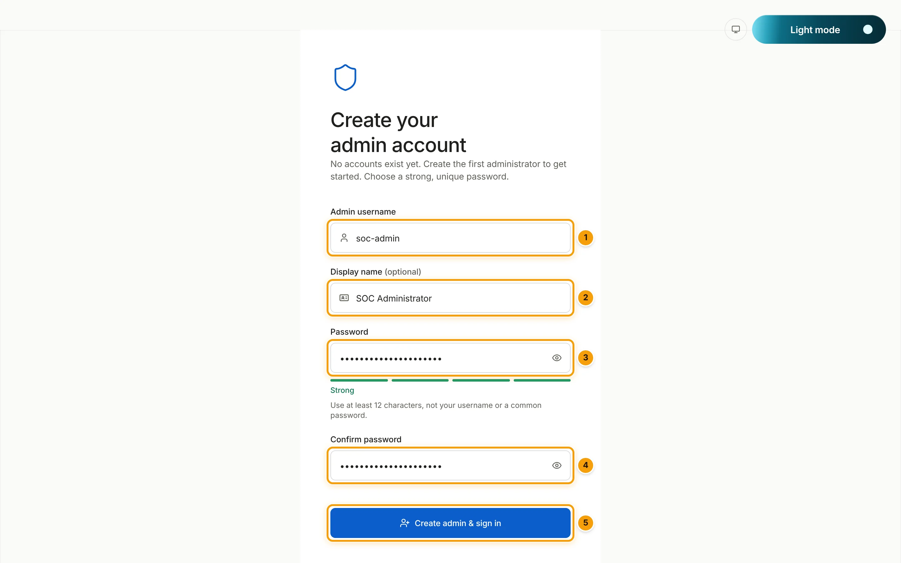</a><br>
      <sub><b>1. Create your admin account.</b> At least 12 characters, not the username or a common password.</sub>
    </td>
    <td width="33%" valign="top">
      <a href="docs/assets/screenshots/install-03-setup-workspace.webp">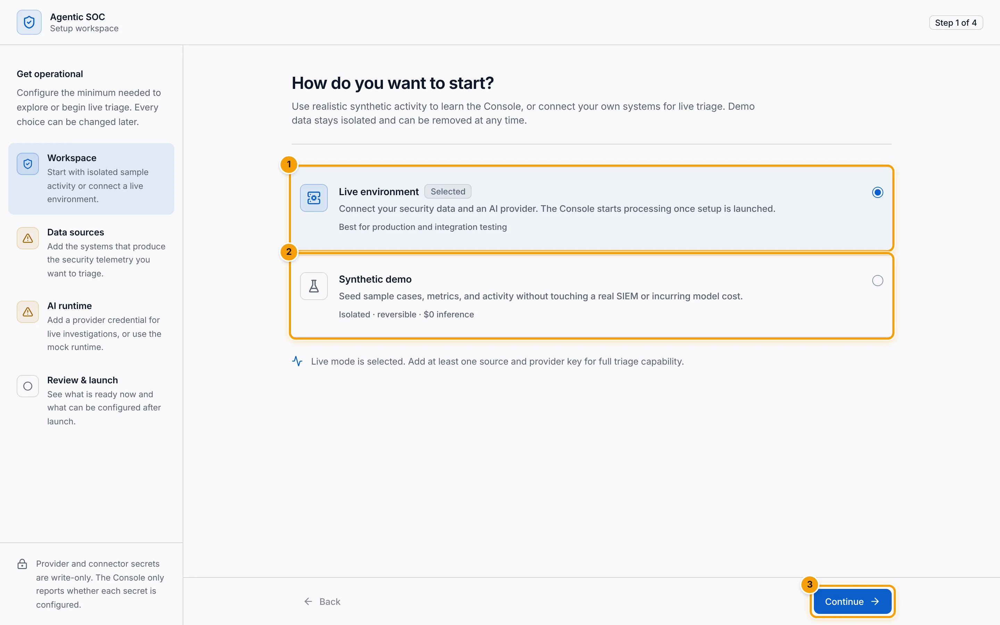</a><br>
      <sub><b>2. Choose a workspace.</b> Live environment, or an isolated synthetic demo.</sub>
    </td>
    <td width="33%" valign="top">
      <a href="docs/assets/screenshots/install-06-setup-review.webp">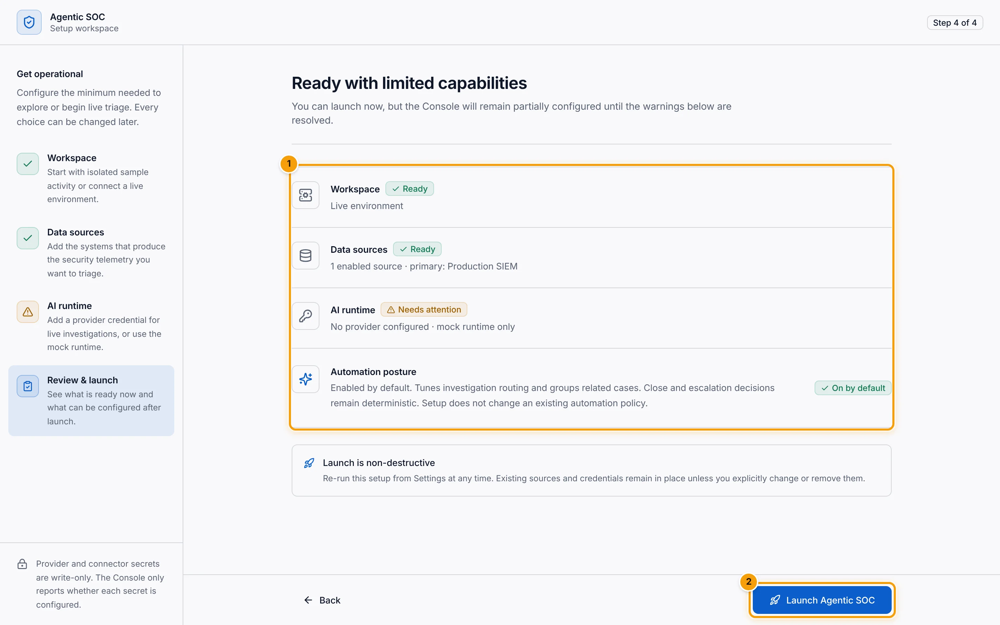</a><br>
      <sub><b>3. Review and launch.</b> A readiness summary before you start. Its "mock runtime only" wording is wrong in 0.1.13: without a key, investigations become Needs human cases.</sub>
    </td>
  </tr>
</table>

Verify the stack through the Console's proxy:

```bash
curl --fail http://localhost:8080/api/health/live
curl --fail http://localhost:8080/api/health/ready
curl --fail http://localhost:8080/api/health/build-info
```

**Live** confirms the API process is running. **Ready** confirms the state store is usable
and returns HTTP `503` when it is not. **Build info** reports the version, release channel,
commit and state backend without exposing secrets. Stop the stack with
`./scripts/agentic-soc-compose.sh down`; the named PostgreSQL volume is kept.

Use `./scripts/agentic-soc-compose.sh` for every lifecycle command. After a supervised
update it preserves the digest-pinned release override that raw `docker compose` commands
would bypass. For TLS, backups, SSO, notifications and hardening, read [DEPLOY.md](DEPLOY.md)
and the [upgrade contract](docs/operations/upgrades.md).

## Configuration

Configuration has three layers. Only keys and a data scope are needed to start; everything
else has a working default.

| Layer | Where it lives | Survives a restart | Examples |
| --- | --- | --- | --- |
| Environment secrets | `.env`, which Compose maps from `TLSOC_*` names into the backend | Yes | Database password, JWT secret, model provider keys, enrichment keys, SSO and notification secrets |
| Runtime secret tier | Backend process memory, set from the setup wizard, **Settings** or a source editor | **No** | A provider key typed during setup, a source's read-only API key, a webhook bearer token or HMAC secret |
| Operator settings | The state store | Yes | Sources and feeds, field mapping, models per role, `AutoClosePolicy`, budgets, automation, enrichment, notifications, users and roles, branding, retention |

> [!WARNING]
> **In version 0.1, secrets you type in the Console are kept in backend memory only.** A
> provider key entered in the setup wizard or a source credential saved in a source editor
> is lost when the backend restarts and must be entered again. Put every secret you need to
> keep in `.env`.

References:

- [`.env.example`](.env.example), the annotated environment template
- [Configuration reference](docs/reference/configuration.md) and
  [environment variables](docs/ENVIRONMENT.md)
- [Models and spend](docs/administration/models-spend.md)
- [Authentication](docs/administration/authentication.md) and
  [users and roles](docs/administration/users-rbac.md)
- [Feeds and field mapping](docs/sources/feeds-mapping.md)

## Documentation

The Help Center bundled with a running Console (**Help Center** at the bottom of the
navigation rail) is authoritative for the version you installed. The repository pages
below may describe a newer channel.

| I want to | Start here |
| --- | --- |
| Install, with every screen shown | [INSTALL.md](INSTALL.md) |
| Browse the whole manual | [Help Center home](docs/index.md) |
| Evaluate quickly | [Quickstart](docs/getting-started/quickstart.md), [Demo](docs/getting-started/demo.md) |
| Complete first-run setup | [First-run setup](docs/getting-started/first-run.md) |
| Work cases | [Case Manager](docs/analyst/case-manager.md), [Your first case](docs/getting-started/first-case.md) |
| Ask questions in chat | [Workspace Chat](docs/analyst/chat.md) |
| Read the dashboards | [Dashboards](docs/analyst/dashboards.md) |
| Connect sources | [Sources](docs/sources/index.md), [Support matrix](docs/sources/support-matrix.md) |
| Write runbooks | [Runbooks](docs/intelligence/runbooks.md) |
| Review who changed what | [Audit log](docs/administration/audit-log.md) |
| Deploy and operate | [DEPLOY.md](DEPLOY.md), [Deployment](docs/operations/deployment.md), [Health and backup](docs/operations/health-backup.md) |
| Update a deployment | [Upgrades](docs/operations/upgrades.md) |
| Follow long-running work | [Background jobs](docs/operations/background-jobs.md) |
| Fix a problem | [Troubleshooting](docs/operations/troubleshooting.md) |
| Integrate the API | [API reference](docs/reference/api.md), [Permissions](docs/reference/permissions.md) |
| Understand the design | [Architecture](docs/concepts/architecture.md), [Security model](SECURITY.md), [Compatibility](COMPATIBILITY.md) |
| Know the limits | [Known limitations](docs/releases/known-limitations.md) |
| Develop the project | [Developer handoff](docs/HANDOFF.md), [CONTRIBUTING.md](CONTRIBUTING.md), [AGENTS.md](AGENTS.md) |

## Repository layout

| Path | Contents |
| --- | --- |
| `backend/` | FastAPI backend: connectors, OCSF, correlation, agents, policy, stores, API, and the offline test suite |
| `webui/` | The React and TypeScript Console (Vite, Tailwind CSS, Radix UI) and its tests |
| `updater/` | The private update supervisor for signed releases |
| `deploy/` | Compose definitions, field mappings and deployment assets |
| `docs/` | The Help Center source (MkDocs), release pages, research records and documentation assets |
| `scripts/` | The demo launcher, the Compose wrapper, and release, documentation and validation helpers |
| `overrides/`, `mkdocs.yml` | Help Center theme overrides and site configuration |
| `archive/` | The retired Kibana plugin, frozen and not built, tested or shipped |
| `.github/workflows/` | CI, documentation and release workflows |

Root documents: [AGENTS.md](AGENTS.md) (project context and rules), [DEPLOY.md](DEPLOY.md),
[DEMO.md](DEMO.md), [COMPATIBILITY.md](COMPATIBILITY.md), [SECURITY.md](SECURITY.md),
[CHANGELOG.md](CHANGELOG.md), [ROADMAP.md](ROADMAP.md) and [Journal.md](Journal.md), the
shared development journal.

## Development and testing

Read [CONTRIBUTING.md](CONTRIBUTING.md) and [AGENTS.md](AGENTS.md) before you change the
system. Keep deterministic case authority, API compatibility, auditability, accessibility
and the Journal workflow intact.

**Backend** (Python 3.11). Tests run fully offline against fake stores and a mock model.

```bash
cd backend
python3 -m venv .venv
. .venv/bin/activate
pip install -r requirements-dev.txt
python -m pytest -q                # the full offline suite
uvicorn app.main:app --port 8088   # local API, in-memory state
```

**Console** (Node.js 22).

```bash
cd webui
npm ci
npm run dev                        # http://localhost:5173, proxies /api to :8088
npm run test:strict                # Vitest suite, zero stderr allowed
npm run check:types                # API type drift against OpenAPI
npm run lint -- --max-warnings=0   # ESLint and accessibility rules
npm run gates                      # design-system gates
npm run build                      # Help Center, type check, Vite build
```

**Documentation and release metadata.**

```bash
python3 scripts/check_docs.py
python3 scripts/check_version.py
```

Every pull request runs [`.github/workflows/ci.yml`](.github/workflows/ci.yml): twenty
independent quality checks plus the fail-closed `CI passed` aggregate, covering backend
tests, PostgreSQL and Redis acceptance, rollback, the Console suite, API drift, design
gates, the Help Center build, workflow contracts, the updater and all three release images.
See [Continuous integration](CONTRIBUTING.md#continuous-integration-merge-gate) for every
check and how to run it locally.

## Release channels and versions

| Channel | Branch | What you get |
| --- | --- | --- |
| **Testing** | `Testing` | Integrated candidates for acceptance testing. May contain changes that have not passed release acceptance. |
| **Stable** | `main`, plus an immutable annotated `vX.Y.Z` tag | Accepted releases with signed, digest-pinned images and versioned documentation. |

- The current source version is **0.1.13** (documentation line 0.1). The Console header
  always shows the running version and channel, for example `v0.1.13 · Testing`.
- A tag is installable only when its signed GitHub Release, public digest-pinned images and
  canonical runtime acceptance all exist. Until 0.1.13 passes that gate, `v0.1.1` remains
  the last Stable tag verified as installable.
- The tags `v0.1.4` to `v0.1.12` are immutable historical records and are not installation
  sources. The [release pages](docs/releases/) explain each one.

Known limits of 0.1: one backend replica; HTTP push has no durable receipt inbox, so senders
must retry; secrets entered in the Console are held in memory; several queue connectors
still need transport-level validation. See [Release channels](docs/releases/channels.md),
the [0.1.13 release notes](docs/releases/0.1.13.md), [Known limitations](docs/releases/known-limitations.md)
and [CHANGELOG.md](CHANGELOG.md).

## Roadmap

Planned work is tracked in [ROADMAP.md](ROADMAP.md). Open items include an opt-in row-level
data scope, wider OCSF classification and a schema version update, scale-out workers with a
Helm chart and OpenTelemetry, and native pull connectors for Splunk, Microsoft Sentinel,
QRadar, Google Chronicle, CrowdStrike, SentinelOne and Microsoft Defender.

## Contributing, conduct and security

- **Contributing:** follow [CONTRIBUTING.md](CONTRIBUTING.md) for branches, tests,
  documentation and the Journal. Feature work merges into `Testing` through pull requests.
- **Code of conduct:** participation follows the [Code of Conduct](CODE_OF_CONDUCT.md).
- **Security:** report vulnerabilities privately through the
  [responsible-disclosure process](SECURITY.md#8-responsible-disclosure). Do not open a
  public issue for an undisclosed weakness.

## License

This repository does not publish a license file. Source availability does not grant
permission to use, modify or redistribute the code. An explicit license must be added before
the project is represented as open source.

## Acknowledgements

- [MITRE ATT&CK](https://attack.mitre.org/) is © The MITRE Corporation. A compact subset is
  bundled in `backend/app/threat/` under the ATT&CK
  [Terms of Use](https://attack.mitre.org/resources/legal-and-branding/terms-of-use/).
- The [Open Cybersecurity Schema Framework (OCSF)](https://ocsf.io/) provides the canonical
  event schema.
- Built with FastAPI, LangGraph, Pydantic and SQLAlchemy on the backend, and React, Vite,
  Tailwind CSS and Radix UI in the Console. The Help Center is built with MkDocs Material.
