# First-run setup

This guide applies to **Agentic SOC 0.1** and is for administrators opening a new Agentic SOC
Console for the first time. The console shows setup instead of the operational
workspace until the deployment is marked complete.

The screenshots on this page come from a real fresh install of 0.1.13. Numbered amber
badges mark the controls each step uses; select a screenshot to open it full size. The
screenshots use the light theme; a fresh install opens in the dark theme, the
organization default, and each user can change it under
**Settings → Account → Appearance**. The sign-in screens follow the browser's own
choice, with a light and dark switch in the top right corner.

## Before you begin

For a fully operational **Live environment**, have the following ready:

- a unique administrator password;
- one source and a synthetic event you can safely send;
- a read-only source credential for a pull connector, or an authentication secret
  for a push receiver; and
- an OpenAI provider key for the default GPT-5.6 Luna runtime, or another supported
  provider key if you plan to change the role assignments.

You may also launch a live workspace without a source or provider. The review stage
labels that state **Ready with limited capabilities** and explains exactly what will
not work until those items are added. For an evaluation with no live credentials,
choose **Synthetic demo** instead.

## 1. Secure the administrator account

When authentication is enabled and no user exists, Agentic SOC can bootstrap an initial
administrator. If the deployment presents the seeded `Admin` account, replace its
default password immediately and create named accounts before connecting real data.
Never retain demo credentials on a shared deployment.

Which screen you see first depends on the deployment's `.env`; see
[Choose how the first administrator is created](install.md#choose-how-the-first-administrator-is-created).

For role design, MFA, SSO, and session policy, see
[Identity and access](../administration/users-rbac.md).

### Create the first administrator

**Create your admin account** appears when authentication is on and no account exists
yet. It works only while no account exists and setup is not complete: the moment the
first administrator exists, it locks itself.

<figure markdown="span">
[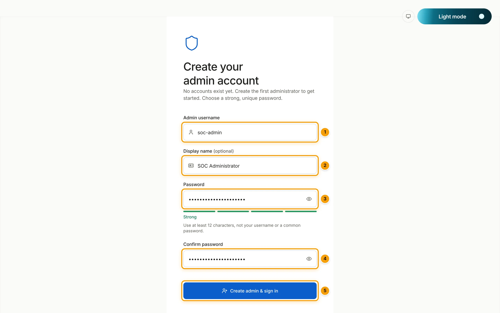 ](../assets/screenshots/install-01-create-admin.webp)
<figcaption>Create your admin account, on a fresh install.</figcaption>
</figure>

1. In **Admin username** (badge 1), choose the administrator's sign-in name, for
   example `soc-admin`. Use a different name from any environment administrator.
2. In **Display name (optional)** (badge 2), enter the name the Console shows, for
   example `SOC Administrator`.
3. In **Password** (badge 3), enter a strong, unique password. The policy line reads
   "Use at least 12 characters, not your username or a common password.", and the
   meter below the field rates the password.
4. In **Confirm password** (badge 4), repeat it. A mismatch shows "Passwords do not
   match."
5. Select **Create admin & sign in** (badge 5). The button stays disabled until the form
   is valid. The account is created as a `super_admin` and you are signed in.

The server checks the same password policy and writes the audit record before it
creates the account.

Next, the Console may offer **Secure your account**: an optional second factor for this
account. Select **Turn on two-factor** to enroll an authenticator app now, or
**Skip for now & continue** to set it up later under
**Settings → Account → Security & two-factor**.

<figure markdown="span">
[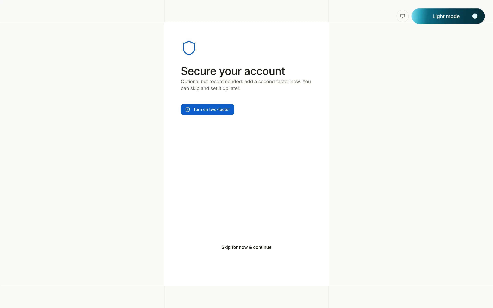 ](../assets/screenshots/install-01b-secure-account.webp)
<figcaption>The optional second-factor offer after the account is created.</figcaption>
</figure>

### Sign in later

The sign-in form has two steps. First enter the **Username** (badge 1) and select
**Continue** (badge 2); the button appears once you type a username.

<figure markdown="span">
[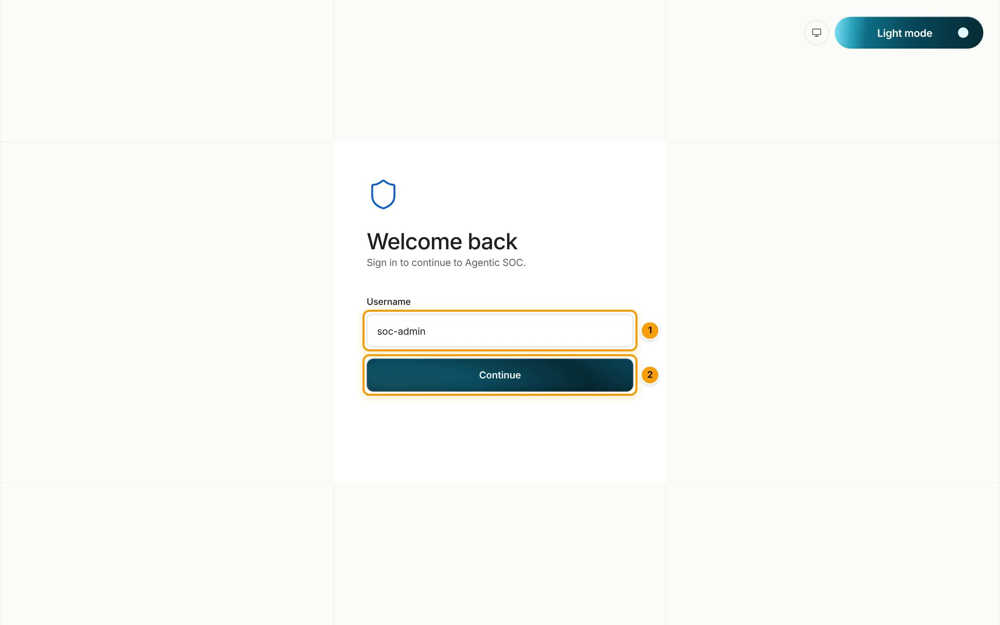 ](../assets/screenshots/install-02a-sign-in-username.webp)
<figcaption>Sign-in, step 1: the username.</figcaption>
</figure>

Then enter the **Password** (badge 1). **Remember me** (badge 2) keeps this browser
signed in for a server-bounded time, up to 24 hours, and asks you to confirm first;
leave it clear on a shared computer. Select **Sign in** (badge 3). **Back** returns to
the username step.

<figure markdown="span">
[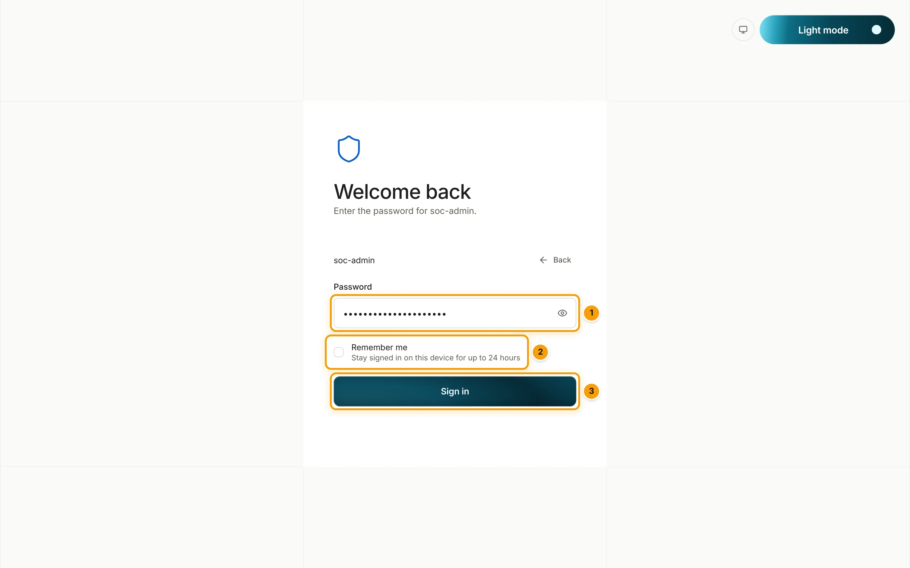 ](../assets/screenshots/install-02-sign-in.webp)
<figcaption>Sign-in, step 2: the password and Remember me.</figcaption>
</figure>

!!! note "Remember me over plain HTTP"

    This screenshot was captured on a direct local connection. On the Compose stack over
    plain HTTP, **Remember me** is greyed out and reads "Available when the console is
    served over HTTPS". It becomes available once the Console is behind TLS and
    `TLSOC_AUTH_COOKIE_SECURE=true`.

When the backend seeded the demonstration administrator, the sign-in page shows a hint
with `Admin` / `Admin@123`. Sign in, change that password at once, and create named
accounts.

## 2. Workspace

Choose one starting mode:

- **Live environment** connects your own security systems and AI provider. Polling
  and processing begin after setup is launched.
- **Synthetic demo** seeds isolated sample cases, metrics, and activity and uses the
  deterministic `$0` mock runtime. It never calls a configured live provider and is
  not a connection test for a real source.

Demo data and the mock runtime make the next two stages optional. Demo Mode is
reversible and can be removed later.

<figure markdown="span">
[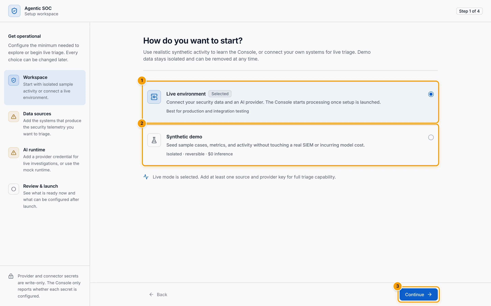 ](../assets/screenshots/install-03-setup-workspace.webp)
<figcaption>Step 1 of 4: Workspace.</figcaption>
</figure>

The wizard rail on the left lists the four stages. Each stage shows a check when it is
ready, an amber triangle when it needs attention, and a circle when it is not started.
On a fresh install **Live environment** (badge 1) is already selected. Select
**Synthetic demo** (badge 2) instead for an isolated evaluation, then select
**Continue** (badge 3).

## 3. Data sources

The source editor is driven by connector manifests. It renders the connection,
authentication, feed, and mapping fields supported by the selected connector.

1. Choose an implemented connector from the [support matrix](../sources/support-matrix.md).
2. Give the source a recognizable display name. The Console derives the source ID from
   it when you first save, and the ID then stays fixed.
3. Configure the transport and non-secret fields.
4. For a pull source, use a credential restricted to read and index-metadata access
   on the intended patterns. Never use a superuser or service-system account.
5. Configure one narrow feed first.
6. Use **Test connection** for Elasticsearch, OpenSearch, or Wazuh. The test uses
   the current draft without saving it.
7. Save a push receiver, send a synthetic event, and inspect source health instead;
   push and broker receivers do not have a meaningful one-shot connection test.

Secret values are not returned to the console. The source record stores only which
secret field names are configured. If the source editor is open and you try to move
to another setup stage or close a re-run, Agentic SOC asks before discarding that
draft.

### Walkthrough: an Elasticsearch source

These screenshots add an Elasticsearch / ELK pull source. Other connectors show their
own fields in the same editor.

Select **Add your first source**. The connector picker opens. Type in
**Search connectors…** (badge 1) to filter the 19 connectors, which are grouped as SIEM
and log stores, transports and receivers, queues and brokers, object stores, and files.
Select the **Elasticsearch / ELK** card (badge 2). Each card's **?** button explains the
connector.

<figure markdown="span">
[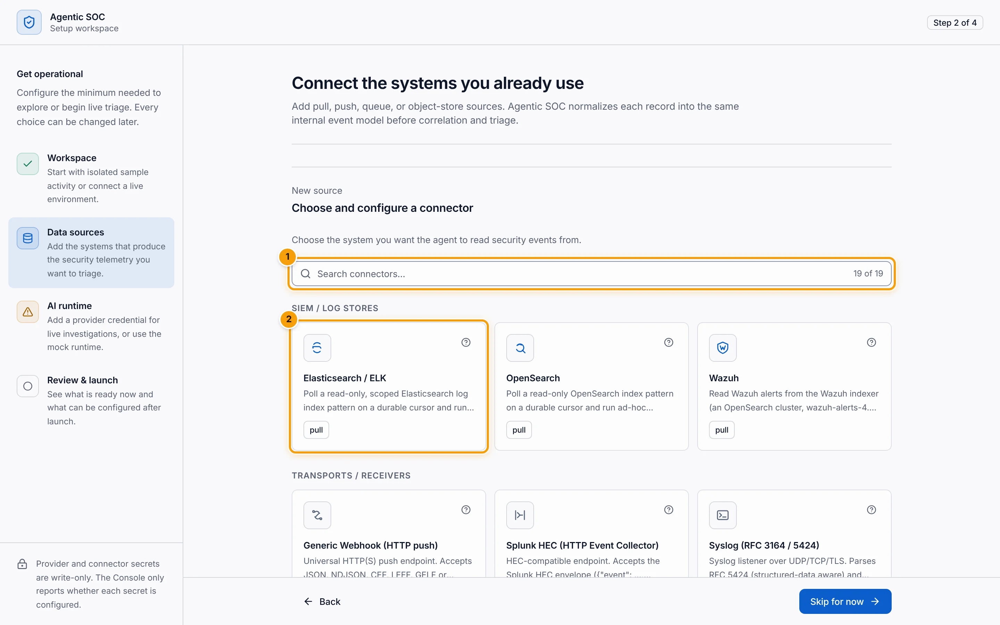 ](../assets/screenshots/install-04a-choose-connector.webp)
<figcaption>Choose and configure a connector.</figcaption>
</figure>

The editor opens on the chosen connector (badge 1); **Choose a different connector**
goes back to the picker, and **How to add Elasticsearch / ELK** expands a short guide.
Fill in the top of the form:

1. **Display name** (badge 2): a friendly name shown across the Console, for example
   `Production SIEM`. Leave **Enabled**, **Primary (the agent reads from this)**, and
   **Auto-Correlate** on for the first source.
2. **Elasticsearch URL** (badge 3, required): the base URL of the Elasticsearch HTTP
   API. On the Compose network use the container name, for example
   `https://elasticsearch:9200`.
3. **API key (read-only)** (badge 4): a read-only key scoped to the log index pattern
   only, never `kibana_system` or the `elastic` superuser. It is stored in the secret
   store and afterwards shown only as configured.
4. **CA certificate (PEM)**: paste a private CA certificate, select a `.pem` or `.crt`
   file, or give a path mounted into the container such as `/certs/ca/ca.crt`. Leave it
   blank for a public CA.

<figure markdown="span">
[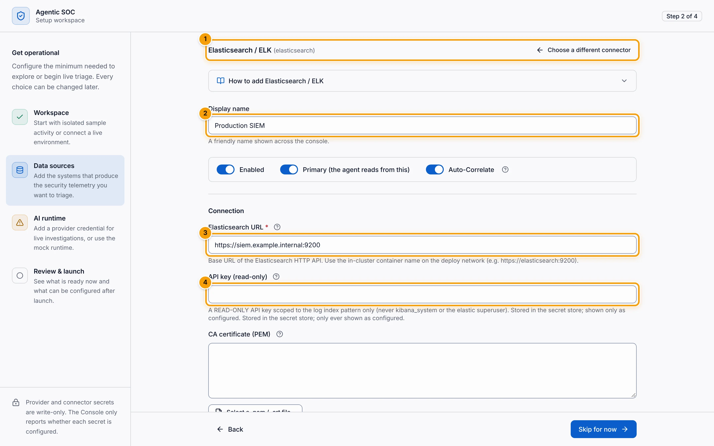 ](../assets/screenshots/install-04-setup-sources.webp)
<figcaption>The top of the Elasticsearch / ELK source editor. The URL is an example.</figcaption>
</figure>

Scroll down to the connection's TLS switch and the field mapping:

1. **Verify TLS certificates** (badge 1): keep it on. Disable it only for a throwaway
   lab with self-signed certificates.
2. **Log index pattern** (badge 2, required): the index pattern or data view the agent
   reads, for example `all-logs-*`. Comma-separated patterns are allowed.
3. Check the mapped fields: **Timestamp field** (`@timestamp`, which drives the durable
   cursor), **Source IP field** (`source.ip`), **User field** (`user.name`),
   **Host field** (`host.name`), and **Rule / module field** (`event.module`).

<figure markdown="span">
[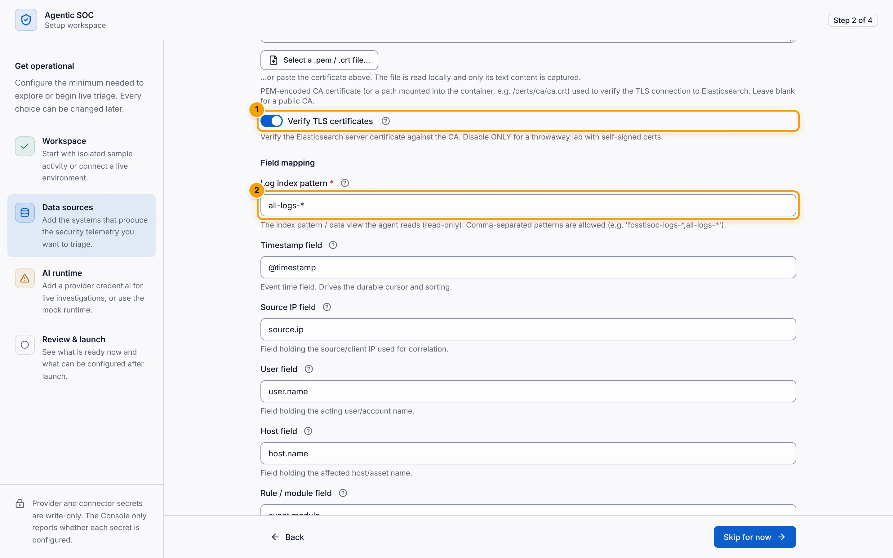 ](../assets/screenshots/install-04b-source-index-pattern.webp)
<figcaption>TLS verification and the field mapping.</figcaption>
</figure>

!!! tip "Type the index pattern yourself"

    The **Log index pattern** field shows a default such as `all-logs-*`, but the editor
    does not count that default as an entry until you edit the field. If **Add source**
    reports "Please complete required fields: Log index pattern" while the field shows a
    value, clear the field and type your pattern. The OpenSearch and Wazuh index pattern
    fields behave the same way.

At the bottom of the editor, the **Feeds** block sets each feed's pattern, role (Events,
Alerts, or Ignore), optional feed query, and poll schedule; **Correlation** sets the
entity strategy, and **Display** sets the message field. The defaults suit a first
source. Then:

1. Select **Test connection** (badge 1) to test the draft without saving it.
2. Select **Add source** (badge 2) to save it. Only the URL and the index pattern are
   required to save; you can add the API key later.

<figure markdown="span">
[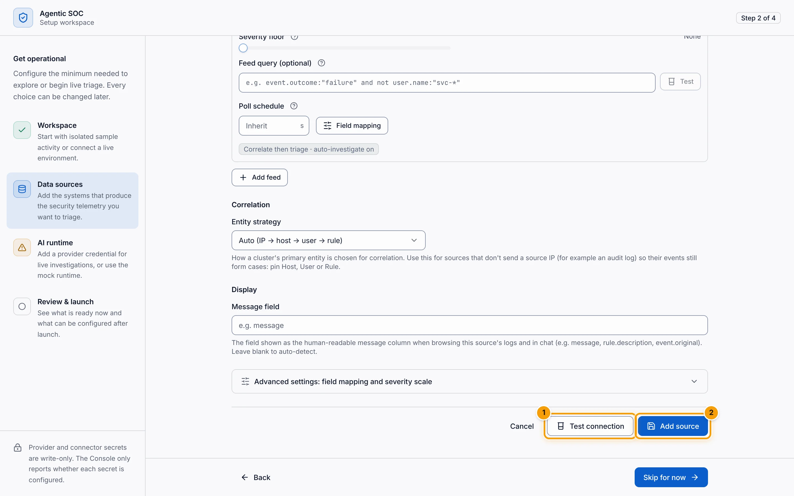 ](../assets/screenshots/install-04c-source-save.webp)
<figcaption>Test the draft, then save the source.</figcaption>
</figure>

The stage now lists the saved source (badge 1) with its **Primary** badge, its connector
and mode (`Elasticsearch · Pull`), and **Edit** and **Remove**. Another pull source can
be made primary with **Make primary**. The footer button reads **Skip for now** until a
source is enabled, and **Continue** (badge 2) afterwards.

<figure markdown="span">
[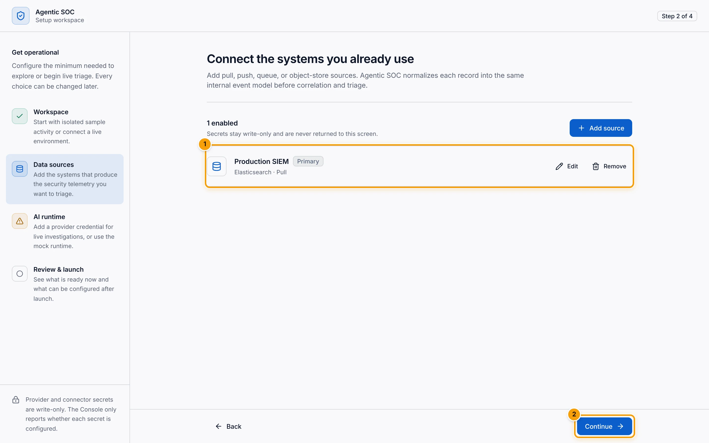 ](../assets/screenshots/install-04d-source-saved.webp)
<figcaption>One enabled source, ready to continue.</figcaption>
</figure>

## 4. AI runtime

Add an OpenAI key for the fresh-install GPT-5.6 Luna completion defaults, or add an
alternate provider key and change the role assignments in Settings. Provider keys are
**write-only**: the console reports only whether one is configured and never returns
its value. A blank field leaves an existing key unchanged. A newly typed key saves
automatically when you leave this stage, including Back, a progress-stage link,
Continue, or a setup re-run's Close action. If the write fails, setup stays on the
AI runtime stage so you can retry.

<figure markdown="span">
[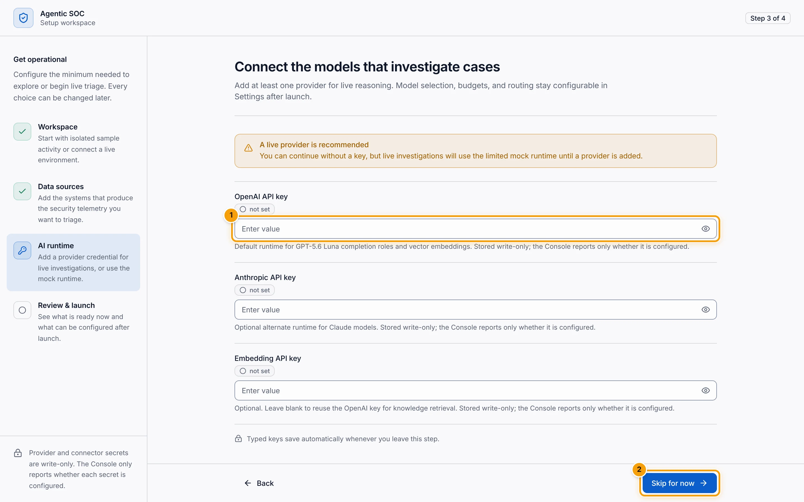 ](../assets/screenshots/install-05-setup-ai-runtime.webp)
<figcaption>Step 3 of 4: AI runtime, before any key is entered.</figcaption>
</figure>

The stage has three fields, each marked **not set** until a key is configured:

- **OpenAI API key** (badge 1): the default runtime for GPT-5.6 Luna completion roles
  and vector embeddings.
- **Anthropic API key**: an optional alternate runtime for Claude models.
- **Embedding API key**: optional. Leave it blank to reuse the OpenAI key for knowledge
  retrieval.

Without a key the stage warns "A live provider is recommended": live investigations
then use the limited mock runtime until a provider is added. The footer button reads
**Skip for now** (badge 2) when no key is typed or configured, and **Continue**
otherwise.

Fresh workspaces assign `gpt-5.6-luna` to router, investigator, formatter, standup,
chat, and overview; embeddings remain on `text-embedding-3-small`. Existing stored
assignments are never rewritten. Per-role model selection is under
**Settings → General → Models**; providers, self-hosted OpenAI-compatible endpoints and
budgets are on **Analytics → Models**. In Demo Mode, the deterministic mock runtime is
already available, so a live key is optional.

Every provider call passes through the shared cost ledger. The default daily budget
is a preflight ceiling, not a provider-side billing limit; configure provider-side
budgets as a second boundary. Workspace and Case Manager chat are metered in the same
ledger but sit outside the daily and monthly AI budget; their only bound is an optional
chat-only daily cap, off by default.

## 5. Review & launch

The final stage reports each item as **Ready**, **Needs attention**, or **Optional**.
It distinguishes these outcomes instead of claiming every configuration is complete:

- **Demo workspace is ready** when Synthetic demo is active;
- **Ready for live triage** when a live source and provider are configured; or
- **Ready with limited capabilities** when live telemetry or a live provider is
  missing.

<figure markdown="span">
[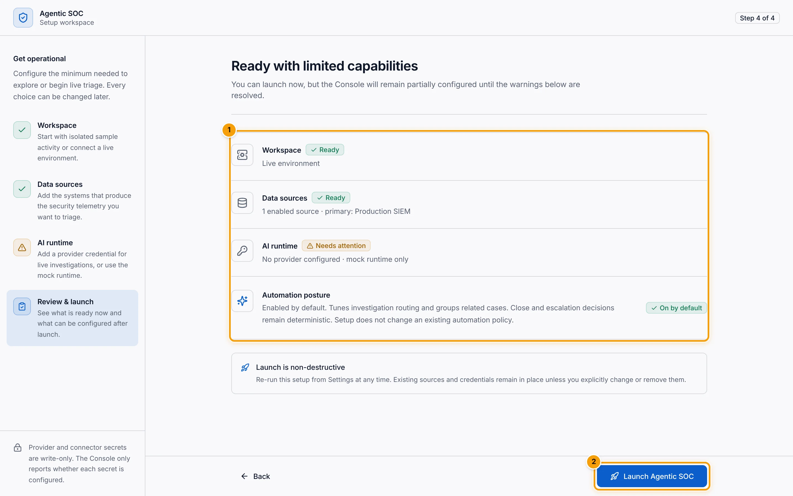 ](../assets/screenshots/install-06-setup-review.webp)
<figcaption>Step 4 of 4: Review & launch, with a source and no provider.</figcaption>
</figure>

The readiness summary (badge 1) has one row per item. In the screenshot,
**Data sources** reads "1 enabled source · primary: Production SIEM" and **AI runtime**
reads "No provider configured · mock runtime only", so the heading is
**Ready with limited capabilities**. With no source, **Data sources** reads
"No source configured · live telemetry will not be ingested".

The **Automation posture** row explains that adaptive investigation routing and
related-case grouping are on by default. Detailed controls remain in **Settings**.
This posture does not change the deterministic close/escalate authority.

Select **Launch Agentic SOC** (badge 2) on first run. This calls `POST /api/setup/complete`,
starts enabled pull polling, and reconciles enabled background receivers. If a
completion response is lost, the console checks the authoritative setup status
before showing a failure so a successful launch does not strand you in setup.

Administrators can re-run the same workflow from **Settings**. The final action is
then **Apply changes**, and **Close** returns without marking setup incomplete.
Existing sources and credentials remain in place unless you explicitly change or
remove them.

If `GET /api/setup/status` cannot be read, the console fails closed: it shows
**Can't verify setup state** with **Retry** instead of opening an operational page
whose setup state is unknown.

## Verify setup

After launch the Console opens the **Cyber Defence Center**. Until cases arrive it shows
**No triage activity yet**, with **Connect a source** and **Start live demo**.

<figure markdown="span">
[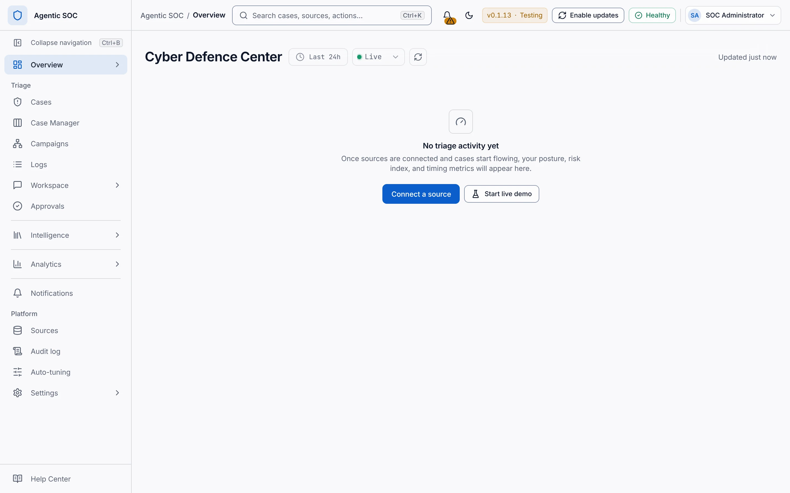 ](../assets/screenshots/install-07-after-launch.webp)
<figcaption>The first screen after launch on a fresh live workspace.</figcaption>
</figure>

After the workspace opens:

- **Sources** lists the new source and its enabled state;
- source coverage or health shows a successful poll or recent event;
- **Logs** shows the expected normalized fields;
- **Cost** is zero until a model-backed action runs; and
- **Audit log** records later state-changing actions.

!!! warning "Do not widen scope yet"

    Validate timestamp, native ID, rule, severity, user, host, address, and source
    provenance with synthetic data before adding broad event patterns. Mapping
    mistakes at this stage can create misleading correlations and cases.

## Next steps

- [Create your first case](first-case.md)
- [Understand feeds and mapping](../sources/feeds-mapping.md)
- [Understand deterministic decisions](../concepts/deterministic-decisions.md)
