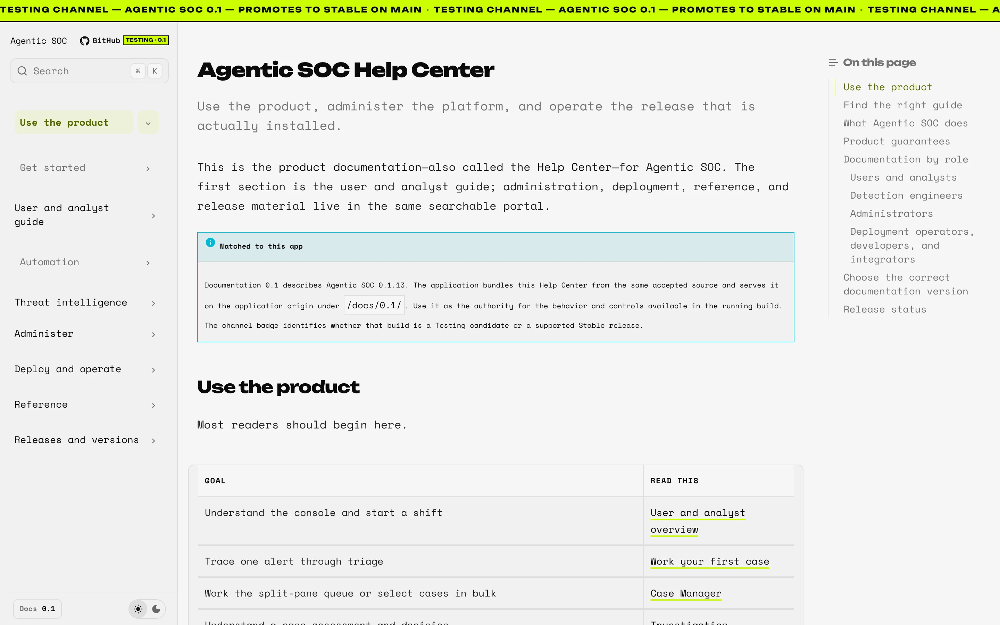

# Install Agentic SOC

This guide applies to **Agentic SOC 0.1** and is for operators installing the recommended
self-contained evaluation stack. It runs PostgreSQL with pgvector, Redis, the Agentic SOC
API, and the nginx-served Agentic SOC Console. Your SIEM or event source remains separate
and read-only.

The install takes six steps: check out the source, prepare `.env`, start the stack, verify
the health checks, open the Console, and (when you are done) stop the stack. First-run
setup in the Console follows in [First-run setup](first-run.md).

## What the stack contains

`deploy/docker-compose.agnostic.yml` starts five containers on one Docker host. Only
ports `8080` (the Console) and `8088` (the API) are published to the host. Select the
diagram to open it full size.

<figure markdown="span">
[![Agentic SOC reference Compose deployment on one Docker host: a browser reaches tlsoc-webui (nginx) on published port 8080, which proxies /api to tlsoc-backend on port 8088 (also published for API clients and push senders). The backend uses tlsoc-postgres with the tlsoc-pgdata volume and tlsoc-redis, neither published, and connects out read-only to security sources, model providers and enrichment. The agentic-soc-updater supervisor alone mounts the Docker socket, talks to the backend over a private control.sock volume, and fetches signed releases only for an approved update.](../assets/architecture/deployment-light.svg#only-light) ](../assets/architecture/deployment-light.svg)
[![Agentic SOC reference Compose deployment on one Docker host: a browser reaches tlsoc-webui (nginx) on published port 8080, which proxies /api to tlsoc-backend on port 8088 (also published for API clients and push senders). The backend uses tlsoc-postgres with the tlsoc-pgdata volume and tlsoc-redis, neither published, and connects out read-only to security sources, model providers and enrichment. The agentic-soc-updater supervisor alone mounts the Docker socket, talks to the backend over a private control.sock volume, and fetches signed releases only for an approved update.](../assets/architecture/deployment-dark.svg#only-dark) ](../assets/architecture/deployment-dark.svg)
<figcaption>The reference Compose deployment.</figcaption>
</figure>

| Container | What it does |
| --- | --- |
| `tlsoc-webui` | nginx serves the Console and the bundled Help Center on port `8080` and proxies `/api/` to the backend. |
| `tlsoc-backend` | The FastAPI application: API, connectors, receivers, engines, and agents. It is also published on port `8088` for API clients and HTTP push senders. |
| `tlsoc-postgres` | PostgreSQL with pgvector. It holds all application state on the named volume `tlsoc-pgdata`. Not published. |
| `tlsoc-redis` | The enrichment and deduplication cache, with no persistence. Not published. |
| `agentic-soc-updater` | The private update supervisor. It is the only container that mounts the Docker socket, and it applies only signed releases that an administrator approves. |

Receiver ports such as syslog `1514` bind inside the backend container. Publish only the
ones you configure. The container names keep their compatibility identifiers.

## Prerequisites

- Docker Engine or Docker Desktop
- Docker Compose v2 (`docker compose`, not the legacy `docker-compose`)
- Git, Bash, and Python 3 on the host: `scripts/agentic-soc-compose.sh` uses Bash and
  Python 3
- outbound network access for the image builds (base images and the Python and npm
  package registries) and for your model provider
- enough local capacity for five containers, three local image builds, and the state
  volume
- an Anthropic or OpenAI key, or a reachable OpenAI-compatible model, for real
  investigations
- a least-privilege credential if you plan to add a pull source

The deterministic demo does not require a provider key. See [Run the demo](demo.md)
when infrastructure and external model calls are not part of your evaluation.

## 1. Check out version 0.1

After its complete signed publication and canonical runtime acceptance succeed, use
the immutable `v0.1.13` Stable tag. Use `Testing` only for an explicitly unreleased
evaluation.

=== "Stable 0.1.13 (after acceptance)"

    ```bash
    git clone https://github.com/ARYDESTROYER/Kavach-AgenticSOC.git
    cd Kavach-AgenticSOC
    git checkout v0.1.13
    ```

=== "Testing (unreleased preview)"

    ```bash
    git clone --branch Testing https://github.com/ARYDESTROYER/Kavach-AgenticSOC.git
    cd Kavach-AgenticSOC
    ```

Keep a full clone (no `--depth 1`). The one-time updater bootstrap
(`scripts/bootstrap-updater.sh`) checks that the release tag's commit is contained in
`origin/main`, which a shallow single-branch clone does not have.

The remote uses default `main` for accepted Stable source. Pulling `main` gives you the
current accepted Stable source, not the next Testing candidate. Repository protections
and required checks must still be verified independently. Do not create or move a
release tag locally.

Use `v0.1.13` only when its canonical GitHub Release, plan signature, public image
digests, and canonical PostgreSQL Compose runtime acceptance all verify. Otherwise use a
previously verified Stable release, or Testing only for an explicitly unreleased
evaluation.

??? note "Tags that are not installation sources (v0.1.4 to v0.1.12)"

    These immutable tags are publication records. They must never be used as
    installation sources.

    - `v0.1.4` and `v0.1.5`: their publication attempts stopped before a canonical
      signed plan and public GitHub Release existed.
    - `v0.1.6`, `v0.1.7`, and `v0.1.8`: these publications have signed, public
      artifacts but failed canonical bootstrap acceptance at different portability
      boundaries.
    - `v0.1.9`: the publication built, signed, and anonymously proved all three images,
      but its constrained supervisor could not traverse the runner-owned verification
      directory, and no GitHub Release or installable plan was published.
    - `v0.1.10`: the workflow timed out while its Web Console builder ran under target
      emulation. It has no installable GitHub Release or canonical signed plan.
    - `v0.1.11`: the workflow built, signed, anonymously proved, and verified all three
      images and the plan, but failed during post-verification cleanup before its
      canonical Release or assets were published.
    - `v0.1.12`: the release completed the entire signed, public publication, but
      canonical v0.1.1 bootstrap failed closed before application mutation because
      matching absent legacy state-schema labels were normalized asymmetrically.

??? note "What the 0.1.13 build changes"

    Version 0.1.13 retains the writable updater trust cache and least-privilege
    verification assets, and moves only architecture-neutral Console builder work to
    BuildKit's native platform. The final nginx runtime remains target-platform-specific.
    It also restores the runner-owned verification fixture to private mode only after
    verifier exit. It changes no schema, protocol, identity, privilege, trust predicate,
    or frozen-base bytes.

## 2. Prepare configuration

Run every command in this guide from the repository root.

```bash
cp .env.example .env
```

At minimum, set a database password and stable authentication secret. Enable the
built-in authentication layer for any shared evaluation:

```dotenv
TLSOC_PG_PASSWORD=<random-database-password>
TLSOC_AUTH_ENABLED=true
TLSOC_AUTH_JWT_SECRET=<stable-random-secret-at-least-32-bytes>

# Optional: an environment fallback administrator (see "Choose how the first
# administrator is created" below).
TLSOC_AUTH_ADMIN_USERNAME=admin
TLSOC_AUTH_ADMIN_PASSWORD=

# Choose one for non-demo investigations, or configure a compatible local model:
TLSOC_ANTHROPIC_API_KEY=
TLSOC_OPENAI_API_KEY=
```

Generate random values with `openssl rand -hex 32`. Never commit `.env`.

What each variable does:

- `TLSOC_PG_PASSWORD`: always required. The PostgreSQL password; Compose refuses to
  start without it.
- `TLSOC_AUTH_ENABLED`: set `true` for any shared evaluation. Turns on sign-in, roles,
  MFA, SSO, and sessions. The `.env.example` default is `false`.
- `TLSOC_AUTH_JWT_SECRET`: needed with authentication. The session signing key, 32
  bytes or more. Keep it stable: when it is blank, every session ends on each backend
  restart.
- `TLSOC_AUTH_ADMIN_USERNAME`: optional. The username of an environment fallback
  `super_admin`.
- `TLSOC_AUTH_ADMIN_PASSWORD`: optional. That administrator's password, hashed in
  memory at startup and never stored.
- `TLSOC_OPENAI_API_KEY`: recommended. The provider for the fresh-install GPT-5.6 Luna
  role defaults and embeddings.
- `TLSOC_ANTHROPIC_API_KEY`: optional. An alternate provider. Change the role
  assignments in **Settings → General → Models** to use it.
- `TLSOC_AUTH_COOKIE_SECURE`: set `true` when TLS terminates in front of the Console,
  so the session cookie is HTTPS-only.

Leave `AGENTIC_SOC_UPDATE_REPOSITORY` at the value `.env.example` ships unless you
publish signed releases from your own fork. It names the repository whose signed
releases the update supervisor trusts, which is a separate identity from the clone URL.

### Choose how the first administrator is created

With authentication turned on (`TLSOC_AUTH_ENABLED=true`) and an empty user store, the
first screen at `http://localhost:8080` depends on the administrator password
(`TLSOC_AUTH_ADMIN_PASSWORD`) in `.env`:

| Administrator password | First screen |
| --- | --- |
| Set | **Create your admin account**. You create a named administrator in the browser. The environment administrator also works as a fallback sign-in. |
| Blank | The sign-in screen. The backend seeds the demonstration administrator `Admin` / `Admin@123`, and the sign-in page shows a hint with those credentials. Change that password immediately. |
| Authentication off | No sign-in. The setup wizard opens directly. Use this only on an isolated workstation. |

For a shared deployment, set `TLSOC_AUTH_ADMIN_PASSWORD` to a unique value so the
demonstration account is never created, and choose a different username for your named
administrator. This needs no change to the Compose file, whose exact hash supervised
updates check. For other bootstrap options, see
[Authentication](../administration/authentication.md).

!!! warning "Secrets entered later in the UI"

    In Agentic SOC 0.1, runtime-entered source, notification, SSO, and local-model secret
    values live in process memory. They must be re-entered after a backend restart.
    Environment or an external deployment secret mechanism is the durable boot-time
    path.

## 3. Validate and start

```bash
./scripts/agentic-soc-compose.sh config --quiet
./scripts/agentic-soc-compose.sh up --detach --build
./scripts/agentic-soc-compose.sh ps
```

What to expect:

1. `config --quiet` prints nothing when the Compose file and `.env` are valid. A
   missing `TLSOC_PG_PASSWORD` stops it with an error that names that variable.
2. `up --detach --build` builds three local images (the backend, the Console with its
   Help Center, and the update supervisor) and starts the stack. The first build
   downloads base images and packages, so it takes longer than later starts.
3. `ps` lists `tlsoc-postgres`, `tlsoc-redis`, `tlsoc-backend`, `tlsoc-webui`, and
   `agentic-soc-updater`. The Console container starts only after the backend reports
   healthy.

Open `http://localhost:8080` for a workstation evaluation. Terminate TLS at a trusted
ingress and set secure cookies before exposing the deployment beyond a trusted
network.

## 4. Verify the API

```bash
curl --fail http://localhost:8080/api/health/live
curl --fail http://localhost:8080/api/health/ready
curl --fail http://localhost:8080/api/health/build-info
```

- **Live** confirms the API process is running.
- **Ready** confirms the configured application-state store can serve requests. An
  unavailable dependency returns HTTP `503`.
- **Build info** reports the product version and build metadata without secrets.

??? example "Sample responses"

    These responses come from a local source-run demo backend (`./scripts/run-demo.sh`,
    queried directly on port `8088`), which keeps its state in memory. Each is
    pretty-printed with `python3 -m json.tool`:

    ```text
    $ curl -s http://127.0.0.1:8088/api/health/live | python3 -m json.tool
    {
        "status": "ok",
        "service": "tlsoc-agentic-triage",
        "version": "0.1.13"
    }

    $ curl -s http://127.0.0.1:8088/api/health/ready | python3 -m json.tool
    {
        "status": "ready",
        "ready": true,
        "version": "0.1.13",
        "store_type": "InMemoryESClient",
        "checks": {
            "state_store": true
        }
    }

    $ curl -s http://127.0.0.1:8088/api/health/build-info | python3 -m json.tool
    {
        "service": "tlsoc-agentic-triage",
        "version": "0.1.13",
        "release_channel": "testing",
        "commit_sha": "4cb849a9092d115845000b64efa388e3864964d7",
        "build_time": "2026-11-11T22:34:11+05:30",
        "state_backend": "elasticsearch",
        "ocsf_version": "1.4.0",
        "provenance_complete": true,
        "provenance_missing": [],
        "provenance_advisories": []
    }
    ```

    On the reference Compose stack, readiness reports `"store_type": "PostgresStateStore"`
    and build info reports `"state_backend": "postgres"`, with your own commit and build
    time. `"service": "tlsoc-agentic-triage"` is a compatibility identifier.

Open **Help Center** from the bottom of the Console rail and confirm the browser
stays on this deployment at `/docs/0.1/`. That bundled Help Center matches the
installed application and remains usable without access to GitHub or the public docs
site.

<figure markdown="span">
[ ](../assets/screenshots/help-center.webp)
<figcaption>The bundled Help Center, served by the Console at /docs/0.1/.</figcaption>
</figure>

If readiness fails, inspect the backend service logs and use the
[troubleshooting guide](../operations/troubleshooting.md):

```bash
./scripts/agentic-soc-compose.sh logs tlsoc-backend
```

## 5. Open the Console

Open `http://localhost:8080`. The first screen is the one your `.env` selected in
[Choose how the first administrator is created](#choose-how-the-first-administrator-is-created).
Create or sign in as the administrator, then complete the four-stage setup wizard:
**Workspace**, **Data sources**, **AI runtime**, and **Review & launch**.
[First-run setup](first-run.md) walks through every screen.

A fresh install opens the Console in the dark theme, the organization default. Each user
can change it under **Settings → Account → Appearance**.

The header may show **Enable updates** until the update supervisor's one-time host setup
is done. See [Upgrades](../operations/upgrades.md).

## 6. Stop the stack

```bash
./scripts/agentic-soc-compose.sh down
```

The named PostgreSQL volume remains. Adding `--volumes` removes application state
and is destructive.

## Common install problems

| Symptom | What to check |
| --- | --- |
| `config` fails and names `TLSOC_PG_PASSWORD` | Set `TLSOC_PG_PASSWORD` in `.env`. |
| The wrapper says `.env` is missing | Run `cp .env.example .env` in the repository root. |
| `/api/health/ready` returns HTTP `503` | The application-state store is not usable. Check `tlsoc-postgres` with `ps` and read the backend logs. |
| The Console shows **Can't verify setup state** | The Console could not read the setup status. Select **Retry** once the backend is ready. |
| Every sign-in ends when the backend restarts | Set a stable `TLSOC_AUTH_JWT_SECRET` and start the stack again. |

## Next steps

- [Complete first-run setup](first-run.md)
- [Create your first case](first-case.md)
- [Choose a source](../sources/support-matrix.md)
- [Harden the deployment](../operations/security.md)
