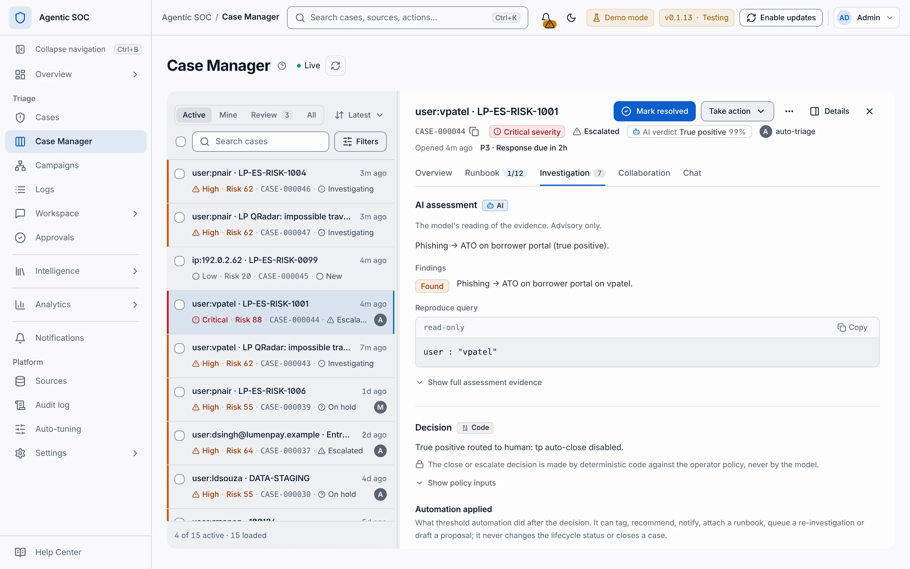
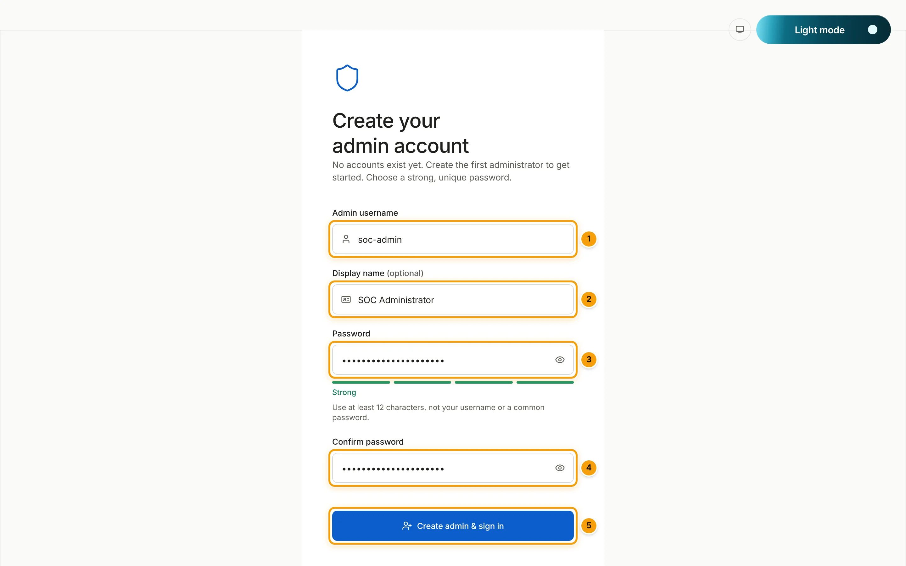
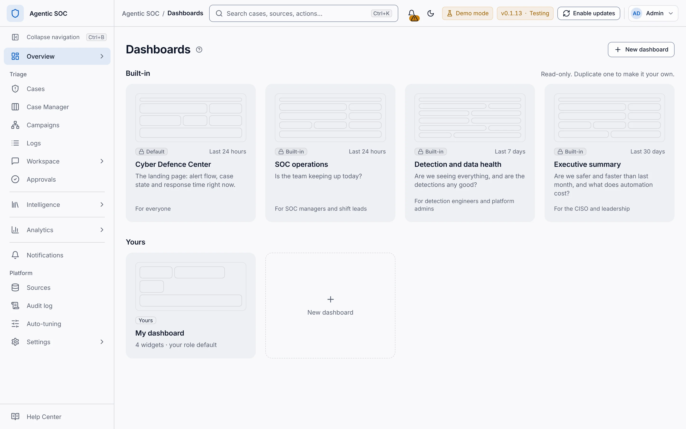
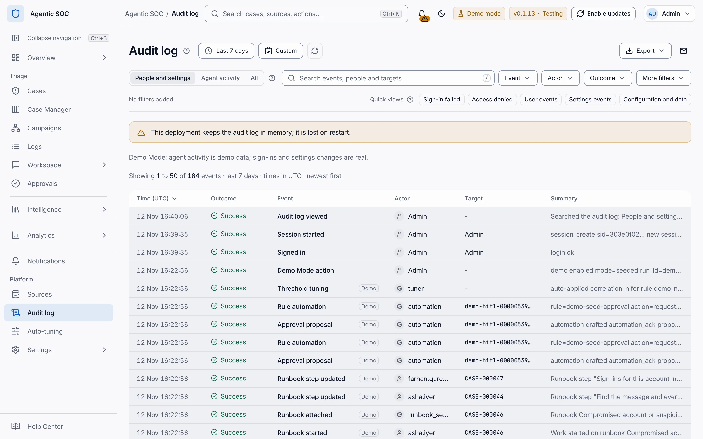
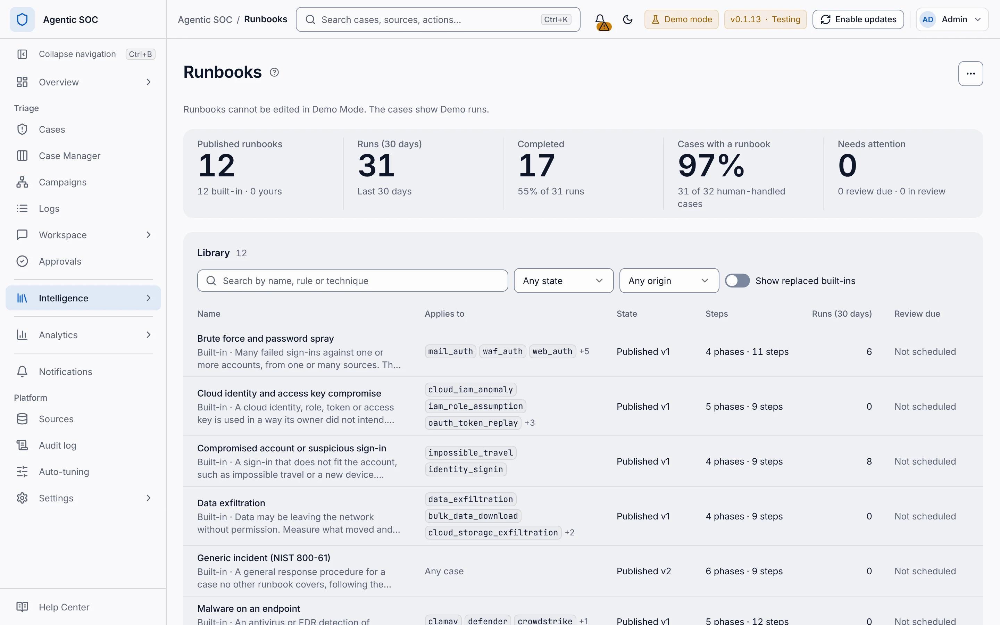
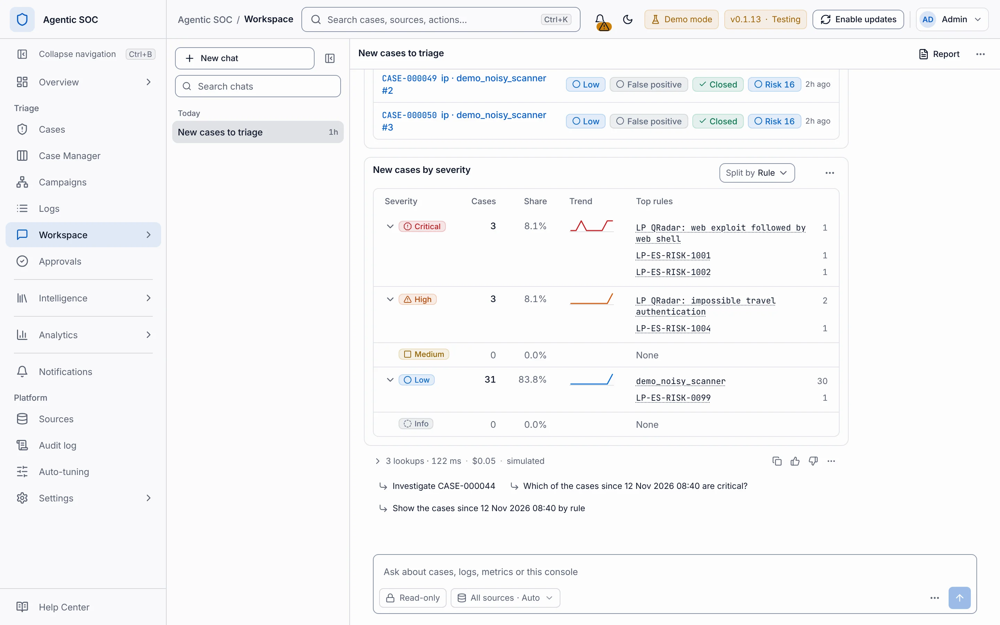
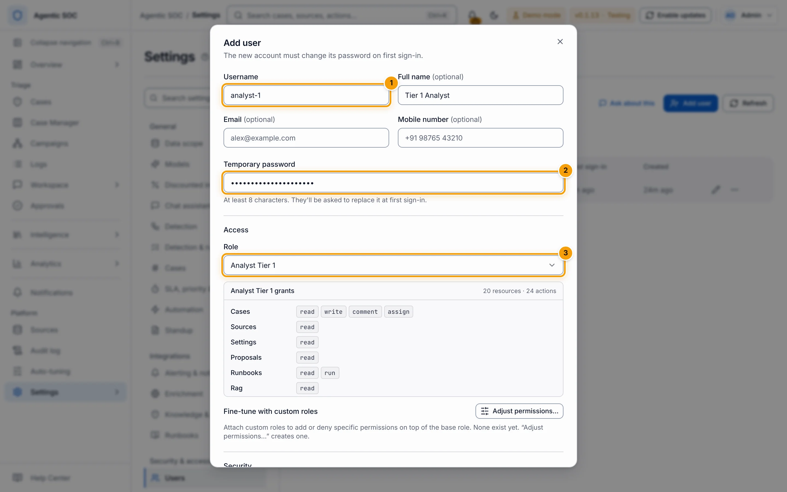

<!-- Generated by scripts/build_release_notes.py from docs/releases/notes/. Edit the
     notes there and run the script; never edit this page by hand. -->

# What's new

Every Agentic SOC release with its highlights, newest first. The same notes ship
with the Console: open **Communication → What's new**. After a release is
installed, the Console shows a short welcome once you sign in. Turn it off with
**Show What's new after updates** in **Settings → Account → Appearance**. With
sign-in turned off, everyone shares one set of preferences, so the welcome shows
once per installation.

Each release record holds the full notes and the known limits of that release.

## Agentic SOC 0.2.0

Testing candidate, not yet released. Visible AI work, explainable numbers and a clearer Case Manager. Everything since 0.1.1 in one release, under a new repository identity and the Apache-2.0 license.

Read the [Agentic SOC 0.2.0 release record](0.2.0.md).

What changed in this version, newest first.

### Not yet released

Visible AI work, explainable numbers and a clearer Case Manager.

- **See when the AI is working on a case** (New, Cases). The queue, the case header, the navigation and the close dialogs show when an AI investigation is running or waiting. [Read more](../analyst/case-manager.md).
    - The case header shows **AI working** with the time so far, or **AI queued**. Its popover says who started the run.
    - The Case Manager item in the navigation counts the cases the AI is working on.
    - The run's result stays authoritative. A close made while it runs is replaced by its result, and the close dialogs say so before you act.
    - When a run you started finishes, or a run replaces your close, your Inbox tells you.

<figure markdown="span">

<figcaption>The AI working chip and its popover.</figcaption>
</figure>

- **A clearer Case Manager** (Improved, Cases). Each part of a case has one place. The header takes two lines, the case facts sit in their own column, and the queue folds away when you need the width. [Read more](../analyst/case-manager.md#read-the-workspace).
    - The header's second line keeps the case number, severity, status, risk, AI verdict, owner and SLA on one line.
    - Press **]** to show or hide the case facts. In a narrow pane they open in a side sheet.
    - Press **[** to fold the queue into a narrow strip. J and K still move through the cases.
    - The Brief opens with the case's next step and four lanes: Evidence, AI, Decision and People.

<figure markdown="span">

<figcaption>The Case Manager in this update.</figcaption>
</figure>

- **A new repository identity for updates** (Improved, Administration). Signed updates now come from ARYDESTROYER/Kavach-AgenticSOC. Set it in .env before you bootstrap the updater. [Read more](../operations/upgrades.md#the-repository-was-renamed).
    - Add `AGENTIC_SOC_UPDATE_REPOSITORY=ARYDESTROYER/Kavach-AgenticSOC` to .env, with that exact letter case.
    - The bootstrap refuses a missing line or the former name, prints the line to add, and never edits .env.
    - Releases 0.1.12 and earlier stay valid under the former name. The public Help Center moved to the new Pages address.

<figure markdown="span">

<figcaption>The new repository identity in Settings.</figcaption>
</figure>

- **Case tabs in a new order** (Improved, Cases). Six tabs: Brief, Evidence, AI investigation, Response, Activity and Chat. Alt+2, Alt+4 and Alt+5 now open Evidence, Response and Activity, and Chat moves to Alt+6. [Read more](../analyst/case-manager.md#the-six-tabs).
    - Alt+1 to Alt+6 open the tabs in that order.
    - Before, Alt+2 opened Runbook, Alt+4 opened Collaboration and Alt+5 opened Chat.
    - A link to the retired Timeline or Threat context tab opens Evidence at the matching section.

<figure markdown="span">

<figcaption>The six case tabs, with the Brief open.</figcaption>
</figure>

- **Every number shows its math** (New, Cases). Hover a risk score, a decision or a dashboard figure for its formula with the real numbers. Press it for the inputs, the steps and the rounding. [Read more](../analyst/explainable-numbers.md).
    - On a case: the risk score, the close or escalate decision, the priority, the SLA and the AI cost.
    - On dashboards and Metrics: the KPI figures, with the cases behind them.
    - **Copy calculation** copies the whole arithmetic.
    - A case scored before this version keeps its stored factors. Where its inputs were not kept, the panel says they were not recorded.

<figure markdown="span">

<figcaption>The risk score with its math.</figcaption>
</figure>

- **What's new and Communication** (New, Help). This welcome appears once after each update. The Communication group holds Inbox and What's new, the release tracker.
    - Open **Communication**, then **What's new**, to read every release with its highlights and screenshots.
    - Turn the welcome off with **Show What's new after updates** in Settings, Account, Appearance.

<figure markdown="span">

<figcaption>The release tracker in Communication.</figcaption>
</figure>

- **A quieter sign-in page** (Improved, Security). The sign-in page uses the Console's own colours and moves once as it opens. The Remember me row shows only its name. [Read more](../getting-started/first-run.md#sign-in-later).
    - Checking **Remember me** opens a warning first. It says how long this device stays signed in.
    - When an administrator turned Remember me off, or the connection is not secure, the row stays visible and disabled, with the reason.
    - A single sign-on error shows a fixed sentence, never text from the address bar.

<figure markdown="span">

<figcaption>The sign-in page.</figcaption>
</figure>

- **Every case record within reach** (New, Cases). The Evidence tab lists the raw events behind a case. The case facts open every stored field and each AI call with its cost. [Read more](../analyst/case-manager.md#case-facts).
    - Open an event for every field as a table or as JSON, then copy or download it.
    - **View all fields** in the case facts shows every stored field of the case.
    - The cost in the case facts lists each AI call with its tokens and its cost formula.
    - Raw events need the `sources:read` permission. AI costs need `cost:view`.

<figure markdown="span">

</figure>

- **Access and account security fixes** (Security). Case reads, the settings read and Standup now check permissions, and account security is stricter. [Read more](../administration/authentication.md#sessions).
    - A role without the permission now gets an Access denied answer from these reads.
    - An account an administrator creates or resets must change its temporary password before anything else.
    - Ten wrong second-factor codes in a row pause second-factor checks for 5 minutes, doubling up to an hour.
    - Changing your own password signs out your other sessions. An administrator's reset signs the account out everywhere.
    - Only a Super admin with a fresh sign-in can change single sign-on settings.
    - Single sign-on no longer links an account created through another provider because the email matches.
- **Fixes across the application** (Fixed, Platform). Fixes from a full review of the application, in the AI pipeline, SLA timers, metrics, settings, Demo Mode and accessibility.
    - A case a person closed before an automatic AI run started stays closed.
    - The SLA response clock stops for a case the AI agent closed.
    - Settings refuses values that cannot work together, such as a response target longer than the resolution target.
    - In Demo Mode, a seeded case's cost has usage rows behind it, and its risk score matches its factors.
    - Focus, names and reflow work better with a keyboard, a screen reader and a phone.
- **Apache-2.0 license** (New, Platform). Agentic SOC is free software under the Apache License 2.0. [Read more](0.2.0.md#license).
    - The license text is in the repository and in each image.

### 25 November 2026

Team activity, case screenshots and a calmer Case Manager.

- **Team activity** (New, Administration). Per-person, per-day work counts from the audit log, for SOC managers and auditors. [Read more](../analyst/team-activity.md).
    - Counts come with their context. The page never ranks people or gives them a score.
    - A chart per day, a sheet for each person with their events, and a CSV download.

<figure markdown="span">

<figcaption>Team activity in the seeded Demo.</figcaption>
</figure>

- **Screenshots on cases** (New, Cases). Add PNG, JPEG or WebP screenshots to a case. Their metadata is removed and they are never sent to a model. [Read more](../analyst/collaboration.md).
    - Paste, drag and drop or pick a file, with an optional caption.
    - Up to 20 images per case, 2 MiB each and 20 MiB per case.

<figure markdown="span">

<figcaption>Screenshots on a case's Activity tab.</figcaption>
</figure>

- **A review of automatic closes** (New, Automation). About 5% of automatic closes are picked for a person to review, at most 10 a day and 3 per rule. [Read more](../automation/auto-close-review.md).
    - You classify the case before you see what the AI decided.
    - A review never changes the case unless you reopen it.
    - Reviews stay out of agent statistics. Agent effectiveness shows the agreement once 30 reviews exist.

<figure markdown="span">

<figcaption>A review of an automatic close.</figcaption>
</figure>

- **A calmer Case Manager** (Improved, Cases). One control band above the queue, two-line queue rows, and one primary action for the case's state beside Take action. [Read more](../analyst/case-manager.md).
    - The queue gains a Review scope with the number of reviews waiting.

<figure markdown="span">

<figcaption>The Case Manager in this update.</figcaption>
</figure>

- **A clearer close** (Improved, Cases). Closing a case asks for the disposition once and can record the actions taken. Rate the AI starts collapsed. [Read more](../analyst/case-manager.md#close-or-resolve-with-a-disposition).
    - A note is asked for only when your classification overrides the AI.

<figure markdown="span">

<figcaption>The close dialog.</figcaption>
</figure>

- **A switch for role-based access** (New, Administration). A Super admin turns role-based access on or off on Roles and permissions, after a fresh sign-in. [Read more](../administration/users-rbac.md).

<figure markdown="span">

<figcaption>The Role-based access group in this update.</figcaption>
</figure>

- **Truthful setup wording** (Improved, Administration). The setup wizard says Ready for live triage only when a source is connected and the investigation models can be called. [Read more](../getting-started/first-run.md).
    - Without a usable key it says so, and that new cases wait for a person.

<figure markdown="span">

<figcaption>The setup wizard's AI runtime stage in this update.</figcaption>
</figure>

- **Only a Super admin manages Super admin accounts** (Security). Giving an account the Super admin role, or changing one that has it, needs a Super admin with a recent sign-in. [Read more](../administration/users-rbac.md).
- **Reinvestigation keeps people's work** (Fixed, Cases). Rebuilding a case keeps its owner, comments, grades, history and a disposition an analyst set.

### 13 November 2026

A step-by-step install guide with real screenshots.

- **A step-by-step install guide** (New, Help). The Install and First-run setup pages walk through every step with real screenshots of each first-run screen. [Read more](../getting-started/install.md).
    - The repository's install guide covers five paths: a workstation demo, the Compose stack, production hardening, an existing Elastic stack and running from source.

<figure markdown="span">

<figcaption>One of the first-run screens the guide shows.</figcaption>
</figure>

- **Architecture diagrams** (New, Help). Light and dark diagrams show the system data flow and the Compose deployment. [Read more](../concepts/architecture.md).

### 11 November 2026

Steadier runbook guidance and audit log fixes.

- **The fallback runbook no longer guides the AI** (Fixed, Intelligence). The Generic incident fallback runbook is still attached for people, but it no longer guides the investigator. A specific runbook still does. [Read more](../intelligence/runbooks.md).
    - Guidance can change the verdict the AI returns, never the close decision.
- **The audit log reads every row on PostgreSQL** (Fixed, Administration). A stray control character in an audit row no longer breaks the Audit log, its count, its exports or chat's audit search. [Read more](../administration/audit-log.md).
- **Your account activity is back** (Fixed, Security). Settings, Account, Sessions and activity shows your own events again.

<figure markdown="span">

<figcaption>Your own activity in Settings.</figcaption>
</figure>

- **Safer rollbacks** (Improved, Administration). This build keeps what a newer build writes, so a later release can roll back to it cleanly. [Read more](../operations/upgrades.md#rollback-forward-compatibility).

### 6 November 2026

A Dashboards library, a usable audit log, rule sheets and Runbooks.

- **Dashboards library** (New, Dashboards). The Overview row opens a library of four built-in dashboards and your own. The Cyber Defence Center stays the landing page. [Read more](../analyst/dashboards.md).
    - Built-in dashboards are read only. Duplicate one to change it.

<figure markdown="span">

<figcaption>The Dashboards library in this update.</figcaption>
</figure>

- **An audit log you can use** (Improved, Administration). Search the audit log, choose a scope, open any record in a side sheet, and export CSV or JSON Lines. [Read more](../administration/audit-log.md).
    - Export needs the `audit:export` permission and a fresh sign-in.

<figure markdown="span">

<figcaption>The Audit log in this update.</figcaption>
</figure>

- **A sheet for every rule** (New, Detection). Press any rule name to see its alerts over time, its top sources and targets, and its latest alerts and cases, with Open all in Logs. [Read more](../automation/rules.md).

<figure markdown="span">

<figcaption>The sheet for one rule.</figcaption>
</figure>

- **One Runbooks feature** (New, Intelligence). Phased procedures with matching that gives its reason, a run on each case with a Next step card, and reviewed versions. [Read more](../intelligence/runbooks.md).
    - A library of 12 built-in runbooks.
    - The investigator reads only Published runbook text.

<figure markdown="span">

<figcaption>The Runbooks library in this update.</figcaption>
</figure>

- **The Console offers only what your roles allow** (Improved, Security). Pages, panels and actions your roles cannot use are not offered, because the Console reads the server's own access check. [Read more](../reference/permissions.md).
- **Named severity levels** (Improved, Dashboards). Severity breakdowns use named levels, with the top rules and Split by.

<figure markdown="span">

<figcaption>Severity by named level, with top rules.</figcaption>
</figure>

- **Docked navigation and grouped Settings** (Improved, Platform). The navigation rail docks beside every page, and Settings is grouped.

<figure markdown="span">

<figcaption>The docked navigation and grouped Settings.</figcaption>
</figure>

- **More room for chat** (Improved, Chat). The default chat timeouts and capacity are three times larger.

<figure markdown="span">

<figcaption>Chat timeouts and capacity in Settings.</figcaption>
</figure>

### 24 October 2026

Suggested questions and a neater chat.

- **Suggested questions from your data** (New, Chat). A new chat offers 3 or 4 questions built from your own cases and sources, with no model call. [Read more](../analyst/chat.md).
    - Each suggestion has a one-line reason, and a line says what changed since your last visit.
    - Hide a suggestion for a day, or turn suggestions off in the composer options.

<figure markdown="span">

<figcaption>Suggested questions on a new chat.</figcaption>
</figure>

- **Follow-up questions** (New, Chat). After an answer, up to three follow-up questions appear, each naming something the answer shows. [Read more](../analyst/chat.md).

<figure markdown="span">

<figcaption>An answer with follow-up questions in this update.</figcaption>
</figure>

- **Conversation titles** (Improved, Chat). A conversation takes its title from the first answer.

<figure markdown="span">

<figcaption>A conversation titled from its first answer.</figcaption>
</figure>

- **A neater reading column** (Improved, Chat). Answers sit in a narrower reading column, with quieter block headers and the cost on the meta row.

### 12 October 2026

Chat without limits, Remember me and report downloads.

- **Chat without per-question caps** (Improved, Chat). A question runs until it is answered, with loop guards instead of caps. Chat sits outside the daily and monthly AI budget. [Read more](../analyst/chat.md).
    - An optional chat-only daily cap is off by default.
    - Every chat call is still recorded in the cost ledger.

<figure markdown="span">

<figcaption>Chat limits and spending in Settings.</figcaption>
</figure>

- **A working indicator you can come back to** (New, Chat). The navigation shows when chat is working. Leave the page and come back to the live answer.
- **Remember me** (New, Security). Stay signed in on this device for a time your administrator bounds. [Read more](../administration/authentication.md#remember-me).

<figure markdown="span">

<figcaption>The Remember me dialog.</figcaption>
</figure>

- **Report downloads** (Improved, Chat). Reports download reliably, now also as Word and Excel files.

<figure markdown="span">

<figcaption>The report download menu.</figcaption>
</figure>

- **Exact counts in chat and dashboards** (Improved, Dashboards). Chat counts cases exactly over any window, all time and calendar periods included. Dashboards read exact totals.
- **Overview and Case Manager redesigns** (Improved, Dashboards). The Overview and the Case Manager were redesigned, and a closed case shows the analyst's classification first. [Read more](../analyst/overview.md).

<figure markdown="span">

<figcaption>The Cyber Defence Center after the redesign.</figcaption>
</figure>

### 9 October 2026

A read-only analyst assistant.

- **Workspace chat** (New, Chat). A read-only assistant that looks things up for you and answers with blocks, citations and reports. [Read more](../analyst/chat.md).
    - One question can run several read-only lookups, and the page shows each one as it runs.
    - A live token meter shows what each answer costs.

<figure markdown="span">

<figcaption>A chat answer with a table block.</figcaption>
</figure>

- **Reports** (New, Chat). Collect answers into a report with your notes and an optional AI summary. The Reports library lists them. [Read more](../analyst/chat.md).

<figure markdown="span">

<figcaption>A report built from chat answers.</figcaption>
</figure>

### 9 September 2026

KPI drill-downs, Agent health in the bell and a navy dark mode.

- **A drill-down behind every KPI** (Improved, Dashboards). Press a KPI tile to see the cases behind the number. Switch metrics in place and download the rows as CSV. [Read more](../analyst/overview.md).

<figure markdown="span">

<figcaption>The drill-down behind a KPI.</figcaption>
</figure>

- **An Auto-closed tile** (New, Dashboards). A sixth KPI tile shows the cases the AI agent closed automatically, a part of Resolved or closed. [Read more](../analyst/kpi-glossary.md#auto-closed).

<figure markdown="span">

<figcaption>The Auto-closed tile.</figcaption>
</figure>

- **Agent health in the notification bell** (Improved, Platform). Agent health sits at the top of the notification bell, so a problem shows on every page.
- **A deep navy dark mode** (Improved, Platform). Dark mode moved to a deep navy palette, with every contrast pair measured again.
- **A close records your classification** (Fixed, Cases). When you choose a disposition as you close a case, it counts as your classification. The AI's own label never counts as yours.
- **The investigator sees the fields that matter** (Fixed, Automation). The investigator now reads alert fields such as the URL path, the HTTP method and the user agent.

### 24 August 2026

Cyber Defence Center and required MFA.

- **Cyber Defence Center** (Improved, Dashboards). The landing dashboard has a new name, and every metric shows a trendline on hover or focus. [Read more](../analyst/overview.md).

<figure markdown="span">

<figcaption>The Cyber Defence Center with a KPI trend open.</figcaption>
</figure>

- **Human vs AI** (New, Dashboards). A Human vs AI card shows how many cases people and the AI agent closed over time. [Read more](../analyst/kpi-glossary.md#human-vs-ai).

<figure markdown="span">

<figcaption>The Human vs AI card.</figcaption>
</figure>

- **Multi-factor sign-in an administrator can require** (Security). An administrator can require multi-factor sign-in for an account. The person enrols while signing in. [Read more](../administration/authentication.md#mfa).

<figure markdown="span">

<figcaption>Requiring multi-factor sign-in for a new account.</figcaption>
</figure>

- **Richer account creation** (Improved, Administration). Set a display name, email, phone and custom roles when you create an account, with a live summary of the role. [Read more](../administration/users-rbac.md).

<figure markdown="span">

<figcaption>The Add user dialog.</figcaption>
</figure>

- **38 enrichment providers** (New, Intelligence). 19 new enrichment providers, each with setup steps and an example on its card. [Read more](../intelligence/enrichment.md).

<figure markdown="span">

<figcaption>The enrichment providers.</figcaption>
</figure>

- **Authenticator QR codes that scan** (Fixed, Security). The QR code for authenticator setup now follows the standard, so every scanner reads it.

### 22 August 2026

Background jobs, a full data export and declared-benign rules.

- **Background jobs** (New, Platform). Long work runs as a background job that keeps going when you leave the page. Analytics, Jobs shows its progress and lets you cancel it. [Read more](../operations/background-jobs.md).
    - A job's file downloads only after the server has verified it.
    - Inbox tells you when a job finishes.

<figure markdown="span">

<figcaption>Analytics, Jobs. Demo Mode runs no background jobs.</figcaption>
</figure>

- **A full data export** (New, Administration). Settings, Organization, Data export builds one verified ZIP of the scopes you choose, on the server. [Read more](../administration/settings.md#export-portable-application-state).

<figure markdown="span">

<figcaption>Data export in Settings.</figcaption>
</figure>

- **Declare a rule benign** (New, Automation). Declare a detection rule benign in your environment. Its alerts then close with no model call, within a risk ceiling, a scope and an expiry you set. [Read more](../automation/rules.md#analyst-rule-policies).
    - Reinvestigating a case always overrides the declaration for that case, and a person's work is never closed over.

<figure markdown="span">

<figcaption>Declared benign rules in Settings.</figcaption>
</figure>

- **Analyst-confirmed precedent** (New, Intelligence). When you turn it on, the investigator is told how many cases of the same rule analysts confirmed. The verdict stays the model's. [Read more](../intelligence/knowledge-memory.md#precedent-by-detection-rule).
- **Simple and Detailed noise reduction views** (Improved, Dashboards). The noise reduction flow has a Simple view of the whole alert-to-case flow and a Detailed view. [Read more](../analyst/kpi-glossary.md#noise-reduction-funnel).

<figure markdown="span">

<figcaption>The Detailed view of the noise reduction flow.</figcaption>
</figure>

- **A provider outage cannot empty the knowledge corpus** (Fixed, Intelligence). A rebuild that would empty the knowledge corpus is refused, and health reads Degraded while the corpus is empty.

### 5 August 2026

Signed, supervised updates for administrators.

- **Signed, supervised updates** (New, Administration). On the PostgreSQL Compose deployment, a Super admin installs a newer Stable release after a signed preflight that can roll back. [Read more](../operations/upgrades.md).
- **Bootstrap from 0.1.1** (Fixed, Administration). Bootstrapping the updater from 0.1.1 no longer stops on application images that carry no state-schema label. [Read more](../operations/upgrades.md#the-unavoidable-first-bootstrap).

### Earlier release records folded into 0.2.0

- [Agentic SOC 0.1.13](0.1.13.md), 5 August 2026. Unpublished candidate, folded into 0.2.0.
- [Agentic SOC 0.1.12](0.1.12.md), 5 August 2026. Bootstrap blocked. Not a supported installation source; superseded by 0.2.0.
- [Agentic SOC 0.1.11](0.1.11.md), 5 August 2026. Failed publication. Not installable; superseded by 0.2.0.
- [Agentic SOC 0.1.10](0.1.10.md), 5 August 2026. Failed publication. Not installable; superseded by 0.2.0.
- [Agentic SOC 0.1.9](0.1.9.md), 5 August 2026. Failed publication. Not installable; superseded by 0.2.0.
- [Agentic SOC 0.1.8](0.1.8.md), 5 August 2026. Bootstrap blocked. Not a supported installation source; superseded by 0.2.0.
- [Agentic SOC 0.1.7](0.1.7.md), 5 August 2026. Bootstrap blocked. Not a supported installation source; superseded by 0.2.0.
- [Agentic SOC 0.1.6](0.1.6.md), 5 August 2026. Bootstrap blocked. Not a supported installation source; superseded by 0.2.0.
- [Agentic SOC 0.1.5](0.1.5.md), 5 August 2026. Failed publication. Not installable; superseded by 0.2.0.
- [Agentic SOC 0.1.4](0.1.4.md), 5 August 2026. Failed publication. Not installable; superseded by 0.2.0.
- [Agentic SOC 0.1.3](0.1.3.md), 4 August 2026. Unpublished snapshot, folded into later releases.
- [Agentic SOC 0.1.2](0.1.2.md), 3 August 2026. Unpublished snapshot, folded into later releases.

## Agentic SOC 0.1.1

Released 31 July 2026. The first Stable release of the 0.1 line. Vendor-neutral ingestion, a tiered AI investigation, decisions made by code, an audit trail and a cost ledger.

Read the [Agentic SOC 0.1.1 release record](0.1.md).

What changed in this version, newest first.

### 31 July 2026

What the 0.1 line provides.

- **Pull and push sources, normalised to OCSF** (New, Platform). Elasticsearch, OpenSearch and Wazuh pull connectors, plus a broad catalog of push, queue and object store receivers. Every record is normalised to OCSF. [Read more](../sources/index.md).
    - Durable cursors, so no event is skipped or read twice.
    - Correlation and risk scoring by code, and one case per cluster signature.
- **A tiered AI investigation** (New, Automation). A router model and an investigator model look into each case. Every model call goes through one gateway into the cost ledger. [Read more](../concepts/architecture.md).
- **Decisions made by code** (New, Automation). Code closes or escalates a case against the policy you set. Neither the model nor procedure text can override it. [Read more](../concepts/deterministic-decisions.md).
    - A case that needs a human never closes automatically, and closing a true positive automatically is off by default.
    - A daily AI budget of 10 US dollars blocks further calls by default. A blocked call sends the case to a person.
- **Case Manager** (New, Cases). A split-pane queue beside the case workspace, with traces, rationale, collaboration and feedback. [Read more](../analyst/case-manager.md).
    - Bulk work is checked against each person's permissions.
    - The 0.1 line also brought campaigns, entity baselines, threshold tuning, detection rules and custom dashboards.
- **Security Command Center** (New, Dashboards). The landing dashboard showed case KPIs, active risk, noise reduction and response timing, with a live refresh. [Read more](../analyst/overview.md).
- **Workspace Chat** (New, Chat). A personal chat with saved, searchable conversations. Case Manager chat uses the same read-only engine for one case. [Read more](../analyst/chat.md).
- **Sign-in, roles and single sign-on** (New, Security). Local sign-in, sessions, role-based access with custom roles, authenticator codes and single sign-on with OpenID Connect. [Read more](../administration/authentication.md).
- **Your choice of state store** (New, Platform). PostgreSQL with pgvector, Elasticsearch or SQLite holds the application's own state. [Read more](../concepts/state-audit-cost.md).
- **Demo Mode and the Help Center** (New, Help). An isolated Demo Mode with five synthetic sources, and a Help Center that matches the installed version. [Read more](../getting-started/demo.md).
